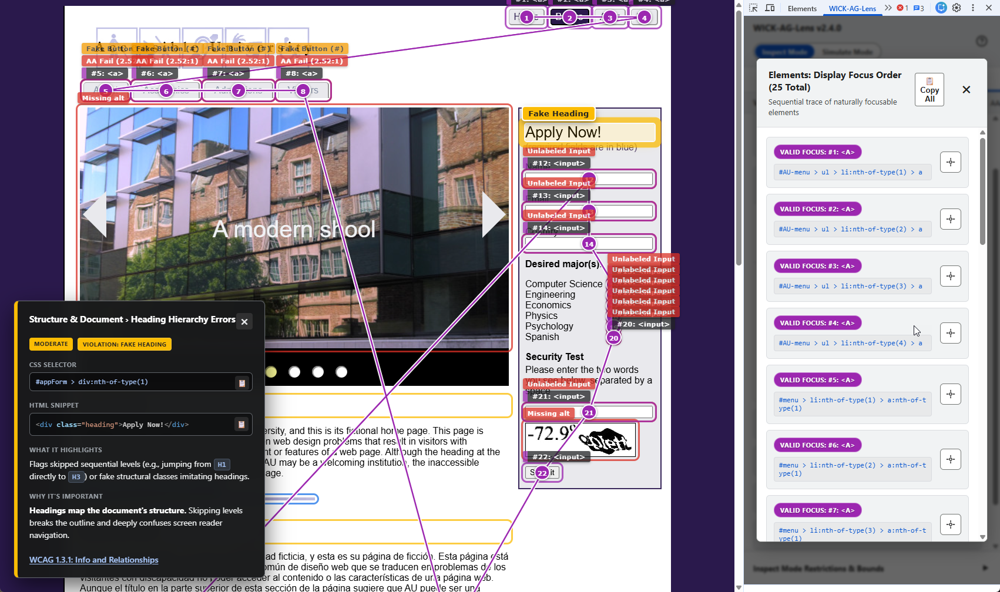
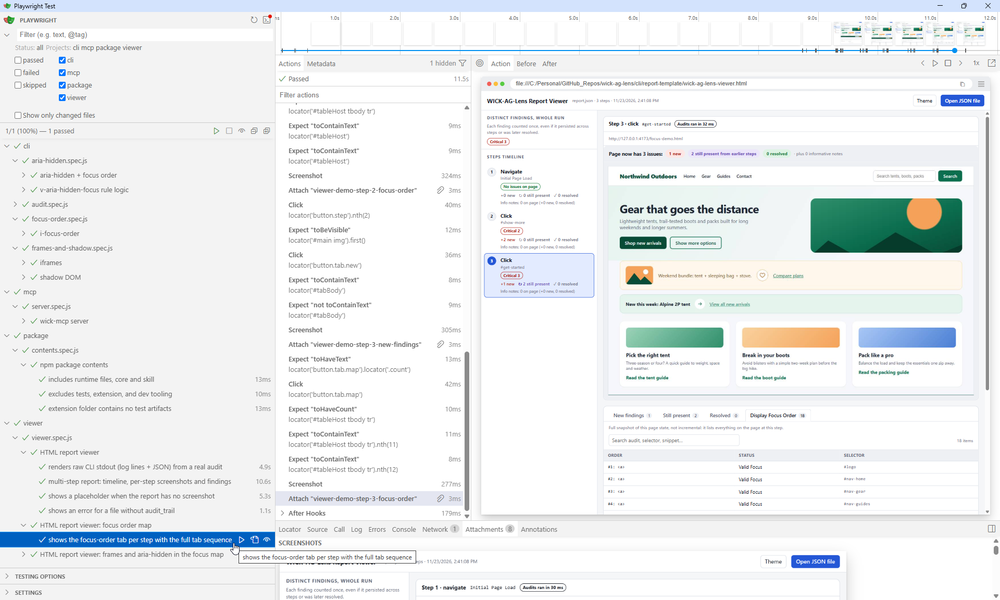

# WICK-AG-Lens: Accessibility Inspector & Automation Suite

WICK-AG-Lens is an open-source, multi-environment web accessibility inspection suite built for Web Developers, QA Engineers, and AI Agents. Powered by a single shared heuristic rules engine, it operates across:

1. **Chrome DevTools Extension ([`extension/README.md`](./extension/README.md)):** Generates real-time visual overlays, focus-order SVG paths, X-Ray clipped element previews, disability simulations, and PDF gatekeeper audits directly inside Chrome DevTools.
2. **Headless CLI, MCP Server & `agent-browser` Integration ([`cli/README.md`](./cli/README.md)):** Runs deterministic Playwright accessibility audits in CI/CD pipelines and equips AI agents (Claude Code, Claude Desktop, Cursor, Windsurf, Copilot) with real-time DOM delta-diffing, multi-step authentication, `agent-browser` session handoffs, and a token-efficient Agent Skill.

Designed for modern web applications, WICK-AG-Lens features a real-time sync engine that automatically re-audits the DOM when new elements are injected or revealed, seamlessly handling Single Page Application (SPA) routing and client-side state transitions.

&nbsp;

[](https://www.npmjs.com/package/wick-ag-lens)
&nbsp;

---

## Documentation Suite

| Guide | Target Audience | Covers |
| :--- | :--- | :--- |
| **[Root `README.md`](./README.md)** *(This File)* | All Users & Contributors | Suite overview, monorepo architecture, SPA rendering internals, the 55-rule Audit Library & Search Predicates, system compatibility, the Playwright test suite, and changelog. |
| **[Chrome Extension Guide](./extension/README.md)** | Web Developers & Manual QA | Chrome Web Store installation, DevTools UI controls, Disability Simulation Mode, PDF Gatekeeper Mode, X-Ray vision, and extension-specific bounds. |
| **[CLI, MCP & AI Guide](./cli/README.md)** | Automation QA, DevOps & AI Agents | Headless CLI flags & examples, 5 auth strategies, MCP Server tools, `agent-browser` integration, bundled `SKILL.md`, JSON delta-diff schema, and an offline HTML report viewer. |

---

## Table of Contents
1. [Features Overview](#features-overview)
2. [Monorepo Architecture & Building](#monorepo-architecture--building)
3. [SPA Rendering & State Handling](#spa-rendering--state-handling)
4. [Audit Library & Ruleset](#audit-library--ruleset)
5. [Search Predicates and Logic Definitions](#search-predicates-and-logic-definitions)
6. [Shared Limitations & Technical Bounds](#shared-limitations--technical-bounds)
7. [Compatibility](#compatibility)
8. [Automated Test Suite (Playwright)](#automated-test-suite-playwright)
9. [Development & Testing Sites](#development--testing-sites)
10. [License](#license)
11. [Contributing](#contributing)
12. [Changelog](#changelog)

---

## Features Overview

* **Unified 55-Rule Heuristic Engine:** Evaluates actionable violations and structural accessibility patterns across WCAG 2.0, 2.1, and 2.2 at conformance levels A, AA, and AAA—guaranteeing identical results between visual browser debugging and headless CI/AI scans.
* **Visual Chrome DevTools Extension:** Highlights issues on-page with interactive code-preview toasts, cross-iframe focus order tracing, X-Ray hatched overlays for clipped elements, Disability Simulation filters, and a binary PDF Gatekeeper scanner. *(See [`extension/README.md`](./extension/README.md))*
* **Headless CLI, AI MCP Server & `agent-browser` Support:** Automates multi-step SPA journeys in CI/CD via Playwright, exposes stateful delta-diff tools (`audit_baseline`, `interact_and_diff`, `get_audit_trail`) over MCP, pairs with `agent-browser` for low-token scouting and encrypted credential vault handoffs, and includes a bundled `SKILL.md`. *(See [`cli/README.md`](./cli/README.md))*
* **Real-Time SPA & DOM Sync:** Detects client-side history routing and dynamic DOM mutations (modals, drawers, lazy-loaded components) to re-evaluate the accessibility tree without manual refreshes.
* **WCAG Criteria Filtering:** Dynamically restricts executed audits and badge outputs by specific WCAG versions (`2.0`, `2.1`, `2.2`) and conformance levels (`A`, `AA`, `AAA`).
* **Shadow DOM & Cross-Iframe Traversal:** Pierces open Web Components and recursively traverses same-origin and nested iframes to aggregate unified accessibility findings.

---

## Monorepo Architecture & Building

> **Note for End-Users:** This section describes the internal repository structure of `wick-ag-lens` for contributors and maintainers. If you are using the Chrome extension, CLI, MCP server, or `agent-browser` to audit your own applications, you do **not** need to run these build steps—skip directly to [Visual Extension Installation](./extension/README.md) or [Headless CLI Automation](./cli/README.md).

To maintain a single source of truth across all execution environments—and keep the Chrome Web Store extension clean of heavy Node dependencies like Playwright—this repository uses a lightweight monorepo architecture. The browser extension, Headless CLI, MCP Server, and `agent-browser` workflows all run against the exact same underlying heuristic ruleset:

* `/core`: The central heuristic rules and DOM traversal engine (`a11y-config.js` and `shared-utils.js`).
* `/extension`: The visual Chrome DevTools extension artifact.
* `/cli`: The Node.js Playwright runner, Headless CLI (`index.js`), and MCP Server (`mcp-server.js`) used for automated pipelines and `agent-browser` handoffs.
* `/skills`: Portable AI Agent Skills (`skills/wick-ag-lens/SKILL.md`) for token-efficient browser and accessibility orchestration.
* `/samples`: Sample pages, a sample login server and a login script, shipped in the npm package so you can try journeys and logins without your own app (see [`cli/docs/sample-journeys.md`](./cli/docs/sample-journeys.md)).
* `/tests`: The Playwright test suite (dev only, never published). See [Automated Test Suite](#automated-test-suite-playwright).

### 1. The Monorepo Build Process (Contributors Only)
Whenever changes are made to the heuristic rules in the root `/core` folder or the agent instructions in `/skills`, the repository must be built to propagate those updates into the target packages.

Run the build script from the repository root:
```bash
node build.js
```
This script copies `/core` into both `/extension/core` (for the Chrome extension) and `/cli/core` (for the headless package), copies `/samples` into `/cli/samples`, and copies `/skills` into `/cli/skills` so the skill is bundled inside the published npm package.

### 2. Version Control (Gitignore)
To prevent Git from tracking duplicate build artifacts and bloating repository history, the generated folders are explicitly ignored. The root `.gitignore` excludes:
```text
/cli/node_modules/
/cli/core/
/cli/skills/
/cli/samples/
/extension/core/
/reports/
*-state.json
```
*Note: Only the root `/core`, `/skills` and `/samples` folders are committed to GitHub (the copies inside `/cli` and `/extension` are build output).*

### 3. Publishing & Distribution
**Publishing the Extension:**
Once built, the `/extension` folder is completely standalone. It can be loaded locally via `chrome://extensions/` (Developer Mode) or zipped directly for the Chrome Web Store.

**Publishing the CLI, MCP Server & Bundled Skill (npm):**
The Headless CLI, MCP Server, and bundled `skills/` directory are distributed together as a single npm package (and `cli/package.json` includes a `prepublishOnly` hook that automatically runs `node ../build.js`). To publish a new release:
1. Run `node build.js` in the repository root so `/cli` contains the latest `/core` engine and `/skills` directory.
2. Navigate into the CLI directory: `cd cli`
3. *(Optional)* Preview the exact files that will be bundled into the npm tarball: `npm pack --dry-run`
4. Publish to the registry: `npm publish`

End-users and AI agents can then run the CLI (`npx wick-ag-lens`), launch the MCP server (`npx -y --package=wick-ag-lens wick-mcp`), or copy the bundled skill from `node_modules/wick-ag-lens/skills/wick-ag-lens/SKILL.md` into their own projects.

---

## SPA Rendering & State Handling

Automated and visual accessibility testing in modern Single Page Applications (SPAs) introduces a classic race condition: the gap between when an action occurs and when the DOM has *actually* finished hydrating. WICK-AG-Lens uses a coordinated architecture across both its visual extension and headless runner to ensure no elements are missed during rapid state changes.

### Who Decides When the Page is Rendered? (The Hybrid Approach)
* **Action Readiness (Playwright / User):** In headless CLI and MCP workflows, Playwright waits for the target element to exist, become visible, stop animating, and receive pointer events before executing an action. In the browser, the human visually assesses readiness.
* **Audit Readiness (WICK-AG-Lens):** Once an interaction completes, control passes to the WICK engine to decide when the DOM is ready to be *scanned*. The engine hooks into an internal double-debounce mechanism to wait for client-side routers and dynamic mutations to settle before evaluating the DOM.
* **The Failsafe (Headless Timing Controls):** Because some enterprise SPAs use detached loaders or custom animations that evade standard observer hooks, the CLI and MCP server expose explicit `waitMs` (`--wait-ms`) and `waitForSelector` (`--wait-for-selector`) parameters to halt baseline scanning until key components mount.

### How the Systems Handle Fast, Sequential Clicks

**The Visual Extension (Asynchronous Human Interaction)**
Humans click unpredictably. To prevent the extension from scanning half-rendered states or blocking the main thread during rapid clicks, it relies on a Dual-Debounce `MutationObserver`:
* If a user clicks a tab and immediately opens a dropdown, the DOM mutates repeatedly.
* Every mutation resets an internal `750ms` countdown timer.
* The WICK audit engine fires only once the DOM remains completely quiet for that full `750ms` window, capturing the final settled layout.

**The Headless CLI & MCP Server (Synchronous Step Execution)**
Automation scripts click faster than humans, which would normally break SPAs. The CLI and MCP server prevent race conditions by enforcing strict, blocking sequential execution:
* When multiple `--step` flags (or sequential `interact_and_diff` calls) are executed, they never run concurrently.
* Step 1 executes its action, halts until the settle listener (`wick-audit-complete` / fallback timer) clears, and computes the accessibility delta-diff.
* Step 2 is blocked from locating or interacting with its target until Step 1's delta-diff is recorded in the timeline.

---

## Audit Library & Ruleset

The following details the complete list of 55 heuristic evaluations performed by the shared `/core` inspector engine, their classification, standard outputs, and corresponding W3C WCAG guidelines.

---

### Detection Levels

Every audit declares how reliable its detection is. The level is shown in the **Detection** column of the tables below, in the Chrome extension (the info panel, the on-page toast and the copied reports) and in the JSON report (`audit_dictionary[auditId].info.detection` and `detection_note`). Treat findings from audits that are not **Rule-based** as candidates to confirm, not as proven failures.

| Level | Meaning | Audits |
| :--- | :--- | :--- |
| **Rule-based** | The audit applies a defined rule to the page's elements and attributes, and a reported element matches that rule. A clean result does not by itself mean the page meets WCAG. | 42 |
| **Pattern-based** | A clear rule, but it relies on a fixed pattern (a word list, an attribute or a text comparison), so it can miss variations. | 7 |
| **Best-effort** | An approximation: results can include false positives or misses. Confirm by hand before acting. | 6 |

The audits that are not Rule-based, and what limits them:

| Audit | Level | Known limit |
| :--- | :--- | :--- |
| **Heading Hierarchy Errors** (`v-heading-errors`) | Best-effort | Skipped levels are exact. 'Fake headings' are guessed from class names containing 'heading' or 'title' plus short text, so some results may be false positives. |
| **Redundant Alt Text** (`v-redundant-alt`) | Best-effort | Matches the English words image, img, photo, picture and graphic anywhere in the alt text. Legitimate descriptions that use those words can be reported, and other languages are missed. |
| **Generic Link Text** (`v-generic-link`) | Best-effort | Matches a fixed list of English phrases (click here, read more, learn more, more, link, here). Other languages and other vague wording are not found, and a longer link text containing one of these words can match. |
| **Unfocusable Clickables** (`v-unfocusable`) | Best-effort | Only finds div, span and section elements with an onclick attribute. Click handlers attached in JavaScript (addEventListener, frameworks) cannot be seen, so an empty result does not prove there are none. |
| **Disabled Focus Outlines** (`v-disabled-focus`) | Best-effort | Reads the page's CSS rules, so it cannot see cascade overrides or a focus style applied another way. Treat results as candidates to check by hand. |
| **Text Color Contrast** (`v-text-contrast`) | Best-effort | Colors are computed, but text over images or gradients cannot be decided and is flagged for manual review. Overlapping elements are not modelled. |
| **Suspicious Link Targets** (`v-suspicious-links`) | Pattern-based | Only detects links whose href is '#' or starts with 'javascript:'. Fake buttons built in other ways are not found. |
| **Unwarned New Window Links** (`v-unwarned-window`) | Pattern-based | Looks for the English phrase 'new window' or 'new tab' in the link text or aria-label. A warning written another way, or in another language, is not recognised. |
| **Placeholder as Label** (`v-placeholder-label`) | Pattern-based | Checks for a label[for] and ARIA names only. Other valid ways of naming a field are not considered. |
| **Label in Name Mismatch** (`v-label-in-name`) | Pattern-based | Compares text after removing case, punctuation and extra spaces, as a substring match. An unusual label can be judged differently from how a user hears it. |
| **Warned New Window Links** (`i-warned-window`) | Pattern-based | Looks for the English phrase 'new window' or 'new tab' in the link text or aria-label. A warning written another way, or in another language, is not recognised. |
| **Display Focus Order** (`i-focus-order`) | Pattern-based | Simulated from tabindex, DOM order and frame structure. It does not press Tab, so scripted focus changes are not reflected. |
| **Accessible Name Resolution** (`i-accessible-name`) | Pattern-based | Simulates the browser's name fallback order (aria-labelledby, aria-label, labels and text, title). It approximates the browser's accessible name algorithm. |

All other audits are **Rule-based**.

---


### Tab 1: Violations & Warnings

#### Structure & Document

| Audit | Classification | Badge Output | WCAG Criteria | Logic | Detection |
| :--- | :--- | :--- | :--- | :--- | :--- |
| **Document Title** | Critical | `"Missing Document Title"` | [2.4.2 (A)](https://www.w3.org/WAI/WCAG22/Understanding/page-titled.html) | [View](#v-doc-title) | Rule-based |
| **Page Encoding** | Moderate | `Encoding: {val}` | [1.3.1 (A)](https://www.w3.org/WAI/WCAG22/Understanding/info-and-relationships.html) | [View](#v-page-encoding) | Rule-based |
| **Auto-playing Media** | Serious | `"Autoplay Media"` | [1.4.2 (A)](https://www.w3.org/WAI/WCAG22/Understanding/audio-control.html) | [View](#v-18) | Rule-based |
| **Heading Hierarchy Errors** | Moderate | `"{TAG} (Skipped)"` or `"Fake Heading"` | [1.3.1 (A)](https://www.w3.org/WAI/WCAG22/Understanding/info-and-relationships.html) | [View](#v-19) | Best-effort |

* **Document Title:** Checks if the document is missing a `<title>` tag or if it is empty. **Screen readers announce the page title first.**
* **Page Encoding:** Checks if the document character set is defined (UTF-8). **Ensures text is parsed and pronounced correctly.**
* **Auto-playing Media:** Flags audio or video elements set to `autoplay`. **Unexpected audio conflicts with screen reader announcements.**
* **Heading Hierarchy Errors:** Flags skipped levels (e.g., `H1` to `H3`) or fake non-semantic headings. **Note: Starting a page directly with an `H2` is not flagged as a skipped level.** Skipping levels confuses screen reader navigation.

#### Images & Media

| Audit | Classification | Badge Output | WCAG Criteria | Logic | Detection |
| :--- | :--- | :--- | :--- | :--- | :--- |
| **Inaccessible SVGs** | Critical | `"Inaccessible SVG"` | [1.1.1 (A)](https://www.w3.org/WAI/WCAG22/Understanding/non-text-content.html) | [View](#v-svg-accessible) | Rule-based |
| **Missing Alt Text** | Critical | `"Missing alt"` or `"Tracking Pixel"` | [1.1.1 (A)](https://www.w3.org/WAI/WCAG22/Understanding/non-text-content.html) | [View](#v-5) | Rule-based |
| **Uncaptioned Video** | Critical | `"<video> (No Captions)"` | [1.2.2 (A)](https://www.w3.org/WAI/WCAG22/Understanding/captions-prerecorded.html) | [View](#v-6) | Rule-based |
| **Redundant Alt Text** | Minor | `Redundant alt: "{text}"` | [1.1.1 (A)](https://www.w3.org/WAI/WCAG22/Understanding/non-text-content.html) | [View](#v-7) | Best-effort |

* **Inaccessible SVGs:** Flags inline `<svg>` elements exposed to screen readers lacking an accessible name. **Screen readers will read out raw SVG code nodes.**
* **Missing Alt Text:** Flags `` elements completely lacking an `alt` attribute. Explicitly segregates 1x1 tracking pixels. **Screen readers will read the raw image filename or URL** if the attribute is missing.
* **Uncaptioned Video:** Flags `<video>` elements missing nested `<track>` elements. **Deaf or hard of hearing users require captions** for video content.
* **Redundant Alt Text:** Flags `alt` attributes containing words like *'image of'* or *'photo of'*. **Screen readers automatically announce images**, making these prefixes redundant.

#### Links & Navigation

| Audit | Classification | Badge Output | WCAG Criteria | Logic | Detection |
| :--- | :--- | :--- | :--- | :--- | :--- |
| **Empty Links** | Critical | `"Empty Link"` | [2.4.4 (A)](https://www.w3.org/WAI/WCAG22/Understanding/link-purpose-in-context.html) | [View](#v-11) | Rule-based |
| **Suspicious Link Targets** | Critical / Serious | `"Fake Button (JS)"` or `"Fake Button (#)"` | [4.1.2 (A)](https://www.w3.org/WAI/WCAG22/Understanding/name-role-value.html) | [View](#v-12) | Pattern-based |
| **Generic Link Text** | Moderate | `Generic link: "{text}"` | [2.4.4 (A)](https://www.w3.org/WAI/WCAG22/Understanding/link-purpose-in-context.html) | [View](#v-13) | Best-effort |
| **Unwarned New Window Links** | Moderate | `'target="_blank" (No Warning)'` | [3.2.5 (AAA)](https://www.w3.org/WAI/WCAG22/Understanding/change-on-request.html) | [View](#v-14) | Pattern-based |

* **Empty Links:** Flags `<a>` tags lacking readable text or accessible names. **Screen readers will read the URL**, which is often confusing. 
* **Suspicious Link Targets:** Flags anchor tags missing routing context acting as buttons (missing `role='button'`). **Using links to trigger JS actions confuses screen readers.** 
* **Generic Link Text:** Flags ambiguous link text like *'Click Here'* or *'Read More'* using exact word boundaries. **Users navigating via a Links List will lack context.** 
* **Unwarned New Window Links:** Flags `target='_blank'` links without text or ARIA warnings. **Unexpectedly opening new tabs disorients cognitive and screen reader users.** 

#### Forms & Controls

| Audit | Classification | Badge Output | WCAG Criteria | Logic | Detection |
| :--- | :--- | :--- | :--- | :--- | :--- |
| **Unlabeled Form Inputs** | Critical | `"Unlabeled Input"` | [3.3.2 (A)](https://www.w3.org/WAI/WCAG22/Understanding/labels-or-instructions.html) | [View](#v-8) | Rule-based |
| **Empty Buttons** | Critical | `"Empty Button"` | [4.1.2 (A)](https://www.w3.org/WAI/WCAG22/Understanding/name-role-value.html) | [View](#v-9) | Rule-based |
| **Placeholder as Label** | Serious | `"Placeholder as Label"` | [4.1.2 (A)](https://www.w3.org/WAI/WCAG22/Understanding/name-role-value.html) | [View](#v-10) | Pattern-based |
| **Invalid Autocomplete** | Moderate | `Invalid autocomplete="{val}"` | [1.3.5 (AA)](https://www.w3.org/WAI/WCAG22/Understanding/identify-input-purpose.html) | [View](#v-autocomplete-invalid) | Rule-based |

* **Unlabeled Form Inputs:** Flags form controls missing `<label>` wrappers, `aria-label`s, or `for` attributes. **Screen readers cannot announce what the input is for.** 
* **Empty Buttons:** Flags buttons without readable text or an `aria-label`. **Screen readers will only announce 'Button'**, providing no context. 
* **Placeholder as Label:** Flags inputs relying solely on the `placeholder` attribute. **Placeholders disappear on typing** and often lack sufficient contrast.
* **Invalid Autocomplete:** Flags fields where `autocomplete` contains unrecognized HTML5 tokens. **Invalid tokens prevent browsers and password managers from functioning correctly.**

#### Keyboard Navigation

| Audit | Classification | Badge Output | WCAG Criteria | Logic | Detection |
| :--- | :--- | :--- | :--- | :--- | :--- |
| **Unfocusable Clickables** | Critical | `"Unfocusable Clickable"` | [2.1.1 (A)](https://www.w3.org/WAI/WCAG22/Understanding/keyboard.html) | [View](#v-1) | Best-effort |
| **Tabindex Violations** | Serious | `tabindex="{val}"` | [2.4.3 (A)](https://www.w3.org/WAI/WCAG22/Understanding/focus-order.html) | [View](#v-3) | Rule-based |
| **Accesskey Attributes** | Moderate | `accesskey="{val}"` | [2.1.4 (A)](https://www.w3.org/WAI/WCAG22/Understanding/character-key-shortcuts.html) | [View](#v-4) | Rule-based |
| **Disabled Focus Outlines (Heuristic)** | Manual | `"Manual Check: Focus Ring"` | [2.4.7 (AA)](https://www.w3.org/WAI/WCAG22/Understanding/focus-visible.html) | [View](#v-2) | Best-effort |

* **Unfocusable Clickables:** Flags generic elements with `onclick` handlers lacking a `tabindex` and a valid semantic `role`. **Keyboard users cannot tab to or activate these elements.** 
* **Tabindex Violations:** Flags elements dynamically forcing focus order via `tabindex > 0`. **Overrides natural DOM focus order**, creating unpredictable navigation paths. 
* **Accesskey Attributes:** Flags explicit `accesskey` definitions. **Often conflicts with native browser or screen reader shortcuts.** 
* **Disabled Focus Outlines (Heuristic):** Parses page CSS via heuristic evaluation to find focusable elements where `outline: none` or `0` is applied on the `:focus` state. **Because this is a static CSS check, it cannot account for complex CSS cascade overrides and marks findings for manual review.**

#### ARIA Names (Errors)

| Audit | Classification | Badge Output | WCAG Criteria | Logic | Detection |
| :--- | :--- | :--- | :--- | :--- | :--- |
| **Prohibited Author Names** | Serious | `Prohibited name on role="{role}"` | [4.1.2 (A)](https://www.w3.org/WAI/WCAG22/Understanding/name-role-value.html) | [View](#v-17) | Rule-based |
| **Label in Name Mismatch** | Serious | `"Mismatch: "{txt}" != "{aria}""` | [2.5.3 (A)](https://www.w3.org/WAI/WCAG22/Understanding/label-in-name.html) | [View](#v-label-in-name) | Pattern-based |
| **Duplicate ID Attributes** | Critical | `Duplicate ID: "{id}" ({v} vis, {h} hid)` or `[Hidden]` | [1.3.1 (A)](https://www.w3.org/WAI/WCAG22/Understanding/info-and-relationships.html) | [View](#v-duplicate-id) | Rule-based |
| **Broken ARIA References** | Critical | `Broken Ref: {attr}="{id}"` | [1.3.1 (A)](https://www.w3.org/WAI/WCAG22/Understanding/info-and-relationships.html) | [View](#v-broken-aria-ref) | Rule-based |

* **Prohibited Author Names:** Flags structural roles (like `presentation`) containing `aria-label` or `aria-labelledby`. **Adding a name to a transparent structural role breaks its semantics.**
* **Label in Name Mismatch:** Flags interactive elements where the visible text is completely overridden by an `aria-label` that does not include the visible text. **Voice dictation users rely on visible text commands.**
* **Duplicate ID Attributes:** Flags multiple elements sharing the identical `id` attribute. **Screen readers and label mappings will only find the first ID.**
* **Broken ARIA References:** Flags ARIA relationship attributes pointing to non-existent DOM IDs. **A broken reference means the relationship is completely lost.**

#### ARIA States (Errors)

| Audit | Classification | Badge Output | WCAG Criteria | Logic | Detection |
| :--- | :--- | :--- | :--- | :--- | :--- |
| **Focusable in Aria-Hidden** | Critical | `"aria-hidden (Focusable)"` | [4.1.2 (A)](https://www.w3.org/WAI/WCAG22/Understanding/name-role-value.html) | [View](#v-15) | Rule-based |
| **Invalid ARIA State** | Serious | `'aria-invalid="true"'` | [3.3.1 (A)](https://www.w3.org/WAI/WCAG22/Understanding/error-identification.html) | [View](#v-16) | Rule-based |

* **Focusable in Aria-Hidden:** Flags active controls trapped in `aria-hidden='true'` trees. **Keyboard users can reach them, but screen readers cannot.**
* **Invalid ARIA State:** Flags form controls explicitly marked `aria-invalid='true'`. **Identifies application-enforced validation errors.** 

#### Visual & Contrast

| Audit | Classification | Badge Output | WCAG Criteria | Logic | Detection |
| :--- | :--- | :--- | :--- | :--- | :--- |
| **Text Color Contrast** | Critical | `AA Fail`, `AAA Fail`, `Manual Check` | [1.4.3 (AA)](https://www.w3.org/WAI/WCAG22/Understanding/contrast-minimum.html), [1.4.6 (AAA)](https://www.w3.org/WAI/WCAG22/Understanding/contrast-enhanced.html) | [View](#v-20) | Best-effort |

* **Text Color Contrast:** Traverses the DOM to calculate the effective contrast ratio between text and its background. Dynamically evaluates `font-size` and `font-weight` against WCAG large-text thresholds. Elements over images/gradients are flagged for manual review. 

---

### Tab 2: Informative & Structure

#### Structure & Document

| Audit | Classification | Badge Output | WCAG Criteria | Logic | Detection |
| :--- | :--- | :--- | :--- | :--- | :--- |
| **Valid Heading Order** | Informative | `<{tag}>` | [1.3.1 (A)](https://www.w3.org/WAI/WCAG22/Understanding/info-and-relationships.html) | [View](#i-17) | Rule-based |
| **Landmark Regions** | Informative | `<{role or tag}>` | [2.4.1 (A)](https://www.w3.org/WAI/WCAG22/Understanding/bypass-blocks.html) | [View](#i-18) | Rule-based |
| **Table & Grid Structure** | Informative | `<{tag}>` or `role="{role}"` | [1.3.1 (A)](https://www.w3.org/WAI/WCAG22/Understanding/info-and-relationships.html) | [View](#i-19) | Rule-based |
| **Lists and List Items** | Informative | `<{tag}>` | [1.3.1 (A)](https://www.w3.org/WAI/WCAG22/Understanding/info-and-relationships.html) | [View](#i-20) | Rule-based |
| **Language Definitions** | Informative | `"Missing Root Lang"`, `Root lang="{val}"`, or `lang="{val}"` | [3.1.1 (A)](https://www.w3.org/WAI/WCAG22/Understanding/language-of-page.html) | [View](#i-21) | Rule-based |

* **Valid Heading Order:** Standard `H1-H6` structural outline. **Verifies the logical outline of the page.** 
* **Landmark Regions:** HTML5 and ARIA structural landmark containers. **Allows screen reader users to jump quickly between page sections.** 
* **Table & Grid Structure:** Native `<table>` and ARIA data grids. **Visually maps data structures and verifies custom UI grids implement semantic headers.** 
* **Lists and List Items:** Unordered (`<ul>`), ordered (`<ol>`), and definition lists (`<dl>`). **Ensures related items are programmatically grouped.** 
* **Language Definitions:** Phonetic shifts and root `lang` declarations. **Screen readers rely on the language tag to load the correct accent and pronunciation rules.** 

#### Images & Media

| Audit | Classification | Badge Output | WCAG Criteria | Logic | Detection |
| :--- | :--- | :--- | :--- | :--- | :--- |
| **Display Image Alternatives** | Informative | `alt="{val}"`, `alt=""`, `"Missing alt"`, or `"[Pixel] ..."` | [1.1.1 (A)](https://www.w3.org/WAI/WCAG22/Understanding/non-text-content.html) | [View](#i-3) | Rule-based |
| **Captioned Video** | Informative | `"<video> (Captioned)"` | [1.2.2 (A)](https://www.w3.org/WAI/WCAG22/Understanding/captions-prerecorded.html) | [View](#i-4) | Rule-based |
| **Iframe Context & Titles** | Informative | `title="{title}"`, `"Hidden Iframe"` | [4.1.2 (A)](https://www.w3.org/WAI/WCAG22/Understanding/name-role-value.html) | [View](#i-5) | Rule-based |

* **Display Image Alternatives:** Extracts and visually prints the `alt` text directly over all `` elements, explicitly segregating 1x1 tracking pixels. **Allows rapid visual auditing of alternative text descriptions.**
* **Captioned Video:** Videos containing `<track>` elements. **Confirms proper multimedia accessibility setup.** 
* **Iframe Context & Titles:** Analyzes third-party embed context and `title` attributes. **Screen readers announce the title to inform the user** what the sub-document contains. 

#### Links & Navigation

| Audit | Classification | Badge Output | WCAG Criteria | Logic | Detection |
| :--- | :--- | :--- | :--- | :--- | :--- |
| **Warned New Window Links** | Informative | `'target="_blank" (Warned)'` | [3.2.5 (AAA)](https://www.w3.org/WAI/WCAG22/Understanding/change-on-request.html) | [View](#i-9) | Pattern-based |

* **Warned New Window Links:** `target='_blank'` links with proper warning. **Confirms proper communication of context shifts to assistive technologies.** 

#### Forms & Controls

| Audit | Classification | Badge Output | WCAG Criteria | Logic | Detection |
| :--- | :--- | :--- | :--- | :--- | :--- |
| **Fieldsets & Captions** | Informative | `<{tag}>` | [1.3.1 (A)](https://www.w3.org/WAI/WCAG22/Understanding/info-and-relationships.html) | [View](#i-7) | Rule-based |
| **Touch Target Sizes** | Informative | `{width}x{height}px` | [2.5.8 (AA)](https://www.w3.org/WAI/WCAG22/Understanding/target-size-minimum.html) | [View](#i-8) | Rule-based |
| **Read-Only Fields** | Informative | `"readonly"` | [1.3.1 (A)](https://www.w3.org/WAI/WCAG22/Understanding/info-and-relationships.html) | [View](#i-readonly-fields) | Rule-based |

* **Fieldsets & Captions:** Visual grouping containers (`<fieldset>`). **Crucial for grouping related radio buttons or complex form sections.** 
* **Touch Target Sizes:** Calculates interactive pixel bounds (`width` / `height`). **Undersized targets prevent users with fine motor impairments from activating controls accurately.** 
* **Read-Only Fields:** Inputs marked as `readonly` or `aria-readonly`. **Read-only fields must remain focusable** (unlike disabled fields) so screen readers can access their content.

#### Keyboard Navigation

| Audit | Classification | Badge Output | WCAG Criteria | Logic | Detection |
| :--- | :--- | :--- | :--- | :--- | :--- |
| **Tabindex (Comparison)** | Informative | `tabindex="{val}"` | [2.4.3 (A)](https://www.w3.org/WAI/WCAG22/Understanding/focus-order.html) | [View](#i-1) | Rule-based |
| **Display Focus Order** | Informative | `#{num}: <{tag}>` | [2.4.3 (A)](https://www.w3.org/WAI/WCAG22/Understanding/focus-order.html) | [View](#i-2) | Pattern-based |

* **Tabindex (Comparison):** Visual comparison of all `tabindex` usages. **Provides a sweeping visual map of the programmatic focus strategy.** 
* **Display Focus Order:** Sequential trace of naturally focusable elements. Utilizes hierarchical decimal prefixing (e.g., `[Iframe] #4.1`) for isolated DOM boundaries, connected by dynamic SVG paths and numerical pills. **Simulates the exact path of the `TAB` key route.** 

#### ARIA Roles (Identity)

| Audit | Classification | Badge Output | WCAG Criteria | Logic | Detection |
| :--- | :--- | :--- | :--- | :--- | :--- |
| **ARIA Roles & Attributes** | Informative | `role="{val}"` | [4.1.2 (A)](https://www.w3.org/WAI/WCAG22/Understanding/name-role-value.html) | [View](#i-11) | Rule-based |
| **Aria-Roledescription** | Informative | `roledescription="{val}"` | [4.1.2 (A)](https://www.w3.org/WAI/WCAG22/Understanding/name-role-value.html) | [View](#i-aria-roledescription) | Rule-based |

* **ARIA Roles & Attributes:** Maps explicit `role` definitions. **Allows rapid structural auditing of custom widget semantics.**
* **Aria-Roledescription:** Custom semantic overrides via `aria-roledescription`. **Overrides the native role announcement** (e.g., turning 'button' into 'slide').

#### ARIA Names & Relationships

| Audit | Classification | Badge Output | WCAG Criteria | Logic | Detection |
| :--- | :--- | :--- | :--- | :--- | :--- |
| **Accessible Name Resolution** | Informative | `"[id] {name}"`, `"[aria] {name}"`, `"[text] {name}"`, or `"Missing Name"` | [4.1.2 (A)](https://www.w3.org/WAI/WCAG22/Understanding/name-role-value.html) | [View](#i-10) | Pattern-based |
| **Form Field Descriptions** | Informative | `"aria-describedby"` or `"title"` | [3.3.2 (A)](https://www.w3.org/WAI/WCAG22/Understanding/labels-or-instructions.html) | [View](#i-6) | Rule-based |
| **Aria-Details** | Informative | `"aria-details"` | [4.1.2 (A)](https://www.w3.org/WAI/WCAG22/Understanding/name-role-value.html) | [View](#i-aria-details) | Rule-based |
| **Aria-Controls** | Informative | `"aria-controls"` | [4.1.2 (A)](https://www.w3.org/WAI/WCAG22/Understanding/name-role-value.html) | [View](#i-15) | Rule-based |
| **Aria-Owns** | Informative | `"aria-owns"` | [4.1.2 (A)](https://www.w3.org/WAI/WCAG22/Understanding/name-role-value.html) | [View](#i-16) | Rule-based |
| **List Set & Position** | Informative | `"Item X of Y"` | [1.3.1 (A)](https://www.w3.org/WAI/WCAG22/Understanding/info-and-relationships.html) | [View](#i-aria-setsize) | Rule-based |

* **Accessible Name Resolution:** Computes the final accessible name by simulating the browser's fallback calculation sequence: `aria-labelledby`, then `aria-label`, then native associated labels/text, and finally `title`. **Reveals exactly what a screen reader will announce.** 
* **Form Field Descriptions:** Supplemental instructional text (`aria-describedby`). **Ensures extended hints or error messages are programmatically tied to inputs.** 
* **Aria-Details:** Highlights elements utilizing `aria-details`. **Links complex, rich explanations to an element** (allows structured HTML in the description).
* **Aria-Controls:** Remote DOM visibility targets (`aria-controls`). **Links trigger mechanisms to their targets.** 
* **Aria-Owns:** Remote programmatic ownership (`aria-owns`). **Reconstructs accessibility tree hierarchy for disjointed widgets.** 
* **List Set & Position:** Virtual list mapping (`aria-setsize`, `aria-posinset`). **Tells screen readers the total size of a list and the element's position**, even if all items aren't in the DOM.

#### ARIA States (Conditions)

| Audit | Classification | Badge Output | WCAG Criteria | Logic | Detection |
| :--- | :--- | :--- | :--- | :--- | :--- |
| **ARIA Live Regions** | Informative | `aria-live="{val}"` | [4.1.3 (AA)](https://www.w3.org/WAI/WCAG22/Understanding/status-messages.html) | [View](#i-12) | Rule-based |
| **Required Fields** | Informative | `"required"` or `'aria-required="true"'` | [3.3.1 (A)](https://www.w3.org/WAI/WCAG22/Understanding/error-identification.html) | [View](#i-13) | Rule-based |
| **Aria-Expanded State** | Informative | `aria-expanded="{val}"` | [4.1.2 (A)](https://www.w3.org/WAI/WCAG22/Understanding/name-role-value.html) | [View](#i-14) | Rule-based |
| **Aria-Pressed State** | Informative | `aria-pressed="{val}"` | [4.1.2 (A)](https://www.w3.org/WAI/WCAG22/Understanding/name-role-value.html) | [View](#i-aria-pressed) | Rule-based |
| **Aria-Value Properties** | Informative | `value="{val}"` | [4.1.2 (A)](https://www.w3.org/WAI/WCAG22/Understanding/name-role-value.html) | [View](#i-aria-value) | Rule-based |
| **Aria-Haspopup** | Informative | `haspopup="{val}"` | [4.1.2 (A)](https://www.w3.org/WAI/WCAG22/Understanding/name-role-value.html) | [View](#i-aria-haspopup) | Rule-based |

* **ARIA Live Regions:** Maps dynamic `aria-live` injection containers. **Ensures dynamic content updates are announced to screen readers.** 
* **Required Fields:** Mandatory input enforcement (`required` / `aria-required`). **Ensures required status is programmatically available.** 
* **Aria-Expanded State:** Expandable/collapsible widget states (`aria-expanded`). **Visualizes the current programmatic state of accordions and menus.** 
* **Aria-Pressed State:** Toggle button states (`aria-pressed`). **Visualizes the programmatic state of toggle buttons** (e.g., Mute/Unmute, Play/Pause).
* **Aria-Value Properties:** Slider & progress bar states (`valuenow`, `valuetext`). **Ensures visual slider values match their programmatic data.**
* **Aria-Haspopup:** Elements triggering overlays (`aria-haspopup`). **Prepares users for a context shift** by announcing an interactive overlay.

---

## Search Predicates and Logic Definitions

Elements hidden via CSS parameters like `display: none` or `visibility: hidden`, or by using the HTML `inert` attribute, are excluded by the global DOM processing logic before the specific audits run.

**DOM Traversal:** WICK-AG-Lens utilizes a custom deep `querySelectorAll` function (`querySelectorAllDeep`) combined with bottom-up ancestor mapping. This allows the scanner to pierce standard (open) Shadow DOM boundaries and fully traverse the internal DOM of same-origin iframes, guaranteeing accurate visibility tracking across complex widget architectures.

**Self-Auditing Guard:** Injected extension UI elements (overlay boxes and information toast panels) are explicitly excluded from audits to prevent false positives.

### Tab 1: Violations & Warnings

* <a id="v-doc-title"></a>**Document Title:** Uses the CSS selector `html`. The logic checks if `document.title` is missing or entirely empty strings.
* <a id="v-page-encoding"></a>**Page Encoding:** Uses the CSS selector `html`. The logic evaluates `document.characterSet` to ensure it is defined and set to UTF-8.
* <a id="v-18"></a>**Auto-playing Media:** Uses the CSS selector `audio[autoplay], video[autoplay]`. Elements matching the selector are flagged.
* <a id="v-19"></a>**Heading Hierarchy Errors:** Uses the CSS selector `h1, h2, h3, h4, h5, h6, [role='heading'], [class*='heading'], [class*='title']`. The logic tracks the integer level of headings, intentionally ignoring missing H1s at the start of the document. It flags an element if the current heading level skips sequentially past the previous tracked level. It also flags generic elements without a role attribute if the text length is under 80 characters, utilizing a heuristic wrapper safeguard to actively ignore generic containers that correctly wrap (or are wrapped by) valid native headings to prevent false positives. Outputs are separated into distinct "Skipped Level" and "Fake Heading" legends.
* <a id="v-svg-accessible"></a>**Inaccessible SVGs:** Uses the CSS selector `svg:not([aria-hidden='true']):not([aria-hidden='1'])`. The logic ignores SVGs explicitly hidden from screen readers. For exposed SVGs, it checks if it lacks an `aria-label`, lacks a nested `<title>`, and is not nested within an interactive parent (like a `<button>`) that already provides an accessible name.
* <a id="v-5"></a>**Missing Alt Text:** Uses the CSS selector `img:not([alt])`. Evaluates `getBoundingClientRect()` to distinctly categorize sub-2px tracking pixels apart from standard image violations to reduce UI noise.
* <a id="v-6"></a>**Uncaptioned Video:** Uses the CSS selector `video`. The logic queries descendants for `track[kind="captions"], track[kind="subtitles"]`. If the result length is 0, the video is flagged.
* <a id="v-7"></a>**Redundant Alt Text:** Uses the CSS selector `img[alt]`. The logic reads the alt attribute and uses the regular expression `/\b(image|img|photo|picture|graphic)\b/i` to identify redundant terms before flagging.
* <a id="v-11"></a>**Empty Links:** Uses the CSS selector `a[href]`. The logic evaluates the text content, ARIA labels, and child image alt text. If all sources of accessible names are empty, it triggers a violation.
* <a id="v-12"></a>**Suspicious Link Targets:** Uses the CSS selector `a[href='#'], a[href^='javascript:']`. The logic ignores elements that possess `role="button"`. It categorizes the remaining matches based on whether the `href` prefix is javascript or a hash.
* <a id="v-13"></a>**Generic Link Text:** Uses the CSS selector `a[href]`. The logic trims the text content and applies an exact word boundary regular expression `/\b(click here|read more|learn more|more|link|here)\b/i` to flag matching elements.
* <a id="v-14"></a>**Unwarned New Window Links:** Uses the CSS selector `a[target='_blank']`. The logic concatenates the text content and `aria-label` to test against the regular expression `/new (window|tab)/`. If no match is found, it flags a violation.
* <a id="v-8"></a>**Unlabeled Form Inputs:** Uses the CSS selector `input:not([type='hidden']):not([type='submit']):not([type='button']), select, textarea`. The logic searches the document for a `<label>` with a `for` attribute matching the input ID. It also checks the element for `aria-label` or `aria-labelledby` attributes, or if it is nested directly inside a `label` element. If all checks fail, it is flagged.
* <a id="v-9"></a>**Empty Buttons:** Uses the CSS selector `button, [role='button']`. The logic checks the text content of the element, the presence of `aria-label` or `aria-labelledby`, and the presence of child `img[alt]` elements. If the trimmed text is empty and alternative names are missing, it flags a violation.
* <a id="v-10"></a>**Placeholder as Label:** Uses the CSS selector `input[placeholder], textarea[placeholder]`. The logic checks if the element lacks a `label[for]` referencing its ID and lacks `aria-label` or `aria-labelledby` attributes.
* <a id="v-autocomplete-invalid"></a>**Invalid Autocomplete:** Uses the CSS selector `input[autocomplete], select[autocomplete], textarea[autocomplete]`. The logic splits the token values and validates them against the official W3C HTML5 autocomplete token registry.
* <a id="v-1"></a>**Unfocusable Clickables:** Uses the CSS selector `div[onclick], span[onclick], section[onclick]`. The Javascript logic evaluates each element to ensure it lacks a `role` attribute or lacks a `tabindex` attribute before flagging a violation.
* <a id="v-3"></a>**Tabindex Violations:** Uses the CSS selector `[tabindex]`. The logic parses the attribute value as a base 10 integer and triggers a violation if the value is strictly greater than 0.
* <a id="v-4"></a>**Accesskey Attributes:** Uses the CSS selector `[accesskey]`. All elements matching this selector are flagged.
* <a id="v-2"></a>**Disabled Focus Outlines (Heuristic):** Uses the base CSS selector `a[href], button, input, select, textarea, [tabindex]:not([tabindex='-1'])`. The Javascript logic iterates through `document.styleSheets` and checks each `CSSRule.STYLE_RULE` to see if the selector includes `:focus` or `:focus-visible`. It reads the `outline`, `outlineWidth`, `boxShadow`, and `border` properties. If outline rules contain `none` or `0px` and no fallback border or shadow is provided in the same rule, the selector is recorded. Any interactive element matching that recorded selector is flagged for manual review, as the script cannot natively account for subsequent CSS cascade overrides.
* <a id="v-17"></a>**Prohibited Author Names:** Uses the CSS selector `[role='presentation'], [role='none'], [role='generic']`. The logic triggers a violation if the matched element has an `aria-label` or `aria-labelledby` attribute.
* <a id="v-label-in-name"></a>**Label in Name Mismatch:** Uses the CSS selector `button[aria-label], a[href][aria-label], [role='button'][aria-label], [role='link'][aria-label]`. The logic normalizes whitespace, strips punctuation, and lowercases both the visible `innerText` and the computed `aria-label`. If the visible text is not found as a substring within the `aria-label`, it throws a violation.
* <a id="v-duplicate-id"></a>**Duplicate ID Attributes:** Uses the CSS selector `[id]`. The logic tracks processed IDs to prevent redundant processing. When a duplicate is found, it uses `document.querySelectorAll` with `CSS.escape()` to fetch all colliding nodes. It evaluates `offsetWidth/offsetHeight` to categorize each node as visible or hidden, explicitly registering hidden duplicates with a lighter-colored legend so they appear distinctly in the Details Modal without rendering layout-breaking zero-pixel boxes on the screen.
* <a id="v-broken-aria-ref"></a>**Broken ARIA References:** Targets elements using `[aria-labelledby], [aria-describedby], [aria-controls], [aria-owns], [aria-errormessage], [aria-details], [aria-activedescendant]`. The logic splits the attribute values by whitespace into individual ID strings and checks if `document.getElementById()` returns null. Flags the element if any referenced ID is missing from the DOM.
* <a id="v-15"></a>**Focusable in Aria-Hidden:** Uses the CSS selector `a[href], area[href], button, input:not([type='hidden']), select, textarea, summary, iframe, audio[controls], video[controls], [contenteditable]:not([contenteditable='false']), [tabindex]`. The logic skips disabled or `aria-disabled='true'` controls, controls removed from the tab order with a negative `tabindex` (e.g. `-1`), and controls that are `inert` or not rendered (`display: none`, `visibility: hidden`), since none of them can receive keyboard focus. For the remaining controls, it uses a bottom-up DOM traversal to check if the element or any ancestor possesses `aria-hidden='true'`. Pierces Shadow DOMs and iframes to ensure accurate detection of ghost focus traps.
* <a id="v-16"></a>**Invalid ARIA State:** Uses the CSS selector `[aria-invalid='true']`. Elements matching the selector are flagged.
* <a id="v-20"></a>**Text Color Contrast:** Uses the CSS selector targeting standard text elements like `h1`, `p`, `span`, `button`. The logic verifies child text nodes exist. It uses `window.getComputedStyle` to retrieve colors, dynamically factoring in `font-size` and `font-weight` against WCAG large-text thresholds. It calculates the WCAG relative luminance formula and dynamically evaluates failures against the user's active UI filters (AA vs AAA) so strict AAA failures are correctly caught even when AA filters are unchecked. Elements over background images or CSS gradients are automatically flagged for manual review.

### Tab 2: Informative & Structure

* <a id="i-17"></a>**Valid Heading Order:** Uses the CSS selector `h1, h2, h3, h4, h5, h6`. Elements matching the selector are highlighted.
* <a id="i-18"></a>**Landmark Regions:** Uses the CSS selector `main, nav, header, footer, aside, [role='main'], [role='navigation'], [role='banner'], [role='contentinfo']`. The logic retrieves the role attribute or the HTML tag name for the badge output.
* <a id="i-19"></a>**Table & Grid Structure:** Uses the CSS selector `table, caption, th, [role='table'], [role='grid'], [role='treegrid'], [role='columnheader'], [role='rowheader']`. The logic applies a dashed style to header roles and tags, and applies a solid style for grid and table containers.
* <a id="i-20"></a>**Lists and List Items:** Uses the CSS selector `ul, ol, li, dl, dt, dd`. Elements matching the selector are highlighted.
* <a id="i-21"></a>**Language Definitions:** Uses the CSS selector `html, [lang], [xml\\:lang]`. The logic checks if the element is the root html tag. It flags the element if the root tag is missing a language attribute. It categorizes root language declarations separately from inline phonetic shifts.
* <a id="i-3"></a>**Display Image Alternatives:** Uses the CSS selector `img`. The logic calculates bounding box dimensions to isolate tracking pixels, and assigns distinct legends based on whether the `alt` attribute is completely missing, present but empty, or populated.
* <a id="i-4"></a>**Captioned Video:** Uses the CSS selector `video`. The logic checks for child `track[kind="captions"]` or `track[kind="subtitles"]` elements to highlight the video.
* <a id="i-5"></a>**Iframe Context & Titles:** Uses the CSS selector `iframe`. The logic checks if the iframe has `aria-hidden` set to true or `tabindex` set to -1. It flags missing titles if the `title` attribute is missing or empty, otherwise, it outputs the title text.
* <a id="i-9"></a>**Warned New Window Links:** Uses the CSS selector `a[target='_blank']`. The logic combines the text content and `aria-label` to test against the regular expression `/new (window|tab)/`. Matches are highlighted.
* <a id="i-7"></a>**Fieldsets & Captions:** Uses the CSS selector `fieldset, legend`. Elements matching the selector are highlighted.
* <a id="i-8"></a>**Touch Target Sizes:** Uses a CSS selector targeting interactive elements and roles like `button`, `link`, `checkbox`, `slider`. The logic uses `getBoundingClientRect()` to compute width and height. It finds the minimum of the two dimensions and categorizes the element based on strict WCAG thresholds: `< 24px` (WCAG 2.2 AA Fail), `24-43px` (WCAG 2.1 AAA Fail), and `44px+` (WCAG 2.1 AAA Pass).
* <a id="i-readonly-fields"></a>**Read-Only Fields:** Uses the CSS selector `[readonly], [aria-readonly='true']`. Highlights controls marked as read-only.
* <a id="i-1"></a>**Tabindex (Comparison):** Uses the CSS selector `[tabindex]`. The logic parses the attribute as an integer and assigns different visual legends based on whether the value is equal to 0, less than 0, or greater than 0.
* <a id="i-2"></a>**Display Focus Order:** Uses the CSS selector `a[href], area[href], button, input:not([type='hidden']), select, textarea, summary, iframe, audio[controls], video[controls], [contenteditable]:not([contenteditable='false']), [tabindex]:not([tabindex='-1'])`, skipping disabled controls and anything with a negative `tabindex`. Traces and numbers the natural sequential path of focusable elements using hierarchical decimal prefixing for cross-frame focus tracking. It dynamically flags elements that receive keyboard focus but are hidden from Assistive Technologies via `aria-hidden='true'` on the element or an ancestor.
* <a id="i-11"></a>**ARIA Roles & Attributes:** Uses the CSS selector `[role]`. The logic retrieves the value of the role attribute for display.
* <a id="i-aria-roledescription"></a>**Aria-Roledescription:** Uses the CSS selector `[aria-roledescription]`. Retrieves the value of the attribute for display.
* <a id="i-10"></a>**Accessible Name Resolution:** Uses a CSS selector targeting interactive widgets. The logic simulates the browser's native fallback sequence, sequentially checking `aria-labelledby`, `aria-label`, native associated labels/inner text, and finally the `title` attribute to print exactly what the screen reader will announce.
* <a id="i-6"></a>**Form Field Descriptions:** Uses the CSS selector `[aria-describedby], [title]`. The logic outputs the presence of these specific attributes to the badge.
* <a id="i-aria-details"></a>**Aria-Details:** Uses the CSS selector `[aria-details]`. Elements matching the selector are highlighted.
* <a id="i-15"></a>**Aria-Controls:** Uses the CSS selector `[aria-controls]`. Elements matching the selector are highlighted.
* <a id="i-16"></a>**Aria-Owns:** Uses the CSS selector `[aria-owns]`. Elements matching the selector are highlighted.
* <a id="i-aria-setsize"></a>**List Set & Position:** Uses the CSS selector `[aria-setsize], [aria-posinset]`. The logic retrieves the position and set size values for the badge output.
* <a id="i-12"></a>**ARIA Live Regions:** Uses the CSS selector `[aria-live]`. The logic retrieves the value of the aria-live attribute for display.
* <a id="i-13"></a>**Required Fields:** Uses the CSS selector `[required], [aria-required='true']`. The logic distinguishes between HTML required attributes and ARIA required attributes for the output.
* <a id="i-14"></a>**Aria-Expanded State:** Uses the CSS selector `[aria-expanded]`. The logic categorizes the element based on whether the attribute equals true or false.
* <a id="i-aria-pressed"></a>**Aria-Pressed State:** Uses the CSS selector `[aria-pressed]`. The logic categorizes the toggle button state based on whether the attribute equals true, false, or mixed.
* <a id="i-aria-value"></a>**Aria-Value Properties:** Uses the CSS selector `[aria-valuenow], [aria-valuetext]`. Retrieves the active numerical or text value of the slider/progress bar.
* <a id="i-aria-haspopup"></a>**Aria-Haspopup:** Uses the CSS selector `[aria-haspopup]`. Retrieves the overlay type parameter for display.

---

## Shared Limitations & Technical Bounds

The following technical bounds apply to the core DOM inspection engine across both the visual extension and headless automation environments (see [`extension/README.md`](./extension/README.md#extension-limitations--technical-bounds) and [`cli/README.md`](./cli/README.md#cli--mcp-limitations--technical-bounds) for environment-specific constraints):

* **Visibility Filtering:** Elements hidden via `display: none`, `visibility: hidden`, `hidden`, or `inert` are strictly excluded from all analysis to match native accessibility tree behavior.
* **Z-Index Occlusion:** Visibility calculations rely on computed CSS properties. The engine does not calculate 3D geometric occlusion (e.g., an element technically "visible" in the DOM but visually covered by a high `z-index` modal).
* **Focus Order:** Mirrors standard browser `Tab` execution, prioritizing `tabindex > 0`, respecting native Radio Group bundling, and tracing hierarchical paths inside nested iframes.
* **Shadow DOMs:** Standard (open) Web Components are fully traversed and supported. Explicitly `closed` Shadow Roots remain inaccessible by browser design.
* **Iframes & Cross-Origin Policies:** Both the visual extension and headless Playwright scanner traverse active iframes to aggregate findings, though strict browser Same-Origin Policies restrict cross-origin frame DOM injection when blocked by frame sandboxing headers.

---

## Compatibility

### Visual Chrome Extension
* **Browser:** Google Chrome `100.0` or higher (and Chromium-based browsers supporting Manifest V3 DevTools panels).
* **Permissions:** Operates on user-permitted URLs using `storage` and host permissions (`<all_urls>`).

### Headless CLI, MCP Server & `agent-browser`
* **Runtime:** Node.js `18.0.0` or higher (ES Modules support and `fs.cpSync` build compatibility).
* **Browser Engine:** Playwright Chromium (`playwright >= 1.40.1`).
* **Operating Systems:** Windows, macOS, and Linux (including headless CI/CD containers).
* **AI Clients & Companions:** Compatible with any MCP-compliant client (Claude Desktop, Claude Code CLI/VS Code Extension, Cursor, Windsurf, Cline) and Vercel's [`agent-browser`](https://agent-browser.dev/) CLI.

---

## Automated Test Suite (Playwright)

The repository has its own automated tests, so the claims in this documentation are backed by something you can run. They use [Playwright Test](https://playwright.dev/docs/intro) to drive the **real CLI, the real MCP server, the real HTML report viewer and the real `agent-browser`** against local, deliberately flawed pages (served offline, so results are deterministic).


*The Playwright UI (`npm run test:ui`) running the suite: tests grouped by project, with a timeline, action log and an attached screenshot for each step.*

> **Dev only:** the tests live at the repository root, outside `cli/` and `extension/`, and a test checks that nothing from `tests/` is published. What *is* published to help you learn is the sample pages, the sample server and the side-by-side guides: [`cli/docs/sample-journeys.md`](./cli/docs/sample-journeys.md) and [`cli/docs/auth-examples.md`](./cli/docs/auth-examples.md).

```bash
npm run setup     # one-time: root deps + cli deps + Chromium
npm test          # builds, then runs every test
npm run test:ui   # interactive Playwright UI
```

What is tested, how the tests are grouped and tagged (`@journeys`, `@logins`, `@viewer`, `@cli`, `@mcp`, `@agent-browser`, ...), and how to run a subset: see [`tests/README.md`](./tests/README.md).

---

## Development & Testing Sites

The following deliberately inaccessible and accessible demonstration websites were utilized extensively during the development and testing of WICK-AG-Lens to verify the accuracy of the heuristic audits:

* **[W3C Before and After Demonstration (BAD)](https://www.w3.org/WAI/demos/bad/)**
* **[ABI Testing Dojo Demo](https://abi-testing-dojo-demo.azurewebsites.net/)**
* **[AccessComputing: Accessible University (AU) Demo Site](https://projects.accesscomputing.uw.edu/au/)**
* **[Deque University Demo Sites](https://dequeuniversity.com/demo/)**
* **[Intopia Accessibility Testing Playground](https://intopia.github.io/exercise/testing.html)**
* **[Desjardins](https://www.desjardins.com/qc/fr.html)**
* **[https://www.sfgov.org/sites/default/files/Documents/accessible_sampledoc1.pdf](https://www.sfgov.org/sites/default/files/Documents/accessible_sampledoc1.pdf)**
* **[https://www.w3.org/WAI/WCAG21/working-examples/pdf-headers-footers/headers-footers-word.pdf](https://www.w3.org/WAI/WCAG21/working-examples/pdf-headers-footers/headers-footers-word.pdf)**
* **[https://www.w3.org/WAI/WCAG20/Techniques/working-examples/PDF4/decorative-image.pdf](https://www.w3.org/WAI/WCAG20/Techniques/working-examples/PDF4/decorative-image.pdf)**

---

## License
WICK-AG-Lens is available under the MIT License. Reference the [LICENSE.md](./LICENSE.md) file for standard permissions and limitations.

---

## Contributing

First off, thanks for taking the time to contribute!

To contribute, please follow the process described in **[CONTRIBUTING.md](CONTRIBUTING.md "CONTRIBUTING.md")**
Any PR needs to be done over the current *develop-next* branch.

And if you like the project but just don't have the time to contribute, that's fine. There are other easy ways to support the project and show your appreciation, which we would also be very happy about:
- Star the project
- Promote it on social media
- Refer this project in your project's readme
- Mention the project at local meetups and tell your friends/colleagues
- Buying me a coffee or contributing to a training session, so I can keep learning and sharing cool stuff with all of you.

<a href="https://www.buymeacoffee.com/sclavijosuero" target="_blank"></a>

Thank you for your support!

### Credits

Special thanks to the following individuals whose work, feedback, and testing resources contributed to WICK-AG-Lens:

* **[Abigail Armijo](https://www.linkedin.com/in/abigailarmijo/):** For valuable accessibility and usability feedback, and as the author of the [**ABI Testing Dojo Demo**](https://abi-testing-dojo-demo.azurewebsites.net/) website, which was extensively used during testing—especially for validating enterprise authentication workflows and SPA interactions.
* **[Rocio Alvarado](https://www.linkedin.com/in/rocioalvarado/):** For valuable accessibility and usability feedback throughout development.
* **[Russ Weakley](https://www.linkedin.com/in/russweakley/):** Whose article, [*Using the browser console for accessibility testing - Part 2*](https://www.maxdesign.com.au/articles/console2.html), inspired the original creation of the WICK-AG-Lens Chrome extension, and his website [**Intopia Accessibility Testing Playground**](https://intopia.github.io/exercise/testing.html) served as a key testing reference during the project's development.

---

## Changelog

### v3.0.0: The Automation Update
- **Transformed into a Comprehensive Monorepo:** Restructured the project into a unified suite (`/core`, `/extension`, `/cli`, `/skills`), establishing a single source of truth for the heuristic rules engine and portable AI agent skills.
- **Launched Headless CLI for CI/CD:** Introduced a robust Node.js/Playwright CLI for automated accessibility testing, featuring interactive state-injection (`-i`, `-a`) to seamlessly bypass enterprise WAFs, Captchas, and intrusive cookie banners.
- **Introduced AI MCP Server & Bundled Agent Skill:** Empowered AI agents (like Claude) with native tools (`audit_baseline`, `interact_and_diff`, `get_audit_trail`) and a portable, npm-bundled `SKILL.md` (`skills/wick-ag-lens/SKILL.md`) enforcing token-efficient multi-tool routing across WICK-AG-Lens, `agent-browser`, and Playwright MCP.
- **Added `agent-browser` Integration & Session State Handoffs:** Enabled seamless interoperability with Vercel's `agent-browser` CLI via Playwright-compatible `storageState` exports (`agent-browser state save`, `agent-browser auth login`, and `--auto-connect` → `-a` / `authState`), supporting low-token AI scouting and raw DOM blind-spot resolution.
- **Headless Session Save & Reuse:** Any login method can now save its session without a human or a visible browser: the CLI writes the state when `-a <file>` is combined with a login, and the MCP `audit_baseline` tool accepts `saveAuthState`. Later runs reuse it with just `-a` / `authState`. Failed logins are never saved, and the file is created owner-only. Covered by the `@auth` Playwright tests.
- **Advanced Enterprise Authentication:** Engineered five authentication strategies including 2-field shorthand (`-u`/`-p`), multi-step authentication pipelines (`--auth-step`), custom script escapes (`--auth-script`), interactive capture (`-i`), and external session state handoffs (`-a` / `authState`).
- **Generic Multi-Step Interactions & SPA Support:** Added repeatable user-journey testing via the `--step` flag (`click`, `fill`, `select`, `press`, `hover`, `wait`) to capture step-by-step delta diffs of new or resolved violations, backed by explicit SPA hydration timing controls (`--wait-ms`, `--wait-for-selector`).
- **Engine-Level WCAG Filtering:** Added `--wcag-version` and `--wcag-level` parameters to filter heuristic rules at the core engine level prior to DOM execution.
- **Optimized JSON Timeline & Dictionary Schema:** Streamlined report payloads with deduplicated `global_summary` tracking, isolated `page_state_maps` (`focus_order`), structured `interaction` metadata objects, per-audit `totalElemsNew` / `totalElemsResolved` element counters, and a root-level `audit_dictionary`.
- **Integrated Visual State Capture:** Added raw Base64 JPEG screenshot generation (`-s`) synchronized perfectly with the audit timeline to provide multimodal AI agents and visual regression reports with exact layout context.
- **Detection Levels for Every Audit:** Each of the 55 audits now discloses how reliable its detection is (`Rule-based`, `Pattern-based` or `Best-effort`) and, when it is not rule-based, its known limit. Shown in the extension (info panel, on-page toast, copied reports), in the JSON `audit_dictionary` (`info.detection`, `info.detection_note`), in the HTML report viewer and in the README tables. The bundled skill tells agents to mark such findings "Needs confirmation" and to report all severities (`Critical` to `Manual`) with fixes taken from `audit_dictionary`.
- **Stable Selectors & Iframe Focus Order:** `:nth-of-type` is added to a selector only when a same-tag sibling exists, so an element keeps its selector when other elements are added next to it and is not re-reported as new at a later step. The CLI now numbers focus-order stops inside iframes like the extension (`[Iframe] #2.1`).
- **Samples, Guides & Test Suite:** The npm package ships sample pages (`samples/`) and guides (`docs/`, including login methods side by side), and a Playwright test suite (CLI, MCP, report viewer, `agent-browser`, package contents and docs) verifies the documented behavior.
- **Engine & Package Optimization:** Centralized DOM traversal (`querySelectorAllDeep`) to guarantee perfect mathematical parity between the visual browser extension and headless environments, while optimizing the Chrome Web Store and npm package payloads.

### v2.5.0: The Structural Expansion, DOM Integrity, & PDF Update
* **Introduced PDF Gatekeeper Auditing Engine (PDF Mode):** Analyzes raw PDF binary streams directly in the browser to evaluate structural WCAG and PDF/UA prerequisites (Tags, Title, Language, Extraction Permissions).
* **Added PDF Technical Details Modal:** Provides explicit evaluation findings, raw technical stream inspection outputs, scope guidance, and software-specific remediation instructions.
* Added 14 new high-value audits across both the Violations and Informative tabs.
* Introduced comprehensive ARIA state mapping including `aria-pressed`, `aria-valuenow`, `aria-haspopup`, `aria-roledescription`, and `aria-setsize`.
* Added highly requested `Inaccessible SVGs` check that smartly ignores properly nested or purely decorative vector images while flagging true failures.
* Re-introduced and completely rebuilt the `Duplicate ID Attributes` audit using modern `CSS.escape()` parsing to avoid crashes on dynamically generated framework IDs.
* Added the `Broken ARIA References` audit to strictly validate relationship graphs (`aria-labelledby`, `describedby`, `controls`, `owns`, etc.) against the physical DOM.
* Implemented new error boundary checks including `Document Title`, `Page Encoding`, and `Invalid Autocomplete` tokens.
* Fixed `Unchecked runtime.lastError` warnings triggered by back/forward cache (bfcache) tab navigation by wrapping DevTools messages in a safe evaluation helper.
* Reordered all DevTools tabs and audit groups to strictly follow a manual accessibility tester's cognitive flow (Identity > Properties > State).
* Scaled up "Toggle All" master switch UI sizes for better UX visibility.
* Fixed a UI rendering bug in the "Touch Target Sizes" audit where failures under 24px were hidden due to an incorrect WCAG version mapping in the filter UI.
* Fixed a filtering short-circuit bug in "Text Color Contrast" where AAA failures were inadvertently hidden if the AA filter was unchecked, and expanded the rule's mapping to strictly cover permutations across WCAG 2.0, 2.1, and 2.2.
* Split the "Heading Hierarchy Errors" audit into two distinct legend categories ("Skipped Level" and "Fake Heading") with independent colors.
* Enhanced the "Heading Hierarchy Errors" heuristic engine with wrapper safeguards to prevent false positives on generic structural `<div>` elements containing valid nested headings.
* Clarified "Heading Hierarchy Errors" documentation to note that starting a document directly with an `H2` is explicitly allowed and does not trigger a skipped level warning.

### v2.4.2: Adjusting some other permissions
* Adjusted chrome extension permissions (removed "scripting" permission).

### v2.4.1: Adjusting permissions
* Adjusted chrome extension permissions (removed unnecesary "activeTab").

### v2.4.0: The Simulation Update
* Introduced a dedicated "Simulate Mode" featuring an entire suite of Disability Simulation rendering tools.
* Added 4 Color Blindness profiles (plus an Off option) utilizing rigorous SVG `feColorMatrix` implementations (Achromatopsia, Protanopia, Deuteranopia via Viénot models, and Tritanopia).
* Added 5 interactive Impaired Vision conditions with live-updating intensity sliders (Diplopia, Loss of Contrast, Yellowing/Aging Lens, Cataracts, and strict geometric Field Loss).
* Upgraded the "Display Focus Order" audit in Inspect Mode to physically draw connecting SVG pathways and dynamic numerical tracking pills across the layout to completely visualize keyboard navigation routes.
* Resolved a critical ReferenceError in the MutationObserver that prevented SPA soft-updates (modals, dropdowns) from dynamically resyncing.
* Split and overhauled the DevTools footer to house isolated, mode-specific "Restrictions & Bounds" with independent viewport scrolling.
* Refined the DevTools UI with grouped headers, unified flex layouts, and precise "Strict Simulation" accuracy tags.

### v2.3.0: The Real-Time SPA Update
* Engineered a Dual-Debounce MutationObserver to automatically handle Single Page Application (SPA) navigations.
* Implemented "Soft Updates" for dynamic DOM mutations and visibility toggles, silently re-auditing newly injected or revealed elements (modals, dropdowns) without flickering the UI.
* Expanded MutationObserver attribute filters to seamlessly monitor and react to `class`, `style`, `hidden`, `inert`, `aria-hidden`, and `aria-expanded` state changes.
* Added "Hard Wipes" for URL changes to instantly clear stale overlays during client-side routing.
* Upgraded the on-page DevTools info toast to display a clean, truncated HTML code snippet alongside the CSS selector.
* Applied rich VS Code-style dark theme syntax highlighting to the HTML preview box and added dedicated "Copy to Clipboard" actions for both snippets.

### v2.2.0: The Architecture & UX Update
* Added *Accessible Name Resolution* audit to accurately simulate screen reader label fallbacks (`aria-labelledby` > `aria-label` > native text > `title`).
* Implemented cross-frame data aggregation, allowing the extension to perfectly merge nested iframe elements into the global reports and view lists.
* Overhauled Informative badges with a sleek "DevTools" aesthetic (slate background with thick colored accent borders).
* Introduced "X-Ray Vision" for off-screen/clipped elements (e.g., carousel slides), rendering them with a ghosted hatched pattern and a `[Hidden]` label.
* Added hierarchical decimal tracking (e.g., `[Iframe] #4.1`) to the Focus Order audit to perfectly trace keyboard paths inside isolated sub-documents.
* Replaced physical highlight borders with CSS `outline`, permanently eliminating layout reflow loops and infinite scroll-bar expansion bugs.
* Applied rich inline code formatting to all documentation and info panels.

### v2.1.0
* Introduced dynamic WCAG Version (2.0, 2.1, 2.2) and Conformance Level (A, AA, AAA) UI filtering.
* Re-engineered DOM traversal for visibility calculations to seamlessly cross Shadow DOMs and same-origin iframes.
* Enhanced the Focus Order trace and "Focusable in Aria-Hidden" audits to dynamically detect "ghost focus" traps using deep bottom-up traversal.
* Updated Text Color Contrast to dynamically evaluate font-size and weight against thresholds, and explicitly flag complex backgrounds.
* Updated Generic Link text regex to strictly enforce word boundaries.
* Added DevTools UI toast notification system.

### v2.0.0
* Major release. Replaced icons and incorporated WCAG 2.2 AAA compliant styling changes.
* Added new heuristic auditing capabilities (Disabled Focus Outlines).
* Removed standard duplicate ID auditing in favor of expanded keyboard navigation tools.
* Rebranded to WICK-AG-Lens.

### v1.0.0
* Initial release (Chrome extension previously called **a11y-inspector**).
* Introduced targeted visual overlays, precision element locator, one-click clipboard reporting, and WCAG reference modals.
* Included base suite of audits for headings, images, forms, keyboard/interactive elements, links, and ARIA DOM integrity.
* Full support for evaluating DOM elements across nested frames and same-origin iframes.