# WICK-AG-Lens: Accessibility Inspector & MCP Server

WICK-AG-Lens is a professional visual accessibility inspector for Web Developers and QA, now expanded into a full monorepo suite. It operates as a **Chrome browser extension** that generates visual overlays on elements to indicate accessibility violations, a **Headless Node.js CLI** for automated testing, and an **MCP (Model Context Protocol) Server** to empower AI agents with real-time DOM accessibility diffing. 

Designed for modern web applications, it features a real-time sync engine that automatically re-audits the page when new elements are injected or made visible, seamlessly handling Single Page Application (SPA) routing and navigation without requiring a manual refresh. Also includes a simulation Mode and a PDF Gatekeeper Auditing engine.

You can install the visual extension from the Chrome Web Store: **[Install Here](https://chromewebstore.google.com/detail/accessibility-inspector/fjbgedagallcokpkfdlmpafcffblmlhd)**.

&nbsp;
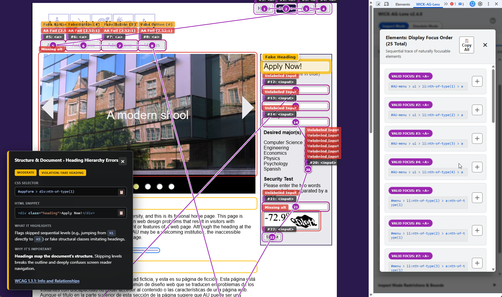
&nbsp;

## Table of Contents
1. [Features Overview](#features-overview)
2. [Monorepo Architecture & Building](#monorepo-architecture--building)
3. [Headless CLI Automation](#headless-cli-automation)
4. [MCP Server (AI Integration)](#mcp-server-ai-integration)
5. [Visual Extension Installation](#visual-extension-installation)
6. [Core Features & Usage](#core-features--usage)
7. [Audit Library & Ruleset](#audit-library--ruleset)
8. [Search Predicates and Logic Definitions](#search-predicates-and-logic-definitions)
9. [Disability Simulation Engine (Logic & Assumptions)](#disability-simulation-engine-logic--assumptions)
10. [PDF Accessibility Engine (Logic & Assumptions)](#pdf-accessibility-engine-logic--assumptions)
11. [Limitations & Technical Bounds](#limitations--technical-bounds)
12. [Compatibility](#compatibility)
13. [License](#license)
14. [Contributing](#contributing)
15. [Development & Testing Sites](#development--testing-sites)
16. [Changelog](#changelog)

## Features Overview
WICK-AG-Lens is built for developers, QA engineers, and AI agents. It runs static analysis against the DOM and computed CSS styles to highlight accessibility patterns, while also offering dynamic rendering filters to simulate specific user conditions and a binary scanner for PDF documents.

*   **Headless CLI & AI MCP Server:** Automate your accessibility testing via Playwright or provide AI agents with a robust tool to audit and diff structural DOM changes dynamically.
*   **Real-Time SPA & DOM Sync:** Automatically detects Single Page Application (SPA) client-side routing and dynamic DOM injections (like modals), seamlessly re-auditing the page in real-time without requiring a manual refresh.
*   **Comprehensive Audits:** Divided into actionable violations and structural information checks covering many of the most common issues identified across WCAG 2.0, 2.1, and 2.2 at the A, AA, and AAA conformance levels.
*   **Disability Simulation Engine:** Toggle strictly modeled color vision deficiencies (CVD) and interactive physiological impairments (like cataracts, diplopia, and field loss) to empathetically audit your layout.
*   **PDF Gatekeeper Auditing:** Zero-dependency binary scanner to evaluate critical structural WCAG and PDF/UA prerequisites (Tags, Title, Language, Extraction Permissions) directly from the active tab.
*   **WCAG Criteria Filtering:** Dynamically restrict audits and legend items by specific WCAG versions (2.0, 2.1, 2.2) and conformance levels (A, AA, AAA).
*   **Visual Highlighting & Focus Tracing:** Draws bounding boxes and badges over target elements, and utilizes SVG paths to map out sequential, cross-iframe keyboard focus order.
*   **X-Ray Vision for Clipped Elements:** Renders hidden or off-screen interactive elements (like carousel slides) with a ghosted hatched pattern so you can visualize hidden focus traps without breaking the layout.
*   **Interactive Info Panels & Code Previews:** Clicking any on-page badge opens a detailed panel explaining the issue, displaying a sanitized HTML snippet of the target element, and providing actionable remediation steps.
*   **Precision Element Locator:** Use the crosshair action inside the DevTools details modal to instantly scroll an affected element into view, marking it with a highly visible pulsating ring.
*   **One-Click Reporting:** Copy formatted text reports of all active audits, their findings, and direct remediation instructions to your clipboard for easy ticket creation or bug tracking.
*   **Shadow DOM & Iframe Support:** Pierces open web components to evaluate encapsulated markup and fully traverses and aggregates data across iframes.

## Monorepo Architecture & Building
To maintain a single source of truth and keep the Chrome Web Store artifact clean of heavy Node dependencies (like Playwright), this project utilizes a lightweight monorepo architecture. 
*   `/core`: The central heuristic logic (`a11y-config.js` and `shared-utils.js`).
*   `/extension`: The visual Chrome extension artifact.
*   `/cli`: The Node.js Playwright environment and MCP server.

### Building the Chrome Extension Locally
Whenever you make changes to the heuristic rules in the `/core` folder, you must build the extension before Chrome can use it.
1. Run the build script from the root directory to copy the core logic into the extension package:
   ```bash
   node build.js
   ```
2. Open Chrome and navigate to `chrome://extensions/`.
3. Toggle **Developer mode** on (top right).
4. Click **Load unpacked** and select the **`extension`** folder.


## Visual Extension Installation

Installing WICK-AG-Lens takes just a few clicks from the official Chrome Web Store.

1. Navigate to the [WICK-AG-Lens page on the Chrome Web Store](https://chromewebstore.google.com/detail/accessibility-inspector/fjbgedagallcokpkfdlmpafcffblmlhd).
2. Click the **Add to Chrome** button located in the top right corner of the page.
3. A confirmation browser dialog will appear. Click **Add extension** to grant the necessary permissions for the tool to inspect pages.
4. You will receive a message saying WICK-AG-Lens has been added to Chrome.
5. Once installed, open your Chrome Developer Tools (`F12` or `Ctrl+Shift+I` on Windows/Linux, `Cmd+Option+I` on Mac).
6. Locate the **WICK-AG-Lens** tab in the top navigation bar of the DevTools panel. Note: You may need to click the `>>` icon if your DevTools window is narrow.


## Headless CLI Automation
The CLI utilizes Playwright to inject the WICK-AG-Lens core heuristics into a headless browser, allowing you to run audits in your terminal or CI/CD pipelines.

### Setup
Navigate to the CLI directory and install the dependencies (including the Playwright browser binaries):
```bash
cd cli
npm install
npx playwright install chromium
```

### CLI Usage
Run a baseline audit against any public URL:
```bash
node index.js audit https://example.com
```

### CLI Options & Authentication
You can pass several arguments to customize the run and bypass login screens:
*   `--audits <list>`: Comma-separated list of specific audit IDs to run (e.g., `v-doc-title,v-empty-links`)[cite: 2].
*   `-a, --auth-state <path>`: Path to a saved Playwright storage state JSON file (cookies/localStorage) to bypass logins[cite: 2].
*   `--login-url <url>`: URL to navigate to for authentication before running the audit[cite: 2].
*   `-u, --user <user>` and `-p, --pass <pass>`: Credentials for the login URL[cite: 2].
*   `-i, --interactive`: Launches a visible browser and waits 30 seconds for you to manually solve Captchas/MFA before auditing[cite: 2].
*   `-w, --width <pixels>`: Sets the viewport width to test responsive layouts (defaults to 1280).
*   `-H, --height <pixels>`: Sets the viewport height to test responsive layouts (defaults to 800).
*   `-s, --screenshot`: Includes a Base64 JPEG screenshot of the rendered page inside the final JSON output.
*   `--wait-ms <milliseconds>`: Explicit pause duration in milliseconds after `networkidle` to let client-side routers or slow animations settle.
*   `--wait-for-selector <selector>`: Halts audit execution until a specific CSS selector mounts in the DOM.
*   `--click <selectors>`: Comma-separated CSS selector(s) to interact with after the baseline audit. Executes each click sequentially, waits for DOM/SPA settling, and logs delta diffs (and optional screenshots) at each step.
*Example (Dynamic Login):*
```bash
node index.js audit https://app.com/dashboard --login-url https://app.com/login -u admin -p 1234
```

*Example (Mobile Layout Test - iPhone 13 Viewport):*
```bash
node index.js audit https://www.mywebapp.com/qc/fr.html -w 390 -H 844
```

*Example (Audit with Base64 Screenshots included in the JSON output):*
```bash
node index.js audit https://example.com -s
```

*Example (Single Action & Delta Diff):*
```bash
node index.js audit https://example.com --click "button#open-navigation-menu"
```

*Example (Multi-Action Sequence & Step-by-Step Diffs):*
```bash
node index.js audit https://example.com --click "button#open-menu, a#settings-link, button#toggle-dark-mode" -s
```

*Example (Mobile Responsive Click with Screenshots):*
```bash
node index.js audit https://example.com/ -w 390 -H 844 -a "example-state.json" --click "button.mobile-menu-toggle" -s
```

### Viewing CLI Screenshots
When you use the `-s` flag, the snapshot is embedded dynamically after every action (baseline, clicks, etc.) directly in the JSON output under the `screenshot_base64` key. 

It is exported as a **raw Base64 string** (e.g., `/9j/4AA...`) without the HTML Data URI prefix. This raw format is intentional, as multimodal AI agents using the MCP server require clean Base64 data without HTML prefixes to process visual inputs.

To view the image manually:
1. **In the Browser:** Open a new tab, type `data:image/jpeg;base64,` into the address bar, paste your raw string immediately after it, and hit Enter.
2. **In HTML Custom Reports:** Prepend the prefix inside an image tag's source attribute: 
   ``

### Handling Enterprise Firewalls & Cookie Banners (State Injection)

Modern enterprise websites often use aggressive bot mitigation (e.g., Akamai), heavy front-end frameworks (e.g., Adobe Experience Manager) with lazy-loaded footers, and intrusive Cookie Consent banners. 

When running a standard headless audit, these protections can result in incomplete scans (missing lazy-loaded elements) or broken CSS selectors (because an injected cookie banner shifts the DOM hierarchy).

WICK-AG-Lens CLI solves this using a **Two-Step State Injection Workflow**. By capturing a human-verified browser state once, you can run perfect, fully-hydrated headless audits indefinitely.

#### Step 1: The One-Time Setup (Interactive Mode)
Use the `-i` (interactive) flag to launch a visible browser, and the `-a` (auth-state) flag to specify where to save the session data.

```bash
node index.js audit "https://www.mywebsite.com/main.html" --audits="i-focus-order" -i -a "mywebsite-state.json"
```

1. A Chromium window will open and wait for 30 seconds.
2. Manually click "Accept" or "Decline" on the site's cookie banner.
3. Wait for the 30-second timer to expire. 
4. The CLI will automatically save your pristine, banner-free session (cookies and local storage) into `mywebsite-state.json`.

#### Step 2: Fully Automated Headless Audits
For all future runs (or in your CI/CD pipeline), drop the `-i` flag but keep the `-a` flag pointing to your saved state file.

```bash
node index.js audit "https://www.mywebsite.com/main.html" --audits="i-focus-order" -a "mywebsite-state.json"
```

**What happens under the hood:**
* Playwright runs completely headless at maximum speed.
* It injects your saved cookies before the page loads, preventing the cookie banner from rendering and altering the DOM tree.
* It deletes the `navigator.webdriver` flag to spoof a standard human session.
* It performs an automated, smooth bottom-to-top scroll to force `IntersectionObserver` elements (like heavy footers and widgets) to hydrate before capturing the structural accessibility snapshot.

#### Troubleshooting Edge Cases: WAF Sinkholes & SPA Timing

Even with state injection, enterprise sites with aggressive Web Application Firewalls (WAFs) and complex client-side routing can present two unique challenges for headless automation:

**1. Akamai "Sinkholing" (Bot Mitigation)**
Enterprise WAFs (such as Akamai or Cloudflare) sometimes detect subtle headless behaviors. Instead of blocking the connection outright, they "sinkhole" the bot by serving a fake 404 "Page Not Found" screen.
*   **Resolution:** Target the **root domain** (e.g., `https://www.example.com/`) rather than a deeply nested regional route (e.g., `/qc/fr.html`). Initializing at the root allows the server to evaluate injected cookies and trigger natural HTTP redirects, authenticating the session and bypassing the sinkhole.

**2. SPA Hydration Timing**
Complex Single Page Applications (SPAs) may momentarily display a skeleton screen or 404 placeholder while client-side routes resolve. If Playwright's `networkidle` lifecycle event resolves during that window, the audit may run against the transient state rather than the fully rendered view.
*   **Resolution:** Use the built-in timing options to delay baseline execution until the target component mounts:
    *   `--wait-ms <milliseconds>`: Pauses execution after page load to allow dynamic scripts to hydrate.
    *   `--wait-for-selector <selector>`: Halts execution until a specific DOM element (e.g., a persistent nav or hero container) is present.

*Example (Waiting for SPA Hydration):*
```bash
node index.js audit [https://www.desjardins.com/](https://www.desjardins.com/) --wait-ms 3000 -a "desjardins-state.json"
```


## MCP Server (AI Integration)

The MCP (Model Context Protocol) Server exposes WICK-AG-Lens tools directly to AI agents (like Claude), allowing them to navigate pages, click elements, and receive delta logs of accessibility barriers created or resolved by their actions.

### Exposed Tools

* `audit_baseline`: Runs a full baseline scan on a target URL. Accepts `url`, an optional array of `requestedAudits`, an `includeScreenshot` boolean for multimodal visual context, and `viewportWidth`/`viewportHeight` parameters to test mobile layouts dynamically.
* `interact_and_diff`: Clicks a CSS selector, waits for the SPA router to settle via the internal double-debounce event, and returns a delta log of new or resolved violations. Accepts an `includeScreenshot` boolean.
* `get_audit_trail`: Returns the full chronological Action-State timeline log with global metadata and health scores.

### Handling Cookie Banners Dynamically with AI

When building CLI tools for humans, workarounds like 30-second pauses and interactive (`-i`) flags are necessary to handle obstacles like Cookie Consent banners. However, when exposing these same tools via an MCP Server, **the AI becomes the human.** 

If you hook this up to a multimodal AI agent (like Claude Desktop) that has access to browser automation tools, the AI can handle banners and firewalls dynamically, eliminating the need for manual state injection.

Here is how an AI agent handles this automatically using the WICK MCP tools:

1. **The AI Discovers the Banner (Baseline)**
   The AI calls the `audit_baseline` tool. It looks at the returned JSON (and the screenshot base64) and realizes, *"Ah, there is a giant cookie consent banner blocking the footer, and my element count is low."*

2. **The AI Uses the Diff Tool to Clear the Banner**
   The AI dynamically finds the CSS selector for the "Accept Cookies" button (e.g., `#onetrust-accept-btn-handler`) and calls the interaction tool:
   `interact_and_diff(actionName: "Accept Cookies", selector: "#onetrust-accept-btn-handler")`

3. **The Clean State is Achieved**
   Under the hood, the WICK script clicks that exact button, waits for the DOM to settle (which removes the banner and shifts the DOM back to its proper structure), and generates the new accessibility snapshot automatically. The AI can now visually perceive the roadblock is gone and capture the fully hydrated, clean element state entirely on its own!

### Running & Testing the MCP Server

To test the server locally using the Anthropic MCP Inspector:

```bash
cd cli
npx @modelcontextprotocol/inspector node mcp-server.js
```

To configure in Claude Desktop, add the following to your `claude_desktop_config.json`:

```json
"mcpServers": {
  "wick-ag-lens": {
    "command": "node",
    "args": ["/absolute/path/to/wick-ag-lens/cli/mcp-server.js"]
  }
}
```

## Core Features & Usage

### 1. WCAG Filtering & Audit Controls (Inspect Mode)
The inspector categorizes 55 heuristic rulesets across two primary tabs: **Violations & Warnings** (actionable failures) and **Informative & Structure** (valid page architecture and semantic patterns). 

*   **Version & Level Filters:** Dynamically restrict the visible audits using the Version (2.0, 2.1, 2.2) and Level (A, AA, AAA) filters. Toggling these checkboxes instantly redraws the page highlights to strictly match the selected compliance criteria.
*   **Master Toggles & Clean UI:** Use the Master Toggle at the top of each tab to activate all audits instantly, and use the category chevron buttons to collapse groups for a clutter-free DevTools workspace.
*   **Inline Information:** Clicking the `[ i ]` icon next to any audit expands an inline panel detailing exactly *What it highlights*, *Why it's important*, and *How to fix it*, complete with links directly to the official W3C WCAG documentation.

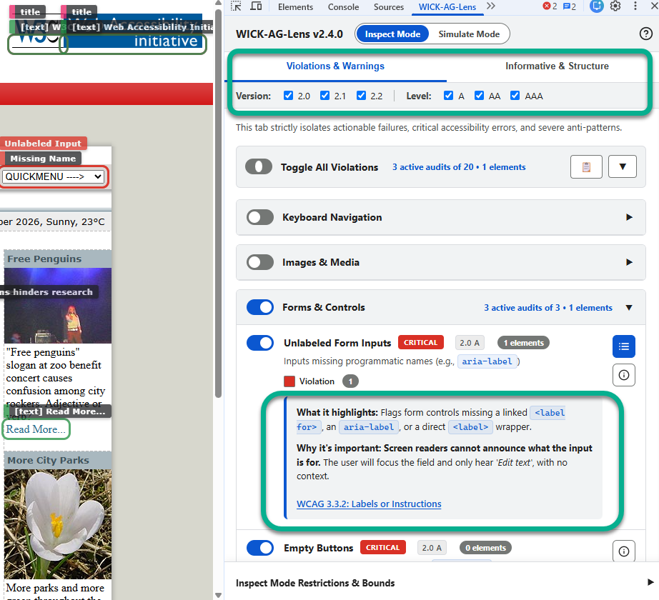

### 2. Disability Simulation Engine (Simulate Mode)
Switch from the standard "Inspect Mode" into "Simulate Mode" using the top header toggle to visually alter the host page, allowing developers to experience structural boundaries and contrast failures firsthand.
*   **Color Blindness:** Applies strict SVG `feColorMatrix` transformations to emulate Achromatopsia, Protanopia, Deuteranopia, and Tritanopia.
*   **Impaired Vision:** Utilizes interactive intensity sliders to dynamically emulate Double Vision (Diplopia), Loss of Contrast, Yellowing (Aging Lens), Cataracts, and Field of Vision Loss (Central Macular and Peripheral Tunnel parameters).
*   **Accuracy Indicators:** The UI explicitly tags simulations as *Strict Simulation* (mapped to established physiological math) or *Approximate* (combinatorial CSS filters).

Color Blindness:

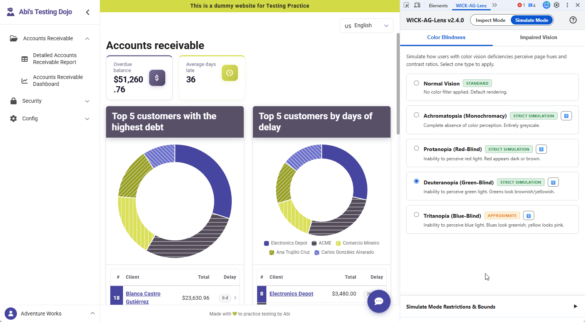

Impaired Vision:

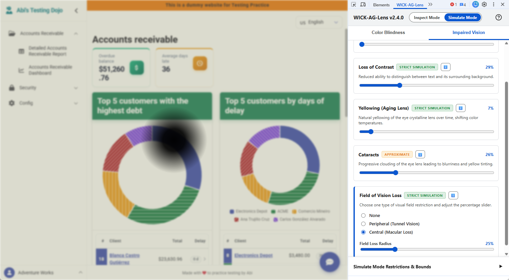

### 3. PDF Gatekeeper Auditing (PDF Mode)
Analyze raw PDF binary streams directly in the browser. Since Chrome's native PDF viewer is securely isolated and cannot be visually overlaid, this mode programmatically inspects the Document Catalog and Metadata dictionaries via an ArrayBuffer stream.
*   **Auto-Scan Verification:** Navigate to any direct PDF URL and toggle "Scan Active PDF" to execute an instant structural audit covering Tags, Titles, Language, and Extraction Permissions.
*   **View Technical Details Modal:** Click the details icon on any gatekeeper check to open a comprehensive modal. This displays the explicit Evaluation Finding (Pass/Fail), the precise Technical Stream Inspection output (e.g., `/MarkInfo << /Marked true >>`), Scope Guidance, and specific Remediation steps across Adobe Acrobat, Microsoft Word, and InDesign.
*   **Global Clipboard Export:** A dedicated `Copy Tab Report` (📋) button allows you to instantly export all 4 PDF gatekeeper checks, their statuses, technical outputs, and software-specific remediation instructions directly to your clipboard.
*   **Accuracy Identifiers:** Checks are clearly labeled with their confidence interval (e.g., *High Confidence* for strict catalog validation vs. *Moderate Confidence* for heuristic metadata scanning).

PDF Gatekeeper Auditing:

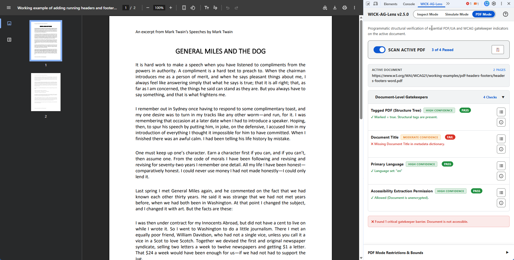

Impaired Vision:

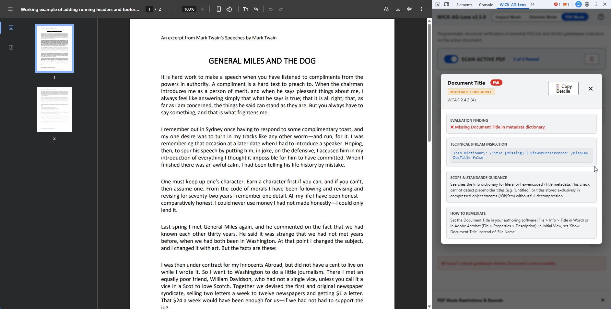


### 4. Interactive Info Panels & Code Previews
Clicking on any highlighted badge directly on the page summons a detailed DevTools-style toast notification. This panel provides immediate context for the audit, explaining *what* was flagged, *why* it creates a barrier for users, and **how to fix it** (utilizing clean, collapsible native HTML accordions to keep the UI compact and prevent screen clutter).

Crucially, the panel extracts a clean, extension-sanitized **HTML Snippet** of the target element, styled with VS Code dark-theme syntax highlighting, alongside the precise **CSS Selector**. Dedicated "Copy" buttons (📋) allow you to instantly grab the code or selector for bug reports without opening the native Elements panel.

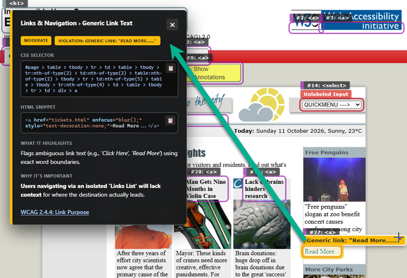

### 5. View Elements List & Precision Locator
For audits that return multiple findings, clicking the "View Elements" (list icon) button inside the DevTools panel opens a comprehensive details modal displaying a hierarchically sorted list of every flagged element.

*   **Precision Locator:** Clicking the target crosshair button next to any item will smoothly scroll the browser directly to that specific element on the page, flashing a bright pulsating focus ring to help you locate it instantly—even if it is deeply nested inside a complex UI or an embedded iframe.
*   **Export Modal List:** A dedicated `Copy All` button allows you to copy the exact list of isolated elements, their labels, and their CSS selectors directly to your clipboard.

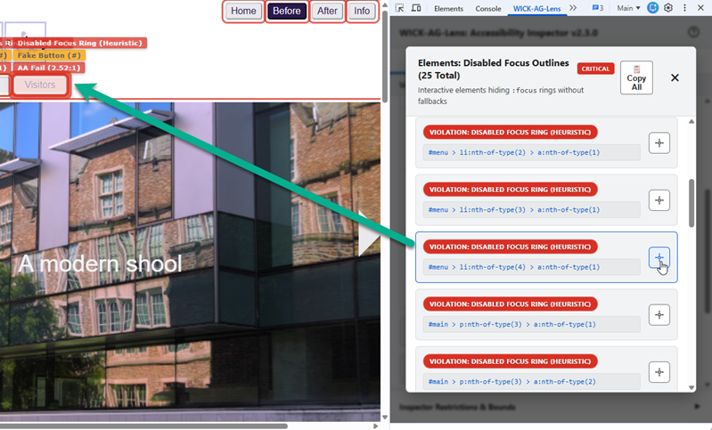

### 6. Comprehensive Tab Reporting
To streamline QA ticketing, WICK-AG-Lens features a global clipboard export function. Clicking the clipboard icon (📋) at the top of either the Violations or Informative tabs generates a fully formatted text report of your current analysis.
*   The report only exports data for **actively toggled audits** that pass your current WCAG filters.
*   It organizes the output by Category and Rule, explicitly logging `(No matching elements found)` for active audits that currently pass.
*   Crucially, the exported report **automatically includes explicit, actionable Remediation steps** for every flagged rule, making it effortless to paste direct solutions into Jira or bug tracking tickets for your developers.

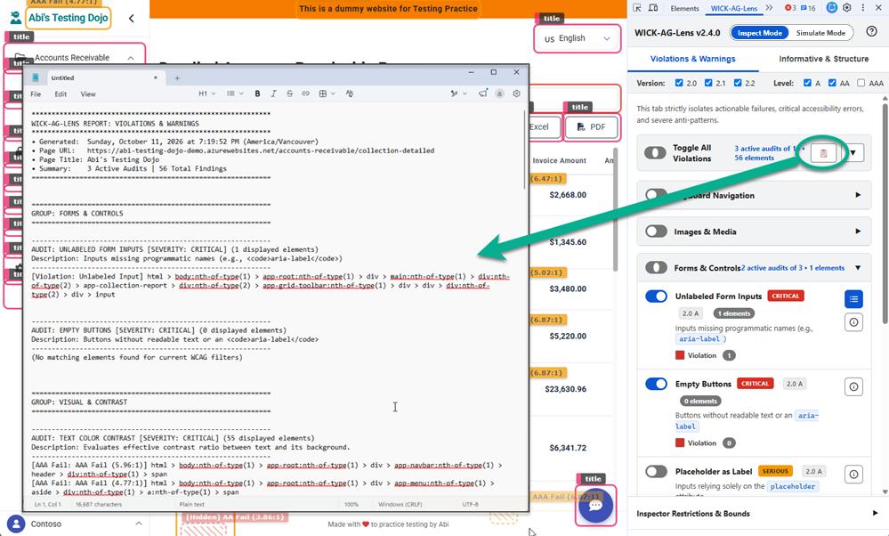

### 7. Real-Time SPA & Dynamic DOM Sync
WICK-AG-Lens features a Dual-Debounce MutationObserver to handle modern Single Page Applications (React, Vue, Angular) and dynamic content seamlessly. 
*   **SPA Navigation (Hard Wipe):** Instantly detects URL changes via the history API, clearing old highlights and triggering a fresh audit to prevent stale ghost boxes from floating over new views.
*   **Dynamic DOM Mutations (Soft Update):** Listens for injected elements (e.g., lazy-loaded content) as well as state changes on pre-rendered components (e.g., toggling `display: none` or `aria-hidden` on modals and dropdowns). Once the DOM settles, it silently runs a background rescan to attach new highlights and update holistic contexts without flashing the screen.

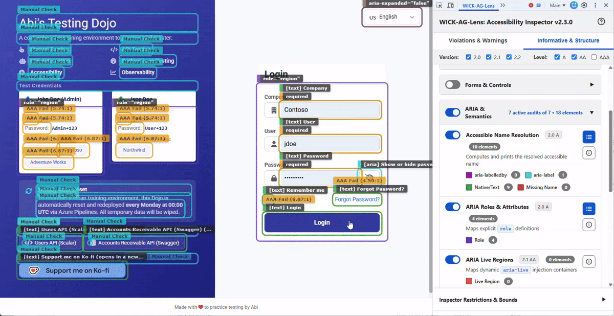

### 8. X-Ray Vision for Clipped Elements
When elements are pushed off-screen or hidden inside `overflow: hidden` containers (like carousel slides or scrollable panels), the extension detects their clipping bounds. Instead of ignoring them or drawing misleading boxes, WICK-AG-Lens renders these hidden elements using a specialized "X-Ray" ghosted hatched pattern. This allows auditors to visualize the exact footprint of hidden interactive elements and invisible focus traps without breaking the page layout.

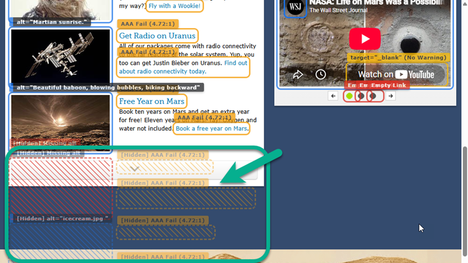

### 9. Embedded Offline Documentation
Accessibility auditing shouldn't require constantly hunting for internet resources. WICK-AG-Lens includes a fully embedded, offline-ready reference guide. Clicking the book icon in the extension header opens a comprehensive modal detailing every single rule, its WCAG mapping, technical limitations, and precise heuristic logic, ensuring your QA team always has context at their fingertips.

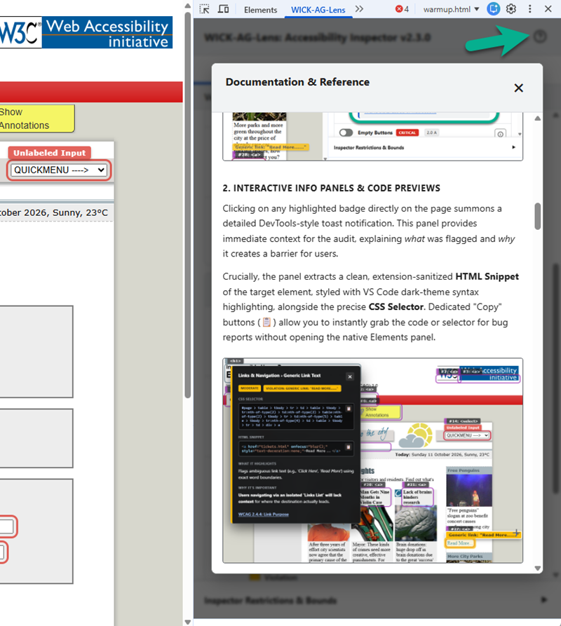

### 10. Native Dark Mode Support
The extension's DevTools panel fully respects your system and browser theme preferences, automatically switching between light and dark modes. It utilizes strictly WCAG 2.2 AAA compliant color contrast variables across both themes, ensuring that the auditing tool itself is accessible and easy on the eyes during long debugging sessions.


## Audit Library & Ruleset

The following details the complete list of heuristic evaluations performed by the inspector, their classification, standard outputs, and the corresponding W3C WCAG guidelines.

---

### Tab 1: Violations & Warnings

#### Structure & Document

| Audit | Classification | Badge Output | WCAG Criteria | Logic |
| :--- | :--- | :--- | :--- | :--- |
| **Document Title** | Critical | `"Missing Document Title"` | [2.4.2 (A)](https://www.w3.org/WAI/WCAG22/Understanding/page-titled.html) | [View](#v-doc-title) |
| **Page Encoding** | Moderate | `Encoding: {val}` | [1.3.1 (A)](https://www.w3.org/WAI/WCAG22/Understanding/info-and-relationships.html) | [View](#v-page-encoding) |
| **Auto-playing Media** | Serious | `"Autoplay Media"` | [1.4.2 (A)](https://www.w3.org/WAI/WCAG22/Understanding/audio-control.html) | [View](#v-18) |
| **Heading Hierarchy Errors** | Moderate | `"{TAG} (Skipped)"` or `"Fake Heading"` | [1.3.1 (A)](https://www.w3.org/WAI/WCAG22/Understanding/info-and-relationships.html) | [View](#v-19) |

*   **Document Title:** Checks if the document is missing a `<title>` tag or if it is empty. **Screen readers announce the page title first.**
*   **Page Encoding:** Checks if the document character set is defined (UTF-8). **Ensures text is parsed and pronounced correctly.**
*   **Auto-playing Media:** Flags audio or video elements set to `autoplay`. **Unexpected audio conflicts with screen reader announcements.**
*   **Heading Hierarchy Errors:** Flags skipped levels (e.g., `H1` to `H3`) or fake non-semantic headings. **Note: Starting a page directly with an `H2` is not flagged as a skipped level.** Skipping levels confuses screen reader navigation.

#### Images & Media

| Audit | Classification | Badge Output | WCAG Criteria | Logic |
| :--- | :--- | :--- | :--- | :--- |
| **Inaccessible SVGs** | Critical | `"Inaccessible SVG"` | [1.1.1 (A)](https://www.w3.org/WAI/WCAG22/Understanding/non-text-content.html) | [View](#v-svg-accessible) |
| **Missing Alt Text** | Critical | `"Missing alt"` or `"Tracking Pixel"` | [1.1.1 (A)](https://www.w3.org/WAI/WCAG22/Understanding/non-text-content.html) | [View](#v-5) |
| **Uncaptioned Video** | Critical | `"<video> (No Captions)"` | [1.2.2 (A)](https://www.w3.org/WAI/WCAG22/Understanding/captions-prerecorded.html) | [View](#v-6) |
| **Redundant Alt Text** | Minor | `Redundant alt: "{text}"` | [1.1.1 (A)](https://www.w3.org/WAI/WCAG22/Understanding/non-text-content.html) | [View](#v-7) |

*   **Inaccessible SVGs:** Flags inline `<svg>` elements exposed to screen readers lacking an accessible name. **Screen readers will read out raw SVG code nodes.**
*   **Missing Alt Text:** Flags `` elements completely lacking an `alt` attribute. Explicitly segregates 1x1 tracking pixels. **Screen readers will read the raw image filename or URL** if the attribute is missing, which is highly disruptive for hidden tracking pixels.
*   **Uncaptioned Video:** Flags `<video>` elements missing nested `<track>` elements. **Deaf or hard of hearing users require captions** for video content.
*   **Redundant Alt Text:** Flags `alt` attributes containing words like *'image of'* or *'photo of'*. **Screen readers automatically announce images**, making these prefixes redundant.

#### Links & Navigation

| Audit | Classification | Badge Output | WCAG Criteria | Logic |
| :--- | :--- | :--- | :--- | :--- |
| **Empty Links** | Critical | `"Empty Link"` | [2.4.4 (A)](https://www.w3.org/WAI/WCAG22/Understanding/link-purpose-in-context.html) | [View](#v-11) |
| **Suspicious Link Targets** | Critical / Serious | `"Fake Button (JS)"` or `"Fake Button (#)"` | [4.1.2 (A)](https://www.w3.org/WAI/WCAG22/Understanding/name-role-value.html) | [View](#v-12) |
| **Generic Link Text** | Moderate | `Generic link: "{text}"` | [2.4.4 (A)](https://www.w3.org/WAI/WCAG22/Understanding/link-purpose-in-context.html) | [View](#v-13) |
| **Unwarned New Window Links** | Moderate | `'target="_blank" (No Warning)'` | [3.2.5 (AAA)](https://www.w3.org/WAI/WCAG22/Understanding/change-on-request.html) | [View](#v-14) |

*   **Empty Links:** Flags `<a>` tags lacking readable text or accessible names. **Screen readers will read the URL**, which is often confusing. 
*   **Suspicious Link Targets:** Flags anchor tags missing routing context acting as buttons (missing `role='button'`). **Using links to trigger JS actions confuses screen readers.** 
*   **Generic Link Text:** Flags ambiguous link text like *'Click Here'* or *'Read More'* using exact word boundaries. **Users navigating via a Links List will lack context.** 
*   **Unwarned New Window Links:** Flags `target='_blank'` links without text or ARIA warnings. **Unexpectedly opening new tabs disorients cognitive and screen reader users.** 

#### Forms & Controls

| Audit | Classification | Badge Output | WCAG Criteria | Logic |
| :--- | :--- | :--- | :--- | :--- |
| **Unlabeled Form Inputs** | Critical | `"Unlabeled Input"` | [3.3.2 (A)](https://www.w3.org/WAI/WCAG22/Understanding/labels-or-instructions.html) | [View](#v-8) |
| **Empty Buttons** | Critical | `"Empty Button"` | [4.1.2 (A)](https://www.w3.org/WAI/WCAG22/Understanding/name-role-value.html) | [View](#v-9) |
| **Placeholder as Label** | Serious | `"Placeholder as Label"` | [4.1.2 (A)](https://www.w3.org/WAI/WCAG22/Understanding/name-role-value.html) | [View](#v-10) |
| **Invalid Autocomplete** | Moderate | `Invalid autocomplete="{val}"` | [1.3.5 (AA)](https://www.w3.org/WAI/WCAG22/Understanding/identify-input-purpose.html) | [View](#v-autocomplete-invalid) |

*   **Unlabeled Form Inputs:** Flags form controls missing `<label>` wrappers, `aria-label`s, or `for` attributes. **Screen readers cannot announce what the input is for.** 
*   **Empty Buttons:** Flags buttons without readable text or an `aria-label`. **Screen readers will only announce 'Button'**, providing no context. 
*   **Placeholder as Label:** Flags inputs relying solely on the `placeholder` attribute. **Placeholders disappear on typing** and often lack sufficient contrast.
*   **Invalid Autocomplete:** Flags fields where `autocomplete` contains unrecognized HTML5 tokens. **Invalid tokens prevent browsers and password managers from functioning correctly.**

#### Keyboard Navigation

| Audit | Classification | Badge Output | WCAG Criteria | Logic |
| :--- | :--- | :--- | :--- | :--- |
| **Unfocusable Clickables** | Critical | `"Unfocusable Clickable"` | [2.1.1 (A)](https://www.w3.org/WAI/WCAG22/Understanding/keyboard.html) | [View](#v-1) |
| **Tabindex Violations** | Serious | `tabindex="{val}"` | [2.4.3 (A)](https://www.w3.org/WAI/WCAG22/Understanding/focus-order.html) | [View](#v-3) |
| **Accesskey Attributes** | Moderate | `accesskey="{val}"` | [2.1.4 (A)](https://www.w3.org/WAI/WCAG22/Understanding/character-key-shortcuts.html) | [View](#v-4) |
| **Disabled Focus Outlines (Heuristic)** | Manual | `"Manual Check: Focus Ring"` | [2.4.7 (AA)](https://www.w3.org/WAI/WCAG22/Understanding/focus-visible.html) | [View](#v-2) |

*   **Unfocusable Clickables:** Flags generic elements with `onclick` handlers lacking a `tabindex` and a valid semantic `role`. **Keyboard users cannot tab to or activate these elements.** 
*   **Tabindex Violations:** Flags elements dynamically forcing focus order via `tabindex > 0`. **Overrides natural DOM focus order**, creating unpredictable navigation paths. 
*   **Accesskey Attributes:** Flags explicit `accesskey` definitions. **Often conflicts with native browser or screen reader shortcuts.** 
*   **Disabled Focus Outlines (Heuristic):** Parses page CSS via heuristic evaluation to find focusable elements where `outline: none` or `0` is applied on the `:focus` state. **Because this is a static CSS check, it cannot account for complex CSS cascade overrides and marks findings for manual review.** Sighted keyboard users rely entirely on focus rings.

#### ARIA Names (Errors)

| Audit | Classification | Badge Output | WCAG Criteria | Logic |
| :--- | :--- | :--- | :--- | :--- |
| **Prohibited Author Names** | Serious | `Prohibited name on role="{role}"` | [4.1.2 (A)](https://www.w3.org/WAI/WCAG22/Understanding/name-role-value.html) | [View](#v-17) |
| **Label in Name Mismatch** | Serious | `"Mismatch: "{txt}" != "{aria}""` | [2.5.3 (A)](https://www.w3.org/WAI/WCAG22/Understanding/label-in-name.html) | [View](#v-label-in-name) |
| **Duplicate ID Attributes** | Critical | `Duplicate ID: "{id}" ({v} vis, {h} hid)` or `[Hidden]` | [1.3.1 (A)](https://www.w3.org/WAI/WCAG22/Understanding/info-and-relationships.html) | [View](#v-duplicate-id) |
| **Broken ARIA References** | Critical | `Broken Ref: {attr}="{id}"` | [1.3.1 (A)](https://www.w3.org/WAI/WCAG22/Understanding/info-and-relationships.html) | [View](#v-broken-aria-ref) |

*   **Prohibited Author Names:** Flags structural roles (like `presentation`) containing `aria-label` or `aria-labelledby`. **Adding a name to a transparent structural role breaks its semantics.**
*   **Label in Name Mismatch:** Flags interactive elements where the visible text is completely overridden by an `aria-label` that does not include the visible text. **Voice dictation users rely on visible text commands.**
*   **Duplicate ID Attributes:** Flags multiple elements sharing the identical `id` attribute. **Screen readers and label mappings will only find the first ID.**
*   **Broken ARIA References:** Flags ARIA relationship attributes pointing to non-existent DOM IDs. **A broken reference means the relationship is completely lost.**

#### ARIA States (Errors)

| Audit | Classification | Badge Output | WCAG Criteria | Logic |
| :--- | :--- | :--- | :--- | :--- |
| **Focusable in Aria-Hidden** | Critical | `"aria-hidden (Focusable)"` | [4.1.2 (A)](https://www.w3.org/WAI/WCAG22/Understanding/name-role-value.html) | [View](#v-15) |
| **Invalid ARIA State** | Serious | `'aria-invalid="true"'` | [3.3.1 (A)](https://www.w3.org/WAI/WCAG22/Understanding/error-identification.html) | [View](#v-16) |

*   **Focusable in Aria-Hidden:** Flags active controls trapped in `aria-hidden='true'` trees. **Keyboard users can reach them, but screen readers cannot**, creating a severe mismatch. 
*   **Invalid ARIA State:** Flags form controls explicitly marked `aria-invalid='true'`. **Identifies application-enforced validation errors.** 

#### Visual & Contrast

| Audit | Classification | Badge Output | WCAG Criteria | Logic |
| :--- | :--- | :--- | :--- | :--- |
| **Text Color Contrast** | Critical | `AA Fail`, `AAA Fail`, `Manual Check` | [1.4.3 (AA)](https://www.w3.org/WAI/WCAG22/Understanding/contrast-minimum.html), [1.4.6 (AAA)](https://www.w3.org/WAI/WCAG22/Understanding/contrast-enhanced.html) | [View](#v-20) |

*   **Text Color Contrast:** Traverses the DOM to calculate the effective contrast ratio between text and its background. Dynamically evaluates `font-size` and `font-weight` against WCAG large-text thresholds. Elements over images/gradients are flagged for manual review. 

---

### Tab 2: Informative & Structure

#### Structure & Document

| Audit | Classification | Badge Output | WCAG Criteria | Logic |
| :--- | :--- | :--- | :--- | :--- |
| **Valid Heading Order** | Informative | `<{tag}>` | [1.3.1 (A)](https://www.w3.org/WAI/WCAG22/Understanding/info-and-relationships.html) | [View](#i-17) |
| **Landmark Regions** | Informative | `<{role or tag}>` | [2.4.1 (A)](https://www.w3.org/WAI/WCAG22/Understanding/bypass-blocks.html) | [View](#i-18) |
| **Table & Grid Structure** | Informative | `<{tag}>` or `role="{role}"` | [1.3.1 (A)](https://www.w3.org/WAI/WCAG22/Understanding/info-and-relationships.html) | [View](#i-19) |
| **Lists and List Items** | Informative | `<{tag}>` | [1.3.1 (A)](https://www.w3.org/WAI/WCAG22/Understanding/info-and-relationships.html) | [View](#i-20) |
| **Language Definitions** | Informative | `"Missing Root Lang"`, `Root lang="{val}"`, or `lang="{val}"` | [3.1.1 (A)](https://www.w3.org/WAI/WCAG22/Understanding/language-of-page.html) | [View](#i-21) |

*   **Valid Heading Order:** Standard `H1-H6` structural outline. **Verifies the logical outline of the page.** 
*   **Landmark Regions:** HTML5 and ARIA structural landmark containers. **Allows screen reader users to jump quickly between page sections.** 
*   **Table & Grid Structure:** Native `<table>` and ARIA data grids. **Visually maps data structures and verifies custom UI grids implement semantic headers.** 
*   **Lists and List Items:** Unordered (`<ul>`), ordered (`<ol>`), and definition lists (`<dl>`). **Ensures related items are programmatically grouped.** 
*   **Language Definitions:** Phonetic shifts and root `lang` declarations. **Screen readers rely on the language tag to load the correct accent and pronunciation rules.** 

#### Images & Media

| Audit | Classification | Badge Output | WCAG Criteria | Logic |
| :--- | :--- | :--- | :--- | :--- |
| **Display Image Alternatives** | Informative | `alt="{val}"`, `alt=""`, `"Missing alt"`, or `"[Pixel] ..."` | [1.1.1 (A)](https://www.w3.org/WAI/WCAG22/Understanding/non-text-content.html) | [View](#i-3) |
| **Captioned Video** | Informative | `"<video> (Captioned)"` | [1.2.2 (A)](https://www.w3.org/WAI/WCAG22/Understanding/captions-prerecorded.html) | [View](#i-4) |
| **Iframe Context & Titles** | Informative | `title="{title}"`, `"Hidden Iframe"` | [4.1.2 (A)](https://www.w3.org/WAI/WCAG22/Understanding/name-role-value.html) | [View](#i-5) |

*   **Display Image Alternatives:** Extracts and visually prints the `alt` text directly over all `` elements, explicitly segregating 1x1 tracking pixels. **Allows rapid visual auditing of alternative text descriptions.**
*   **Captioned Video:** Videos containing `<track>` elements. **Confirms proper multimedia accessibility setup.** 
*   **Iframe Context & Titles:** Analyzes third-party embed context and `title` attributes. **Screen readers announce the title to inform the user** what the sub-document contains. 

#### Links & Navigation

| Audit | Classification | Badge Output | WCAG Criteria | Logic |
| :--- | :--- | :--- | :--- | :--- |
| **Warned New Window Links** | Informative | `'target="_blank" (Warned)'` | [3.2.5 (AAA)](https://www.w3.org/WAI/WCAG22/Understanding/change-on-request.html) | [View](#i-9) |

*   **Warned New Window Links:** `target='_blank'` links with proper warning. **Confirms proper communication of context shifts to assistive technologies.** 

#### Forms & Controls

| Audit | Classification | Badge Output | WCAG Criteria | Logic |
| :--- | :--- | :--- | :--- | :--- |
| **Fieldsets & Captions** | Informative | `<{tag}>` | [1.3.1 (A)](https://www.w3.org/WAI/WCAG22/Understanding/info-and-relationships.html) | [View](#i-7) |
| **Touch Target Sizes** | Informative | `{width}x{height}px` | [2.5.8 (AA)](https://www.w3.org/WAI/WCAG22/Understanding/target-size-minimum.html) | [View](#i-8) |
| **Read-Only Fields** | Informative | `"readonly"` | [1.3.1 (A)](https://www.w3.org/WAI/WCAG22/Understanding/info-and-relationships.html) | [View](#i-readonly-fields) |

*   **Fieldsets & Captions:** Visual grouping containers (`<fieldset>`). **Crucial for grouping related radio buttons or complex form sections.** 
*   **Touch Target Sizes:** Calculates interactive pixel bounds (`width` / `height`). **Undersized targets prevent users with fine motor impairments from activating controls accurately.** 
*   **Read-Only Fields:** Inputs marked as `readonly` or `aria-readonly`. **Read-only fields must remain focusable** (unlike disabled fields) so screen readers can access their content.

#### Keyboard Navigation

| Audit | Classification | Badge Output | WCAG Criteria | Logic |
| :--- | :--- | :--- | :--- | :--- |
| **Tabindex (Comparison)** | Informative | `tabindex="{val}"` | [2.4.3 (A)](https://www.w3.org/WAI/WCAG22/Understanding/focus-order.html) | [View](#i-1) |
| **Display Focus Order** | Informative | `#{num}: <{tag}>` | [2.4.3 (A)](https://www.w3.org/WAI/WCAG22/Understanding/focus-order.html) | [View](#i-2) |

*   **Tabindex (Comparison):** Visual comparison of all `tabindex` usages. **Provides a sweeping visual map of the programmatic focus strategy.** 
*   **Display Focus Order:** Sequential trace of naturally focusable elements. Utilizes hierarchical decimal prefixing (e.g., `[Iframe] #4.1`) for isolated DOM boundaries, connected by dynamic SVG paths and numerical pills. **Simulates the exact path of the `TAB` key route.** 

#### ARIA Roles (Identity)

| Audit | Classification | Badge Output | WCAG Criteria | Logic |
| :--- | :--- | :--- | :--- | :--- |
| **ARIA Roles & Attributes** | Informative | `role="{val}"` | [4.1.2 (A)](https://www.w3.org/WAI/WCAG22/Understanding/name-role-value.html) | [View](#i-11) |
| **Aria-Roledescription** | Informative | `roledescription="{val}"` | [4.1.2 (A)](https://www.w3.org/WAI/WCAG22/Understanding/name-role-value.html) | [View](#i-aria-roledescription) |

*   **ARIA Roles & Attributes:** Maps explicit `role` definitions. **Allows rapid structural auditing of custom widget semantics.**
*   **Aria-Roledescription:** Custom semantic overrides via `aria-roledescription`. **Overrides the native role announcement** (e.g., turning 'button' into 'slide').

#### ARIA Names & Relationships

| Audit | Classification | Badge Output | WCAG Criteria | Logic |
| :--- | :--- | :--- | :--- | :--- |
| **Accessible Name Resolution** | Informative | `"[id] {name}"`, `"[aria] {name}"`, `"[text] {name}"`, or `"Missing Name"` | [4.1.2 (A)](https://www.w3.org/WAI/WCAG22/Understanding/name-role-value.html) | [View](#i-10) |
| **Form Field Descriptions** | Informative | `"aria-describedby"` or `"title"` | [3.3.2 (A)](https://www.w3.org/WAI/WCAG22/Understanding/labels-or-instructions.html) | [View](#i-6) |
| **Aria-Details** | Informative | `"aria-details"` | [4.1.2 (A)](https://www.w3.org/WAI/WCAG22/Understanding/name-role-value.html) | [View](#i-aria-details) |
| **Aria-Controls** | Informative | `"aria-controls"` | [4.1.2 (A)](https://www.w3.org/WAI/WCAG22/Understanding/name-role-value.html) | [View](#i-15) |
| **Aria-Owns** | Informative | `"aria-owns"` | [4.1.2 (A)](https://www.w3.org/WAI/WCAG22/Understanding/name-role-value.html) | [View](#i-16) |
| **List Set & Position** | Informative | `"Item X of Y"` | [1.3.1 (A)](https://www.w3.org/WAI/WCAG22/Understanding/info-and-relationships.html) | [View](#i-aria-setsize) |

*   **Accessible Name Resolution:** Computes the final accessible name by simulating the browser's fallback calculation sequence: `aria-labelledby`, then `aria-label`, then native associated labels/text, and finally `title`. **Reveals exactly what a screen reader will announce.** 
*   **Form Field Descriptions:** Supplemental instructional text (`aria-describedby`). **Ensures extended hints or error messages are programmatically tied to inputs.** 
*   **Aria-Details:** Highlights elements utilizing `aria-details`. **Links complex, rich explanations to an element** (allows structured HTML in the description).
*   **Aria-Controls:** Remote DOM visibility targets (`aria-controls`). **Links trigger mechanisms to their targets.** 
*   **Aria-Owns:** Remote programmatic ownership (`aria-owns`). **Reconstructs accessibility tree hierarchy for disjointed widgets.** 
*   **List Set & Position:** Virtual list mapping (`aria-setsize`, `aria-posinset`). **Tells screen readers the total size of a list and the element's position**, even if all items aren't in the DOM.

#### ARIA States (Conditions)

| Audit | Classification | Badge Output | WCAG Criteria | Logic |
| :--- | :--- | :--- | :--- | :--- |
| **ARIA Live Regions** | Informative | `aria-live="{val}"` | [4.1.3 (AA)](https://www.w3.org/WAI/WCAG22/Understanding/status-messages.html) | [View](#i-12) |
| **Required Fields** | Informative | `"required"` or `'aria-required="true"'` | [3.3.1 (A)](https://www.w3.org/WAI/WCAG22/Understanding/error-identification.html) | [View](#i-13) |
| **Aria-Expanded State** | Informative | `aria-expanded="{val}"` | [4.1.2 (A)](https://www.w3.org/WAI/WCAG22/Understanding/name-role-value.html) | [View](#i-14) |
| **Aria-Pressed State** | Informative | `aria-pressed="{val}"` | [4.1.2 (A)](https://www.w3.org/WAI/WCAG22/Understanding/name-role-value.html) | [View](#i-aria-pressed) |
| **Aria-Value Properties** | Informative | `value="{val}"` | [4.1.2 (A)](https://www.w3.org/WAI/WCAG22/Understanding/name-role-value.html) | [View](#i-aria-value) |
| **Aria-Haspopup** | Informative | `haspopup="{val}"` | [4.1.2 (A)](https://www.w3.org/WAI/WCAG22/Understanding/name-role-value.html) | [View](#i-aria-haspopup) |

*   **ARIA Live Regions:** Maps dynamic `aria-live` injection containers. **Ensures dynamic content updates are announced to screen readers.** 
*   **Required Fields:** Mandatory input enforcement (`required` / `aria-required`). **Ensures required status is programmatically available.** 
*   **Aria-Expanded State:** Expandable/collapsible widget states (`aria-expanded`). **Visualizes the current programmatic state of accordions and menus.** 
*   **Aria-Pressed State:** Toggle button states (`aria-pressed`). **Visualizes the programmatic state of toggle buttons** (e.g., Mute/Unmute, Play/Pause).
*   **Aria-Value Properties:** Slider & progress bar states (`valuenow`, `valuetext`). **Ensures visual slider values match their programmatic data.**
*   **Aria-Haspopup:** Elements triggering overlays (`aria-haspopup`). **Prepares users for a context shift** by announcing an interactive overlay.

## Search Predicates and Logic Definitions

Elements hidden via CSS parameters like `display: none` or `visibility: hidden`, or by using the HTML `inert` attribute, are excluded by the global DOM processing logic before the specific audits run.

**DOM Traversal:** The extension utilizes a custom deep `querySelectorAll` function combined with bottom-up ancestor mapping. This allows the scanner to properly pierce standard (open) Shadow DOM boundaries and fully traverse the internal DOM of same-origin iframes, guaranteeing accurate visibility tracking across complex widget architectures.

**Self-Auditing Guard:** The injected extension UI elements (like the overlay boxes and the information toast panels) are specifically excluded from audits to prevent false positives.

### Tab 1: Violations & Warnings

*   <a id="v-doc-title"></a>**Document Title:** Uses the CSS selector `html`. The logic checks if `document.title` is missing or entirely empty strings.
*   <a id="v-page-encoding"></a>**Page Encoding:** Uses the CSS selector `html`. The logic evaluates `document.characterSet` to ensure it is defined and set to UTF-8.
*   <a id="v-18"></a>**Auto-playing Media:** Uses the CSS selector `audio[autoplay], video[autoplay]`. Elements matching the selector are flagged.
*   <a id="v-19"></a>**Heading Hierarchy Errors:** Uses the CSS selector `h1, h2, h3, h4, h5, h6, [role='heading'], [class*='heading'], [class*='title']`. The logic tracks the integer level of headings, intentionally ignoring missing H1s at the start of the document. It flags an element if the current heading level skips sequentially past the previous tracked level. It also flags generic elements without a role attribute if the text length is under 80 characters, utilizing a heuristic wrapper safeguard to actively ignore generic containers that correctly wrap (or are wrapped by) valid native headings to prevent false positives. Outputs are separated into distinct "Skipped Level" and "Fake Heading" legends.
*   <a id="v-svg-accessible"></a>**Inaccessible SVGs:** Uses the CSS selector `svg:not([aria-hidden='true']):not([aria-hidden='1'])`. The logic ignores SVGs explicitly hidden from screen readers. For exposed SVGs, it checks if it lacks an `aria-label`, lacks a nested `<title>`, and is not nested within an interactive parent (like a `<button>`) that already provides an accessible name.
*   <a id="v-5"></a>**Missing Alt Text:** Uses the CSS selector `img:not([alt])`. Evaluates `getBoundingClientRect()` to distinctly categorize sub-2px tracking pixels apart from standard image violations to reduce UI noise.
*   <a id="v-6"></a>**Uncaptioned Video:** Uses the CSS selector `video`. The logic queries descendants for `track[kind="captions"], track[kind="subtitles"]`. If the result length is 0, the video is flagged.
*   <a id="v-7"></a>**Redundant Alt Text:** Uses the CSS selector `img[alt]`. The logic reads the alt attribute and uses the regular expression `/\b(image|img|photo|picture|graphic)\b/i` to identify redundant terms before flagging.
*   <a id="v-11"></a>**Empty Links:** Uses the CSS selector `a[href]`. The logic evaluates the text content, ARIA labels, and child image alt text. If all sources of accessible names are empty, it triggers a violation.
*   <a id="v-12"></a>**Suspicious Link Targets:** Uses the CSS selector `a[href='#'], a[href^='javascript:']`. The logic ignores elements that possess `role="button"`. It categorizes the remaining matches based on whether the `href` prefix is javascript or a hash.
*   <a id="v-13"></a>**Generic Link Text:** Uses the CSS selector `a[href]`. The logic trims the text content and applies an exact word boundary regular expression `/\b(click here|read more|learn more|more|link|here)\b/i` to flag matching elements.
*   <a id="v-14"></a>**Unwarned New Window Links:** Uses the CSS selector `a[target='_blank']`. The logic concatenates the text content and `aria-label` to test against the regular expression `/new (window|tab)/`. If no match is found, it flags a violation.
*   <a id="v-8"></a>**Unlabeled Form Inputs:** Uses the CSS selector `input:not([type='hidden']):not([type='submit']):not([type='button']), select, textarea`. The logic searches the document for a `<label>` with a `for` attribute matching the input ID. It also checks the element for `aria-label` or `aria-labelledby` attributes, or if it is nested directly inside a `label` element. If all checks fail, it is flagged.
*   <a id="v-9"></a>**Empty Buttons:** Uses the CSS selector `button, [role='button']`. The logic checks the text content of the element, the presence of `aria-label` or `aria-labelledby`, and the presence of child `img[alt]` elements. If the trimmed text is empty and alternative names are missing, it flags a violation.
*   <a id="v-10"></a>**Placeholder as Label:** Uses the CSS selector `input[placeholder], textarea[placeholder]`. The logic checks if the element lacks a `label[for]` referencing its ID and lacks `aria-label` or `aria-labelledby` attributes.
*   <a id="v-autocomplete-invalid"></a>**Invalid Autocomplete:** Uses the CSS selector `input[autocomplete], select[autocomplete], textarea[autocomplete]`. The logic splits the token values and validates them against the official W3C HTML5 autocomplete token registry.
*   <a id="v-1"></a>**Unfocusable Clickables:** Uses the CSS selector `div[onclick], span[onclick], section[onclick]`. The Javascript logic evaluates each element to ensure it lacks a `role` attribute or lacks a `tabindex` attribute before flagging a violation.
*   <a id="v-3"></a>**Tabindex Violations:** Uses the CSS selector `[tabindex]`. The logic parses the attribute value as a base 10 integer and triggers a violation if the value is strictly greater than 0.
*   <a id="v-4"></a>**Accesskey Attributes:** Uses the CSS selector `[accesskey]`. All elements matching this selector are flagged.
*   <a id="v-2"></a>**Disabled Focus Outlines (Heuristic):** Uses the base CSS selector `a[href], button, input, select, textarea, [tabindex]:not([tabindex='-1'])`. The Javascript logic iterates through `document.styleSheets` and checks each `CSSRule.STYLE_RULE` to see if the selector includes `:focus` or `:focus-visible`. It reads the `outline`, `outlineWidth`, `boxShadow`, and `border` properties. If outline rules contain `none` or `0px` and no fallback border or shadow is provided in the same rule, the selector is recorded. Any interactive element matching that recorded selector is flagged for manual review, as the script cannot natively account for subsequent CSS cascade overrides.
*   <a id="v-17"></a>**Prohibited Author Names:** Uses the CSS selector `[role='presentation'], [role='none'], [role='generic']`. The logic triggers a violation if the matched element has an `aria-label` or `aria-labelledby` attribute.
*   <a id="v-label-in-name"></a>**Label in Name Mismatch:** Uses the CSS selector `button[aria-label], a[href][aria-label], [role='button'][aria-label], [role='link'][aria-label]`. The logic normalizes whitespace, strips punctuation, and lowercases both the visible `innerText` and the computed `aria-label`. If the visible text is not found as a substring within the `aria-label`, it throws a violation.
*   <a id="v-duplicate-id"></a>**Duplicate ID Attributes:** Uses the CSS selector `[id]`. The logic tracks processed IDs to prevent redundant processing. When a duplicate is found, it uses `document.querySelectorAll` with `CSS.escape()` to fetch all colliding nodes. It evaluates `offsetWidth/offsetHeight` to categorize each node as visible or hidden, explicitly registering hidden duplicates with a lighter-colored legend so they appear distinctly in the Details Modal without rendering layout-breaking zero-pixel boxes on the screen.
*   <a id="v-broken-aria-ref"></a>**Broken ARIA References:** Targets elements using `[aria-labelledby], [aria-describedby], [aria-controls], [aria-owns], [aria-errormessage], [aria-details], [aria-activedescendant]`. The logic splits the attribute values by whitespace into individual ID strings and checks if `document.getElementById()` returns null. Flags the element if any referenced ID is missing from the DOM.
*   <a id="v-15"></a>**Focusable in Aria-Hidden:** Uses a bottom-up DOM traversal to check if any naturally focusable element (or its ancestors) possesses `aria-hidden='true'`. Pierces Shadow DOMs and iframes to ensure accurate detection of ghost focus traps.
*   <a id="v-16"></a>**Invalid ARIA State:** Uses the CSS selector `[aria-invalid='true']`. Elements matching the selector are flagged.
*   <a id="v-20"></a>**Text Color Contrast:** Uses the CSS selector targeting standard text elements like `h1`, `p`, `span`, `button`. The logic verifies child text nodes exist. It uses `window.getComputedStyle` to retrieve colors, dynamically factoring in `font-size` and `font-weight` against WCAG large-text thresholds. It calculates the WCAG relative luminance formula and dynamically evaluates failures against the user's active UI filters (AA vs AAA) so strict AAA failures are correctly caught even when AA filters are unchecked. Elements over background images or CSS gradients are automatically flagged for manual review.

### Tab 2: Informative & Structure

*   <a id="i-17"></a>**Valid Heading Order:** Uses the CSS selector `h1, h2, h3, h4, h5, h6`. Elements matching the selector are highlighted.
*   <a id="i-18"></a>**Landmark Regions:** Uses the CSS selector `main, nav, header, footer, aside, [role='main'], [role='navigation'], [role='banner'], [role='contentinfo']`. The logic retrieves the role attribute or the HTML tag name for the badge output.
*   <a id="i-19"></a>**Table & Grid Structure:** Uses the CSS selector `table, caption, th, [role='table'], [role='grid'], [role='treegrid'], [role='columnheader'], [role='rowheader']`. The logic applies a dashed style to header roles and tags, and applies a solid style for grid and table containers.
*   <a id="i-20"></a>**Lists and List Items:** Uses the CSS selector `ul, ol, li, dl, dt, dd`. Elements matching the selector are highlighted.
*   <a id="i-21"></a>**Language Definitions:** Uses the CSS selector `html, [lang], [xml\\:lang]`. The logic checks if the element is the root html tag. It flags the element if the root tag is missing a language attribute. It categorizes root language declarations separately from inline phonetic shifts.
*   <a id="i-3"></a>**Display Image Alternatives:** Uses the CSS selector `img`. The logic calculates bounding box dimensions to isolate tracking pixels, and assigns distinct legends based on whether the `alt` attribute is completely missing, present but empty, or populated.
*   <a id="i-4"></a>**Captioned Video:** Uses the CSS selector `video`. The logic checks for child `track[kind="captions"]` or `track[kind="subtitles"]` elements to highlight the video.
*   <a id="i-5"></a>**Iframe Context & Titles:** Uses the CSS selector `iframe`. The logic checks if the iframe has `aria-hidden` set to true or `tabindex` set to -1. It flags missing titles if the `title` attribute is missing or empty, otherwise, it outputs the title text.
*   <a id="i-9"></a>**Warned New Window Links:** Uses the CSS selector `a[target='_blank']`. The logic combines the text content and `aria-label` to test against the regular expression `/new (window|tab)/`. Matches are highlighted.
*   <a id="i-7"></a>**Fieldsets & Captions:** Uses the CSS selector `fieldset, legend`. Elements matching the selector are highlighted.
*   <a id="i-8"></a>**Touch Target Sizes:** Uses a CSS selector targeting interactive elements and roles like `button`, `link`, `checkbox`, `slider`. The logic uses `getBoundingClientRect()` to compute width and height. It finds the minimum of the two dimensions and categorizes the element based on strict WCAG thresholds: < 24px (WCAG 2.2 AA Fail), 24-43px (WCAG 2.1 AAA Fail), and 44px+ (WCAG 2.1 AAA Pass).
*   <a id="i-readonly-fields"></a>**Read-Only Fields:** Uses the CSS selector `[readonly], [aria-readonly='true']`. Highlights controls marked as read-only.
*   <a id="i-1"></a>**Tabindex (Comparison):** Uses the CSS selector `[tabindex]`. The logic parses the attribute as an integer and assigns different visual legends based on whether the value is equal to 0, less than 0, or greater than 0.
*   <a id="i-2"></a>**Display Focus Order:** Traces and numbers the natural sequential path of focusable elements using hierarchical decimal prefixing for cross-frame focus tracking. It dynamically flags elements that receive keyboard focus but are hidden from Assistive Technologies via `aria-hidden='true'` on the element or an ancestor.
*   <a id="i-11"></a>**ARIA Roles & Attributes:** Uses the CSS selector `[role]`. The logic retrieves the value of the role attribute for display.
*   <a id="i-aria-roledescription"></a>**Aria-Roledescription:** Uses the CSS selector `[aria-roledescription]`. Retrieves the value of the attribute for display.
*   <a id="i-10"></a>**Accessible Name Resolution:** Uses a CSS selector targeting interactive widgets. The logic simulates the browser's native fallback sequence, sequentially checking `aria-labelledby`, `aria-label`, native associated labels/inner text, and finally the `title` attribute to print exactly what the screen reader will announce.
*   <a id="i-6"></a>**Form Field Descriptions:** Uses the CSS selector `[aria-describedby], [title]`. The logic outputs the presence of these specific attributes to the badge.
*   <a id="i-aria-details"></a>**Aria-Details:** Uses the CSS selector `[aria-details]`. Elements matching the selector are highlighted.
*   <a id="i-15"></a>**Aria-Controls:** Uses the CSS selector `[aria-controls]`. Elements matching the selector are highlighted.
*   <a id="i-16"></a>**Aria-Owns:** Uses the CSS selector `[aria-owns]`. Elements matching the selector are highlighted.
*   <a id="i-aria-setsize"></a>**List Set & Position:** Uses the CSS selector `[aria-setsize], [aria-posinset]`. The logic retrieves the position and set size values for the badge output.
*   <a id="i-12"></a>**ARIA Live Regions:** Uses the CSS selector `[aria-live]`. The logic retrieves the value of the aria-live attribute for display.
*   <a id="i-13"></a>**Required Fields:** Uses the CSS selector `[required], [aria-required='true']`. The logic distinguishes between HTML required attributes and ARIA required attributes for the output.
*   <a id="i-14"></a>**Aria-Expanded State:** Uses the CSS selector `[aria-expanded]`. The logic categorizes the element based on whether the attribute equals true or false.
*   <a id="i-aria-pressed"></a>**Aria-Pressed State:** Uses the CSS selector `[aria-pressed]`. The logic categorizes the toggle button state based on whether the attribute equals true, false, or mixed.
*   <a id="i-aria-value"></a>**Aria-Value Properties:** Uses the CSS selector `[aria-valuenow], [aria-valuetext]`. Retrieves the active numerical or text value of the slider/progress bar.
*   <a id="i-aria-haspopup"></a>**Aria-Haspopup:** Uses the CSS selector `[aria-haspopup]`. Retrieves the overlay type parameter for display.

## Disability Simulation Engine (Logic & Assumptions)

The Simulate Mode provides an empathetic heuristic overlay to help developers identify critical contrast and layout barriers by simulating severe visual impairments directly in the DOM. These modules map to documented mathematical approximations rather than applying arbitrary color tints.

### Color Vision Deficiencies (CVD)
*   **Achromatopsia (Monochromacy):** Simulates a complete absence of color perception. Rather than a basic grayscale filter, it utilizes a standard SVG `feColorMatrix` mapped strictly to the WCAG relative luminance formula `(0.2126 R + 0.7152 G + 0.0722 B)` to ensure colors are converted to grayscale in direct proportion to their perceived brightness.
*   **Protanopia & Deuteranopia (Red/Green Blindness):** Simulates the physiological lack of L-cones and M-cones, respectively. It applies the precise mathematical linearRGB Viénot model matrices via an SVG `feColorMatrix`.
*   **Tritanopia (Blue-Blindness):** Simulates the lack of S-cones. While a perfect simulation requires a 3D dual-plane mapping (Brettel 1997), WICK-AG-Lens utilizes an optimized SVG linear least-squares approximation matrix to maintain high-performance, real-time rendering within the browser compositor.

### Impaired Vision Physiology
*   **Double Vision (Diplopia):** Simulates perceiving a secondary ghosted image offset from the original content. It renders a highly accurate secondary ghost image using an SVG `feOffset` function combined with an alpha reduction (`feFuncA`) and composites it using `feBlend` directly into the page layer.
*   **Loss of Contrast:** Reduces the ability to distinguish between text and its surrounding background. It utilizes the native CSS `contrast()` function to reduce the luminance amplitude difference between elements while purposefully maintaining structural color (unlike other tools that biologically misrepresent contrast loss by aggressively converting the page to grayscale).
*   **Yellowing (Aging Lens / Nuclear Sclerosis):** Simulates the natural yellowing of the eye crystalline lens over time. Rather than utilizing a generic CSS `sepia()` tone (which unrealistically paints everything brown), it uses a custom SVG `feColorMatrix` that fundamentally degrades the blue channel to replicate the actual biological absorption of short-wavelength light.
*   **Cataracts:** Simulates the progressive clouding of the eye lens. It employs an approximate combinatorial filter simulating light scattering and opacity by mathematically intertwining a Gaussian blur function alongside a proportional drop in visual contrast and minor short-wavelength light absorption.
*   **Field of Vision Loss:** Simulates both Central Loss (Macular Degeneration) and Peripheral Loss (Glaucoma/Tunnel Vision). It employs a non-interactive overlay bounded by a static CSS radial gradient. Central Loss creates a localized central scotoma constrained correctly to a 20% limit of the visual angle, while Peripheral Loss aggressively restricts outer inputs, shrinking the clear tunnel down to 5%.

## PDF Accessibility Engine (Logic & Assumptions)

The PDF Mode provides a programmatic structural verification of essential PDF/UA and WCAG gatekeeper indicators directly from the active binary stream. 

*   **Tagged PDF (Structure Tree):** Scans the Document Catalog for the `/MarkInfo` dictionary. Ensures `/Marked true` is present and `/Marked false` is not. A missing tag tree prevents screen readers from understanding reading order and semantics (WCAG 1.3.1 & ISO 14289-1).
*   **Document Title:** Uses a heuristic metadata scanner to search the Info dictionary for literal or hex-encoded `/Title` metadata, and verifies if `/DisplayDocTitle` is enforced (WCAG 2.4.2). 
*   **Primary Language:** Strict Catalog property validation. Scans for the root `/Lang` ISO language code identifier to ensure speech synthesizers load the correct phonetic dictionary (WCAG 3.1.1).
*   **Accessibility Extraction Permission:** Strict bitmask calculation. Evaluates User Security Access Permissions (`/P`). Evaluates Bit 10 (value 512, `0x200`) to ensure assistive technologies are mathematically permitted to extract text contents if the document is encrypted (Robust Principle).

## Limitations & Technical Bounds

### Inspect Mode
*   **Dynamic Content & SPAs:** The inspector listens to DOM mutations to provide real-time updates. However, rapidly mutating animations or heavily throttled browser threads may occasionally delay the soft-update rescan (debounced to 750ms).
*   **Visibility Filtering:** Elements hidden via `display: none`, `visibility: hidden`, `hidden`, or `inert` are strictly excluded from all analysis to match native accessibility tree behavior.
*   **Clipping & X-Ray Vision:** Elements scrolled off-screen or hidden inside `overflow: hidden` containers (like carousels) are successfully detected and rendered with a ghosted X-Ray hatched pattern.
*   **Z-Index Occlusion:** Visibility calculations rely on CSS properties. The tool does not calculate 3D geometric occlusion (e.g., an element technically "visible" in the DOM but visually covered by a high `z-index` modal).
*   **Focus Order:** Mirrors standard browser `Tab` execution, prioritizing `tabindex > 0`, respecting native Radio Group bundling, and tracing hierarchical paths inside nested iframes.
*   **Shadow DOMs:** Standard (open) Web Components are fully traversed and supported. Explicitly 'closed' Shadow Roots remain inaccessible by browser design.
*   **Iframes & Cross-Origin Policies:** The tool successfully aggregates data across all active iframes (including nested cross-origin embeds) for reporting and element listings. However, it cannot bypass strict Same-Origin Policies to force browser scroll events inside cross-origin windows.

### Simulate Mode
*   **Hardware & Monitor Limitations:** All visual simulations are inherently constrained by the physical hardware of the screen. Absolute accuracy is limited by your monitor's specific color calibration, backlight brightness, viewing angle, and ambient room lighting.
*   **Color Blindness Models:** Protanopia and Deuteranopia use strict linearRGB Viénot physiological matrices, while Tritanopia utilizes an optimized linear least-squares approximation. Achromatopsia strictly follows the WCAG relative luminance formula rather than modeling biological rod-monochromacy.
*   **Impaired Vision Approximations:** Conditions like Cataracts and Loss of Contrast are generated using mathematical CSS filter combinations. They mimic the optical experience to identify severe contrast issues but do not perfectly replicate the physiological deterioration of the human eye.
*   **Field Loss Topography:** Central (Macular) and Peripheral (Glaucoma) visual field losses are simulated using CSS radial gradients bounded by static angles/percentages. These are 2D geometric approximations and do not account for physical biological blind-spot mapping, head movement, or dynamic pupil dilation.

### PDF Mode
*   **Native PDF Viewer Sandbox:** Chrome strictly isolates PDF rendering inside an internal plugin layer. The DOM cannot be directly traversed or highlighted with visual overlays.
*   **Binary Stream Analysis:** Checks are performed programmatically via static byte inspection of the raw PDF Document Catalog, which may skip deeply compressed object streams (`/ObjStm`).
*   **Scope & Coverage:** Programmatic validation verifies critical structural prerequisites with zero false positives. However, deep layout semantics (e.g., table header associations, correct reading order, context-accurate alternative text on vector figures) still require manual screen reader testing or PDF/UA inspection (e.g., using PAC).


## Compatibility
*   **Browser:** Compatible with Google Chrome version 100.0 or higher.
*   **Permissions:** Operates on all URLs permitted by the user using the `activeTab` and `storage` permissions.

## License
WICK-AG-Lens is available under the MIT License. Reference the [LICENSE.md](./LICENSE.md) file for standard permissions and limitations.

## Contributing

First off, thanks for taking the time to contribute!

To contribute, please follow the process described in **[CONTRIBUTING.md](CONTRIBUTING.md "CONTRIBUTING.md")**
Any PR need to be done over the current *develop-next* branch.

And if you like the project but just don't have the time to contribute, that's fine. There are other easy ways to support the project and show your appreciation, which we would also be very happy about:
- Star the project
- Promote it on social media
- Refer this project in your project's readme
- Mention the project at local meetups and tell your friends/colleagues
- Buying me a coffee or contributing to a training session, so I can keep learning and sharing cool stuff with all of you.

<a href="https://www.buymeacoffee.com/sclavijosuero" target="_blank"></a>

Thank you for your support!


## Development & Testing Sites

The following deliberately inaccessible and accessible demonstration websites were utilized extensively during the development and testing of WICK-AG-Lens to verify the accuracy of the heuristic audits:

* **[W3C Before and After Demonstration (BAD)](https://www.w3.org/WAI/demos/bad/)**
* **[ABI Testing Dojo Demo](https://abi-testing-dojo-demo.azurewebsites.net/)**
* **[AccessComputing: Accessible University (AU) Demo Site](https://projects.accesscomputing.uw.edu/au/)**
* **[Deque University Demo Sites](https://dequeuniversity.com/demo/)**
* **[Intopia Accessibility Testing Playground](https://intopia.github.io/exercise/testing.html)**
* **[Desjardins](https://www.desjardins.com/qc/fr.html)**
* **[https://www.sfgov.org/sites/default/files/Documents/accessible_sampledoc1.pdf](https://www.sfgov.org/sites/default/files/Documents/accessible_sampledoc1.pdf)**
* **[https://www.w3.org/WAI/WCAG21/working-examples/pdf-headers-footers/headers-footers-word.pdf](https://www.w3.org/WAI/WCAG21/working-examples/pdf-headers-footers/headers-footers-word.pdf)**
* **[https://www.w3.org/WAI/WCAG20/Techniques/working-examples/PDF4/decorative-image.pdf](https://www.w3.org/WAI/WCAG20/Techniques/working-examples/PDF4/decorative-image.pdf)**

## Changelog

### v3.0.0: The Automation Update
* Restructured project into a monorepo architecture.
* Extracted core heuristic engine into `/core` as the single source of truth.
* Added Node.js CLI with Playwright adapter for headless accessibility automation.
* Added MCP Server (Model Context Protocol) exposing `audit_baseline` and `interact_and_diff` tools to AI agents.
* Centralized DOM traversal (`querySelectorAllDeep`) to ensure mathematical parity between visual and headless environments.
* Moved visual assets to `extension/assets/` to slim down the Chrome Web Store package.

### v2.5.0: The Structural Expansion, DOM Integrity, & PDF Update
* **Introduced PDF Gatekeeper Auditing Engine (PDF Mode):** Analyzes raw PDF binary streams directly in the browser to evaluate structural WCAG and PDF/UA prerequisites (Tags, Title, Language, Extraction Permissions).
* **Added PDF Technical Details Modal:** Provides explicit evaluation findings, raw technical stream inspection outputs, scope guidance, and software-specific remediation instructions.
* Added 14 new high-value audits across both the Violations and Informative tabs.
* Introduced comprehensive ARIA state mapping including `aria-pressed`, `aria-valuenow`, `aria-haspopup`, `aria-roledescription`, and `aria-setsize`.
* Added highly requested `Inaccessible SVGs` check that smartly ignores properly nested or purely decorative vector images while flagging true failures.
* Re-introduced and completely rebuilt the `Duplicate ID Attributes` audit using modern `CSS.escape()` parsing to avoid crashes on dynamically generated framework IDs.
* Added the `Broken ARIA References` audit to strictly validate relationship graphs (`aria-labelledby`, `describedby`, `controls`, `owns`, etc.) against the physical DOM.
* Implemented new error boundary checks including `Document Title`, `Page Encoding`, and `Invalid Autocomplete` tokens.
* Fixed `Unchecked runtime.lastError` warnings triggered by back/forward cache (bfcache) tab navigation by wrapping DevTools messages in a safe evaluation helper.
* Reordered all DevTools tabs and audit groups to strictly follow a manual accessibility tester's cognitive flow (Identity > Properties > State).
* Scaled up "Toggle All" master switch UI sizes for better UX visibility.
* Fixed a UI rendering bug in the "Touch Target Sizes" audit where failures under 24px were hidden due to an incorrect WCAG version mapping in the filter UI.
* Fixed a filtering short-circuit bug in "Text Color Contrast" where AAA failures were inadvertently hidden if the AA filter was unchecked, and expanded the rule's mapping to strictly cover permutations across WCAG 2.0, 2.1, and 2.2.
* Split the "Heading Hierarchy Errors" audit into two distinct legend categories ("Skipped Level" and "Fake Heading") with independent colors.
* Enhanced the "Heading Hierarchy Errors" heuristic engine with wrapper safeguards to prevent false positives on generic structural `<div>` elements containing valid nested headings.
* Clarified "Heading Hierarchy Errors" documentation to note that starting a document directly with an `H2` is explicitly allowed and does not trigger a skipped level warning.

### v2.4.2: Adjusting some other permissions
* Adjusted chrome extension permissions (removed "scripting" permission).

### v2.4.1: Adjusting permissions
* Adjusted chrome extension permissions (removed unnecesary "activeTab").

### v2.4.0: The Simulation Update
* Introduced a dedicated "Simulate Mode" featuring an entire suite of Disability Simulation rendering tools.
* Added 5 Color Blindness profiles utilizing rigorous SVG `feColorMatrix` implementations (Achromatopsia, Protanopia, Deuteranopia via Viénot models, and Tritanopia).
* Added 5 interactive Impaired Vision conditions with live-updating intensity sliders (Diplopia, Loss of Contrast, Yellowing/Aging Lens, Cataracts, and strict geometric Field Loss).
* Upgraded the "Display Focus Order" audit in Inspect Mode to physically draw connecting SVG pathways and dynamic numerical tracking pills across the layout to completely visualize keyboard navigation routes.
* Resolved a critical ReferenceError in the MutationObserver that prevented SPA soft-updates (modals, dropdowns) from dynamically resyncing.
* Split and overhauled the DevTools footer to house isolated, mode-specific "Restrictions & Bounds" with independent viewport scrolling.
* Refined the DevTools UI with grouped headers, unified flex layouts, and precise "Strict Simulation" accuracy tags.

### v2.3.0: The Real-Time SPA Update
* Engineered a Dual-Debounce MutationObserver to automatically handle Single Page Application (SPA) navigations.
* Implemented "Soft Updates" for dynamic DOM mutations and visibility toggles, silently re-auditing newly injected or revealed elements (modals, dropdowns) without flickering the UI.
* Expanded MutationObserver attribute filters to seamlessly monitor and react to `class`, `style`, `hidden`, `inert`, `aria-hidden`, and `aria-expanded` state changes.
* Added "Hard Wipes" for URL changes to instantly clear stale overlays during client-side routing.
* Upgraded the on-page DevTools info toast to display a clean, truncated HTML code snippet alongside the CSS selector.
* Applied rich VS Code-style dark theme syntax highlighting to the HTML preview box and added dedicated "Copy to Clipboard" actions for both snippets.

### v2.2.0: The Architecture & UX Update
* Added *Accessible Name Resolution* audit to accurately simulate screen reader label fallbacks (`aria-labelledby` > `aria-label` > native text > `title`).
* Implemented cross-frame data aggregation, allowing the extension to perfectly merge nested iframe elements into the global reports and view lists.
* Overhauled Informative badges with a sleek "DevTools" aesthetic (slate background with thick colored accent borders).
* Introduced "X-Ray Vision" for off-screen/clipped elements (e.g., carousel slides), rendering them with a ghosted hatched pattern and a `[Hidden]` label.
* Added hierarchical decimal tracking (e.g., `[Iframe] #4.1`) to the Focus Order audit to perfectly trace keyboard paths inside isolated sub-documents.
* Replaced physical highlight borders with CSS `outline`, permanently eliminating layout reflow loops and infinite scroll-bar expansion bugs.
* Applied rich inline code formatting to all documentation and info panels.

### v2.1.0
* Introduced dynamic WCAG Version (2.0, 2.1, 2.2) and Conformance Level (A, AA, AAA) UI filtering.
* Re-engineered DOM traversal for visibility calculations to seamlessly cross Shadow DOMs and same-origin iframes.
* Enhanced the Focus Order trace and "Focusable in Aria-Hidden" audits to dynamically detect "ghost focus" traps using deep bottom-up traversal.
* Updated Text Color Contrast to dynamically evaluate font-size and weight against thresholds, and explicitly flag complex backgrounds.
* Updated Generic Link text regex to strictly enforce word boundaries.
* Added DevTools UI toast notification system.

### v2.0.0
* Major release. Replaced icons and incorporated WCAG 2.2 AAA compliant styling changes.
* Added new heuristic auditing capabilities (Disabled Focus Outlines).
* Removed standard duplicate ID auditing in favor of expanded keyboard navigation tools.
* Rebranded to WICK-AG-Lens.

### v1.0.0
* Initial release (Chrome extension previously called **a11y-inspector**).
* Introduced targeted visual overlays, precision element locator, one-click clipboard reporting, and WCAG reference modals.
* Included base suite of audits for headings, images, forms, keyboard/interactive elements, links, and ARIA DOM integrity.
* Full support for evaluating DOM elements across nested frames and same-origin iframes.