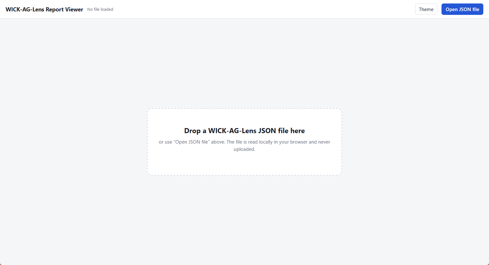
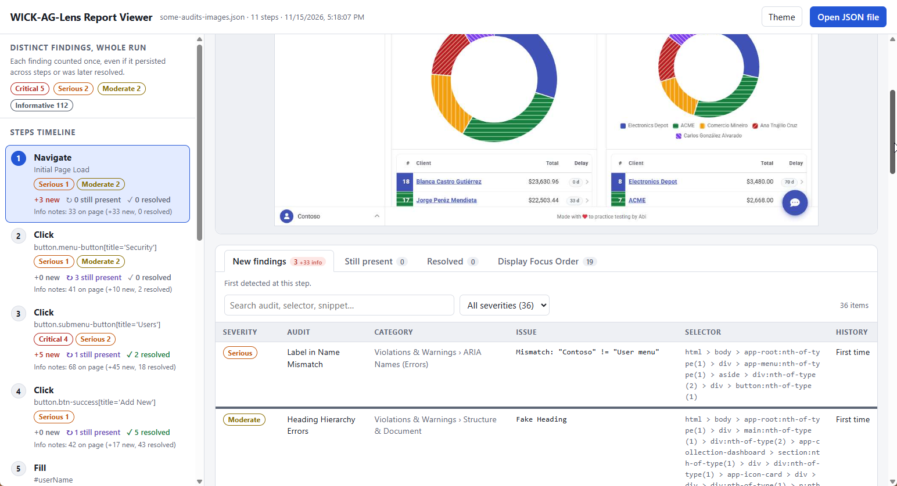
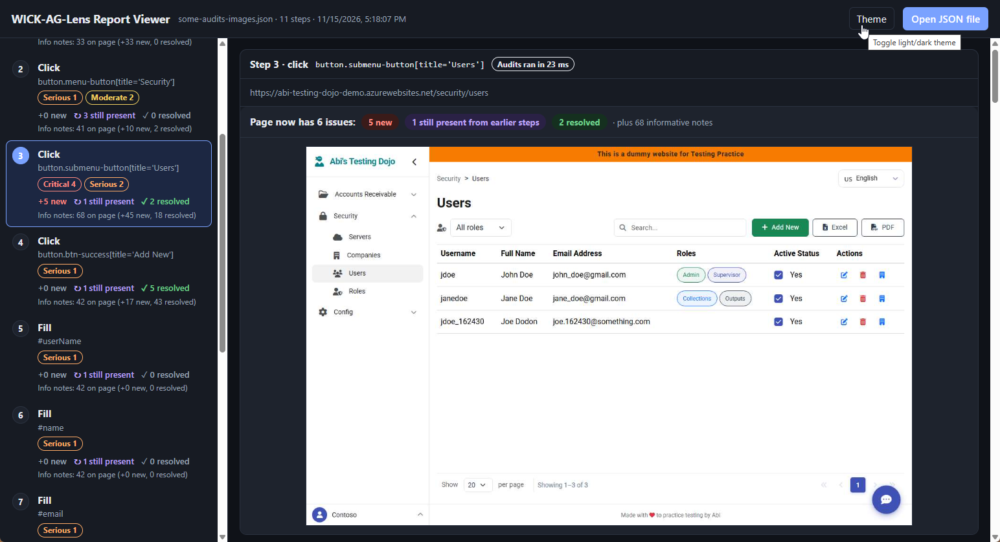

# WICK-AG-Lens: Headless CLI, MCP Server & `agent-browser` Guide

> [**← Back to Main Project Documentation**](../README.md) | [**Chrome DevTools Extension Guide →**](../extension/README.md)

The **WICK-AG-Lens CLI & MCP Package** utilizes Playwright to inject the shared WICK-AG-Lens core accessibility heuristics into a headless browser. It equips CI/CD pipelines and AI coding agents (Claude Code, Claude Desktop, Cursor, Windsurf, Copilot) with deterministic DOM auditing, multi-step authentication, real-time SPA delta-diffing, **`agent-browser`** session handoffs, and a bundled **AI Agent Skill (`SKILL.md`)**.

---

## Table of Contents
1. [Installation & Compatibility](#installation--compatibility)
2. [Headless CLI Automation](#headless-cli-automation)
3. [Step Actions & Keyboard Reference](#step-actions--keyboard-reference)
4. [CLI Usage Examples](#cli-usage-examples)
5. [Authentication Strategies (5 Methods)](#authentication-strategies-5-methods)
6. [Viewing CLI Screenshots](#viewing-cli-screenshots)
7. [Handling Enterprise Firewalls & Cookie Banners](#handling-enterprise-firewalls--cookie-banners)
8. [MCP Server & AI Agent Integration](#mcp-server--ai-agent-integration)
9. [AI Agent Skill Setup (`SKILL.md`)](#ai-agent-skill-setup-skillmd)
10. [Integrating with `agent-browser` & Playwright MCP](#integrating-with-agent-browser--playwright-mcp)
11. [CLI & MCP JSON Output Format](#cli--mcp-json-output-format)
12. [Visual HTML Report Viewer](#visual-html-report-viewer)
13. [CLI & MCP Limitations & Technical Bounds](#cli--mcp-limitations--technical-bounds)

---

## Installation & Compatibility

### Compatibility
* **Node.js:** `18.0.0` or higher (ES Modules support required).
* **Browser Engine:** Playwright Chromium (`playwright >= 1.40.1`).
* **Operating Systems:** Windows, macOS, and Linux (including headless Docker/CI containers).
* **AI Companions:** Any MCP-compatible client (Claude Desktop, Claude Code CLI/VS Code Extension, Cursor, Windsurf, Cline) and Vercel's [`agent-browser`](https://agent-browser.dev/) CLI.

### Setup
Navigate to the `cli` directory (or install via npm) and install the dependencies along with the Playwright Chromium binary:
```bash
cd cli
npm install
npx playwright install chromium
```

---

## Headless CLI Automation

Run a baseline audit against any public URL:
```bash
node index.js audit https://example.com
```
*(Or via `npx wick-ag-lens audit https://example.com` when installed from npm).*

### CLI Options

You can pass several arguments to customize the run:

* `--audits <list>`: Comma-separated list of specific audit IDs to run (e.g., `v-doc-title,v-empty-links`). If omitted, all available audits (both **Violations & Warnings** and **Informative & Structure**) are evaluated by default.
* `--wcag-version <versions>`: Comma-separated list to strictly filter executed audits by WCAG version (e.g., `2.0,2.1,2.2`). If omitted, all supported versions are evaluated by default.
* `--wcag-level <levels>`: Comma-separated list to strictly filter executed audits by WCAG conformance level (e.g., `A,AA,AAA`). If omitted, all supported levels are evaluated by default.
* `-w, --width <pixels>`: Sets the viewport width to test responsive layouts (defaults to `1280`).
* `-H, --height <pixels>`: Sets the viewport height to test responsive layouts (defaults to `800`).
* `-s, --screenshot`: Includes a Base64 JPEG screenshot of the rendered page inside the final JSON output.
- `-q, --screenshot-quality <quality>`: Sets the JPEG screenshot quality on a `1`–`100` scale when `-s` is enabled (defaults to `70`).
* `--wait-ms <milliseconds>`: Explicit pause duration in milliseconds after `networkidle` to let client-side routers or slow animations settle.
* `--wait-for-selector <selector>`: Halts audit execution until a specific CSS selector mounts in the DOM.
* `--step <step>`: Executable post-baseline interaction step (e.g., `click::#open-modal`, `fill::#email::invalid`). Can be repeated to build a multi-step user journey; each step captures a full accessibility delta diff.
* `--login-url <url>`: URL to navigate to for authentication before running the audit.
* `-u, --user <user>`: Shorthand username for standard 2-field login forms.
* `-p, --pass <pass>`: Shorthand password for standard 2-field login forms.
* `--auth-step <step>`: Executable pre-audit auth pipeline step (e.g., `fill::#company::Acme`). Can be repeated.
* `--auth-script <path>`: Path to a custom JavaScript module exporting an async login function.
* `-i, --interactive`: Launches a visible browser for 30 seconds to manually solve Captchas/MFA or Cookie banners.
* `-a, --auth-state <path>`: Path to save (or load) a Playwright storage state JSON file (cookies/localStorage) — compatible with Playwright and `agent-browser state save`.

---

## Step Actions & Keyboard Reference

Both `--auth-step` (which executes silently before the baseline scan to establish a session) and `--step` (which executes sequentially after the baseline scan and records an accessibility diff per step) use the `action::target::value` format.

### Supported Actions
| Action | Syntax | Behavior |
| :--- | :--- | :--- |
| **`click`** | `click::<selector>` | Clicks the target element (buttons, links, tabs, accordions, checkboxes). |
| **`fill`** | `fill::<selector>::<value>` | Clears an input or textarea and enters `<value>`, firing standard DOM input events. |
| **`select`** | `select::<selector>::<value>` | Chooses an `<option>` inside a native `<select>` element by option value or label. |
| **`press`** | `press::<selector>::<key>` | Focuses `<selector>` and dispatches `<key>`. Use `active` as the selector (`press::active::<key>`) to send keystrokes to the currently focused element without resetting tab order. |
| **`hover`** | `hover::<selector>` | Moves the cursor over `<selector>` to reveal tooltips, dropdowns, or hover states. |
| **`wait`** | `wait::<ms_or_selector>` | Waits for a duration in milliseconds (`wait::1000`) or until a CSS selector appears (`wait::.toast-alert`). |

### Supported Keys for `press`
The `press` action accepts standard **W3C `KeyboardEvent.key`** names (case-sensitive):
* **Navigation & Focus:** `Enter`, `Tab`, `Escape`, `Space`, `Backspace`, `Delete`, `Home`, `End`, `PageUp`, `PageDown`
* **Directional Arrows:** `ArrowUp`, `ArrowDown`, `ArrowLeft`, `ArrowRight`
* **Function Keys:** `F1` – `F12`
* **Characters & Digits:** `a`–`z`, `A`–`Z`, `0`–`9`
* **Modifier Combinations (joined with `+`):** `Shift+Tab`, `Control+a`, `Alt+ArrowDown`, `Meta+Enter` *(Supported modifiers: `Shift`, `Control`, `Alt`, `Meta`, `ControlOrMeta`)*

---

## CLI Usage Examples

### 1. WCAG 2.0 & 2.1 (Levels A & AA) Compliance Audit
Filters the rule engine to run only rules mapped to WCAG versions `2.0` and `2.1` at conformance levels `A` and `AA` (which together represent standard WCAG 2.1 AA compliance), excluding Level AAA and WCAG 2.2 checks.
```bash
node index.js audit "https://example.com" --wcag-version="2.0,2.1" --wcag-level="A,AA"
```

### 2. Targeted Audit Subset (`--audits`)
Runs only a specific comma-separated list of rule IDs instead of the full suite—ideal for fast CI smoke checks on high-priority issues like document titles, image alt text, empty links, and unlabeled form inputs.
```bash
node index.js audit "https://example.com" \
  --audits "v-doc-title,v-img-alt,v-empty-links,v-unlabeled-inputs"
```

### 3. Focus Order Mapping & Dynamic Shift Detection (`i-focus-order`)
Maps the complete tab-focus sequence of the page on initial load (Step 1), then opens a navigation drawer (Step 2) and outputs the updated focus sequence in `page_state_maps.focus_order`.
```bash
node index.js audit "https://example.com" \
  --audits "i-focus-order" \
  --step "click::button#open-nav-drawer"
```

### 4. Mobile Layout & Responsive Test (iPhone 13 Viewport)
Emulates a `390x844` mobile viewport to catch responsive reflow issues, mobile menu accessibility flaws, and undersized touch targets.
```bash
node index.js audit "https://www.mywebapp.com/" -w 390 -H 844
```

### 5. Single Interaction & Delta Diff with Screenshot
Captures a baseline audit on page load, clicks the navigation menu button, waits for the DOM to settle, and logs only the newly introduced or resolved findings along with Base64 screenshots at each step.
```bash
node index.js audit "https://example.com" \
  --step "click::button#open-navigation-menu" \
  -s
```

### 6. Multi-Step Navigation & Theme Toggle Sequence
Executes a sequence of UI interactions—opening a menu, navigating to settings, and toggling dark mode—producing an isolated step-by-step accessibility diff (such as new color-contrast violations in dark mode).
```bash
node index.js audit "https://example.com" \
  --step "click::button#open-menu" \
  --step "click::a#settings-link" \
  --step "click::button#toggle-dark-mode" \
  -s
```

### 7. Single-Page Application (SPA) Hydration & Targeted Rules
Waits until a dynamic dashboard widget mounts in the DOM, pauses an additional 1.5 seconds for client-side animations to finish, and runs a targeted subset of rules.
```bash
node index.js audit "https://example.com/analytics" \
  --wait-for-selector ".dashboard-chart-ready" \
  --wait-ms 1500 \
  --audits "v-heading-errors,v-unlabeled-inputs,i-accessible-name"
```

### 8. Keyboard Focus Trap & Modal Escape Testing
Opens a modal dialog, tabs through its interactive controls using the active focus element (`active`), and verifies that pressing `Escape` closes the dialog cleanly.
```bash
node index.js audit "https://example.com/settings" \
  --step "click::#open-profile-modal" \
  --step "press::active::Tab" \
  --step "press::active::Tab" \
  --step "press::active::Escape"
```

### 9. Form Validation, Dropdown Selection & Hover States
Tests dynamic form error states and hover-triggered tooltips by selecting a dropdown option, submitting an invalid input, waiting for validation messages, and hovering over a help badge.
```bash
node index.js audit "https://example.com/checkout" \
  --step "select::select#country::US" \
  --step "fill::input#zip-code::000" \
  --step "click::button#submit-order" \
  --step "wait::.validation-error-banner" \
  --step "hover::span.cvv-help-tooltip"
```

### 10. Standard 2-Field Login Shorthand
Authenticates through a standard username/password login page before navigating to the protected target URL and running the baseline audit.
```bash
node index.js audit "https://example.com/account" \
  --login-url "https://example.com/login" \
  -u "jdoe@example.com" \
  -p "SuperSecret123"
```

### 11. Enterprise Multi-Field Auth + Post-Login SPA Workflow
Logs into a 3-field corporate portal using `--auth-step`, then uses `--step` to navigate SPA menus, filter a data grid, submit via keyboard, and capture screenshots filtered to WCAG 2.0/2.1 Level A & AA.
```bash
node index.js audit "https://abi-testing-dojo-demo.azurewebsites.net/" \
  --audits="v-heading-errors,i-touch-targets,v-unlabeled-inputs,i-focus-order,v-placeholder-label,v-label-in-name,i-accessible-name" \
  --wcag-version "2.0,2.1" \
  --wcag-level "A,AA" \
  --login-url "https://abi-testing-dojo-demo.azurewebsites.net/login" \
  --auth-step "fill::#company::Contoso" \
  --auth-step "fill::#user::jdoe" \
  --auth-step "fill::#password::Admin+123" \
  --auth-step "click::#btn-login" \
  --step "click::button.menu-button[title='Security']" \
  --step "click::button.submenu-button[title='Companies']" \
  --step "fill::input#search-company::Contoso" \
  --step "press::active::Enter" \
  -s
```

### 12. Manual MFA / Cookie Banner Capture & Headless Session Reuse
Opens a visible browser window for 30 seconds so you can manually clear cookie banners or complete Multi-Factor Authentication (MFA), saves the authenticated cookies/storage to `auth-state.json`, and reuses that session in subsequent headless CI runs.
```bash
# Step A: Interactive capture (run once locally)
node index.js audit "https://example.com/portal" -i -a auth-state.json

# Step B: Headless CI audit reusing the saved session
node index.js audit "https://example.com/portal" -a auth-state.json --wcag-level="A,AA"
```

### 13. Custom JavaScript Authentication Module
Delegates complex SSO, OAuth, or multi-page redirect logins to a custom Playwright script (`async (page) => { ... }`) before running the audit.
```bash
node index.js audit "https://example.com/workspace" \
  --auth-script "./scripts/sso-login.js" \
  --step "click::button#new-project"
```

---

## Authentication Strategies (5 Methods)

WICK-AG-Lens supports **five distinct methods** to authenticate and bypass login screens across both the CLI (`-u`/`-p`, `--auth-step`, `--auth-script`, `-i`/`-a`) and the MCP Server (`user`/`pass`, `authSteps`, `authScript`, `authState`).

### 1. Standard 2-Field Login (Shorthand)
Use `-u` and `-p` alongside `--login-url` (or `loginUrl`, `user`, and `pass` in MCP `audit_baseline`) for straightforward single-page login forms.

* **When to use:** Simple forms consisting of a username or email field, a password field, and a submit button on a single page. Under the hood, this automatically compiles into a 3-step pipeline targeting:
  1. **Username / Email:** `input[type="text"], input[type="email"], input[type="user"]`
  2. **Password:** `input[type="password"]`
  3. **Submit:** `button[type="submit"], input[type="submit"]`

```bash
node index.js audit "https://example.com/account" \
  --login-url "https://example.com/login" \
  -u "jdoe@example.com" \
  -p "SuperSecret123"
```

### 2. Complex & Multi-Step Action Pipeline
**When to use:** Forms that require extra fields (like "Company" or "Tenant ID"), or Single Sign-On (SSO) flows (like Okta or Microsoft) where you must submit an email on screen one and enter a password on screen two.
You can chain multiple `--auth-step` flags using the `action::selector::value` format (or pass an `authSteps` array in MCP `audit_baseline`).
*Supported actions: `fill`, `select`, `click`, `press`, `hover`, `wait` (accepts milliseconds or a CSS selector).*

*Example (Multi-Field Form - Username, Password, and Company):*
```bash
node index.js audit https://app.com/dashboard \
  --login-url https://app.com/login \
  --auth-step "fill::input[name='company']::MyCompany" \
  --auth-step "fill::input[name='username']::admin" \
  --auth-step "fill::input[type='password']::1234" \
  --auth-step "click::button[type='submit']"
```

*Example (Multi-Page SSO - Wait for password field to appear):*
```bash
node index.js audit https://app.com/dashboard \
  --login-url https://app.com/login \
  --auth-step "fill::#email-input::admin@company.com" \
  --auth-step "click::#next-btn" \
  --auth-step "wait::#password-input" \
  --auth-step "fill::#password-input::secret123" \
  --auth-step "click::#submit-btn"
```

### 3. Custom Authentication Script (`--auth-script` / `authScript`)
For complex enterprise authentication flows—such as multi-page SSO redirects (Okta, Microsoft Entra ID / Azure AD), OAuth handshakes, or conditional prompts—pass a custom ES module exporting an `async (page) => { ... }` function. The scanner passes the active Playwright `page` instance directly into your function before navigating to the target audit URL.

* **CLI Command:**
```bash
TEST_USER="jdoe@contoso.com" TEST_PASS="Admin+123" \
node index.js audit "https://app.contoso.com/dashboard" \
  --auth-script "./scripts/sso-login.js" \
  --step "click::button#open-reports"
```

* **Example Script (`./scripts/sso-login.js`):**
```javascript
export default async function (page) {
  // 1. Navigate to the protected app to trigger the SSO identity provider redirect
  await page.goto('https://app.contoso.com/login', { waitUntil: 'domcontentloaded' });

  // 2. Step 1 of SSO: Enter corporate email and advance
  const emailInput = page.locator('input[type="email"]');
  await emailInput.waitFor({ state: 'visible', timeout: 15000 });
  await emailInput.fill(process.env.TEST_USER);
  await page.click('input[type="submit"], button[type="submit"]');

  // 3. Step 2 of SSO: Wait for password screen to mount, fill credentials, and sign in
  const passwordInput = page.locator('input[type="password"]');
  await passwordInput.waitFor({ state: 'visible', timeout: 15000 });
  await passwordInput.fill(process.env.TEST_PASS);
  await page.click('input[type="submit"], button[type="submit"]');

  // 4. Optional: Dismiss "Stay signed in?" prompt if presented by the IdP
  const staySignedInBtn = page.locator('input#idBtn_Back, button[data-testid="dismiss-prompt"]');
  if (await staySignedInBtn.isVisible({ timeout: 4000 }).catch(() => false)) {
    await staySignedInBtn.click();
  }

  // 5. Wait until redirected back to the authenticated application shell
  await page.waitForURL('https://app.contoso.com/**', { timeout: 20000 });
  await page.waitForSelector('nav.main-navigation', { timeout: 15000 });
}
```

### 4. Interactive State Capture (The "Human Bypass")
**When to use:** Sites with aggressive bot mitigation (Akamai, Cloudflare), invisible reCAPTCHAs, or MFA push notifications to your phone. Launches a visible browser for 30 seconds (`-i`) and exports cookies and `localStorage` to a reusable JSON file (`-a`).
*(See [Handling Enterprise Firewalls & Cookie Banners](#handling-enterprise-firewalls--cookie-banners) below for full instructions).*

### 5. External Browser & `agent-browser` State Handoff (`-a` / `authState`)
**When to use:** AI-driven workflows, encrypted credential vaults, or reusing an active Chrome session you are already logged into without writing login scripts or waiting on a 30-second interactive timer.

Because `agent-browser` and Playwright share the standard `storageState` JSON format (`cookies` and `localStorage`), you can authenticate externally using any of three protocols and pass the exported file straight into WICK-AG-Lens via `-a <path>` (CLI) or `authState` (MCP):

* **Protocol A — AI-Driven Interactive Login (`agent-browser state save`):** An AI agent navigates unfamiliar login forms using compact `@e` accessibility snapshots and saves the resulting session state:
  ```bash
  agent-browser open https://app.example.com/login
  agent-browser snapshot -i
  agent-browser fill @e1 "jdoe@example.com"
  agent-browser fill @e2 "SuperSecret123"
  agent-browser click @e3
  agent-browser wait --url "**/dashboard"
  agent-browser state save auth-state.json

  # Hand off session state to WICK-AG-Lens
  node index.js audit "https://app.example.com/dashboard" -a auth-state.json
  ```
* **Protocol B — Encrypted Credential Vault (`agent-browser auth login`):** Store credentials once in `agent-browser`'s AES-256-GCM encrypted vault (`~/.agent-browser/auth/`) so raw passwords never appear in CLI flags or AI prompts, then export the session state:
  ```bash
  # One-time encrypted profile setup
  echo "SuperSecret123" | agent-browser auth save my-app \
    --url "https://app.example.com/login" \
    --username "jdoe@example.com" \
    --password-stdin

  # Replay login & export storageState for WICK-AG-Lens
  agent-browser auth login my-app
  agent-browser state save auth-state.json
  node index.js audit "https://app.example.com/dashboard" -a auth-state.json
  ```
* **Protocol C — Live Chrome Session Reuse (`--auto-connect`):** Attach `agent-browser` to an already-authenticated local Chrome window (launched with remote debugging) to extract cookies/storage past corporate SSO, hardware security keys, or 2FA:
  ```bash
  agent-browser --auto-connect state save auth-state.json
  node index.js audit "https://app.example.com/dashboard" -a auth-state.json
  ```

*(Security Note: Saved `storageState` files contain live session tokens in plaintext—always exclude `*-state.json` in `.gitignore` and delete temporary state files after your audit completes).*

---

## Viewing CLI Screenshots

When you use the `-s` flag (or `includeScreenshot: true` in MCP), the snapshot is embedded dynamically after every action (baseline, clicks, etc.) directly in the JSON output under the `screenshot_base64` key.

It is exported as a **raw Base64 string** (e.g., `/9j/4AA...`) without the HTML Data URI prefix. This raw format is intentional, as multimodal AI agents using the MCP server require clean Base64 data without HTML prefixes to process visual inputs.

To view the image manually:
1. **In the Browser:** Open a new tab, type `data:image/jpeg;base64,` into the address bar, paste your raw string immediately after it, and hit Enter.
2. **In HTML Custom Reports:** Prepend the prefix inside an image tag's source attribute: 
   ``

---

## Handling Enterprise Firewalls & Cookie Banners

Modern enterprise websites often use aggressive bot mitigation (e.g., Akamai), heavy front-end frameworks (e.g., Adobe Experience Manager) with lazy-loaded footers, and intrusive Cookie Consent banners. 

When running a standard headless audit, these protections can result in incomplete scans (missing lazy-loaded elements) or broken CSS selectors (because an injected cookie banner shifts the DOM hierarchy).

WICK-AG-Lens CLI solves this using a **Two-Step State Injection Workflow**. By capturing a human-verified browser state once, you can run perfect, fully-hydrated headless audits indefinitely.

### Step 1: The One-Time Setup (Interactive Mode)
Use the `-i` (interactive) flag to launch a visible browser, and the `-a` (auth-state) flag to specify where to save the session data.

```bash
node index.js audit "https://www.mywebsite.com/main.html" --audits="i-focus-order" -i -a "mywebsite-state.json"
```

1. A Chromium window will open and wait for 30 seconds.
2. Manually click "Accept" or "Decline" on the site's cookie banner (or manually log in past any MFA/Captchas).
3. Wait for the 30-second timer to expire. 
4. The CLI will automatically save your pristine, banner-free session (cookies and local storage) into `mywebsite-state.json`.

### Step 2: Fully Automated Headless Audits
For all future runs (or in your CI/CD pipeline), drop the `-i` flag but keep the `-a` flag pointing to your saved state file.

```bash
node index.js audit "https://www.mywebsite.com/main.html" --audits="i-focus-order" -a "mywebsite-state.json"
```

**What happens under the hood:**
* Playwright runs completely headless at maximum speed.
* It injects your saved cookies before the page loads, preventing the cookie banner from rendering and altering the DOM tree.
* It deletes the `navigator.webdriver` flag to spoof a standard human session.
* It performs an automated, smooth bottom-to-top scroll to force `IntersectionObserver` elements (like heavy footers and widgets) to hydrate before capturing the structural accessibility snapshot.

### Troubleshooting Edge Cases: WAF Sinkholes & SPA Timing
Even with state injection, enterprise sites with aggressive Web Application Firewalls (WAFs) and complex client-side routing can present two unique challenges for headless automation:

**1. Akamai "Sinkholing" (Bot Mitigation)**
Enterprise WAFs (such as Akamai or Cloudflare) sometimes detect subtle headless behaviors. Instead of blocking the connection outright, they "sinkhole" the bot by serving a fake 404 "Page Not Found" screen.
* **Resolution:** Target the **root domain** (e.g., `https://www.example.com/`) rather than a deeply nested regional route (e.g., `/qc/fr.html`). Initializing at the root allows the server to evaluate injected cookies and trigger natural HTTP redirects, authenticating the session and bypassing the sinkhole.

**2. SPA Hydration Timing**
Complex Single Page Applications (SPAs) may momentarily display a skeleton screen or 404 placeholder while client-side routes resolve. If Playwright's `networkidle` lifecycle event resolves during that window, the audit may run against the transient state rather than the fully rendered view.
* **Resolution:** Use the built-in timing options to delay baseline execution until the target component mounts:
  * `--wait-ms <milliseconds>`: Pauses execution after page load to allow dynamic scripts to hydrate.
  * `--wait-for-selector <selector>`: Halts execution until a specific DOM element (e.g., a persistent nav or hero container) is present.

*Example (Waiting for SPA Hydration):*
```bash
node index.js audit https://www.example.com/ --wait-ms 3000 -a "example-state.json"
```

---

## MCP Server & AI Agent Integration

The MCP (Model Context Protocol) Server exposes WICK-AG-Lens tools directly to AI agents (like Claude), allowing them to authenticate, navigate pages, execute full user interactions, and receive delta logs of accessibility barriers created or resolved by their actions. It also pairs seamlessly with external browser automation tools—including Vercel's **`agent-browser`** CLI and the official **Playwright MCP**—via standard session state handoffs.

### Exposed MCP Tools
* `audit_baseline`: Authenticates (if configured) and runs a full baseline scan on a target URL. Supports:
  * **Authentication:** `loginUrl`, shorthand `user`/`pass`, ordered `authSteps` (`[{ action, target, value }]`), `authScript` (custom JS module path), and `authState` (path to a saved Playwright/`agent-browser` storageState JSON file).
  * **Scope & Filtering:** `requestedAudits`, `wcagVersions`, and `wcagLevels`.
  * **Viewport & Timing:** `viewportWidth`, `viewportHeight`, `waitMs`, `waitForSelector`, and `includeScreenshot` (Base64 JPEG visual context).
* `interact_and_diff`: Executes a post-baseline interaction (`action`: `"click" | "fill" | "select" | "press" | "hover" | "wait"`, `target`, `value`), waits for the SPA router to settle via the internal double-debounce event, and returns a delta log of `new_findings` and `resolved_findings`. Also supports `requestedAudits`, `wcagVersions`, `wcagLevels`, and `includeScreenshot`.
* `get_audit_trail`: Returns the full chronological Action-State timeline log with `global_summary`, `page_state_maps` (`focus_order`), and `audit_dictionary`.

### Handling Cookie Banners Dynamically with AI
When building CLI tools for humans, workarounds like 30-second pauses and interactive (`-i`) flags are necessary to handle obstacles like Cookie Consent banners. However, when exposing these same tools via an MCP Server, **the AI becomes the human.** 

If you hook this up to an AI agent that has access to WICK-AG-Lens MCP tools, the AI can handle banners and firewalls dynamically, eliminating the need for manual state injection:

1. **The AI Discovers the Banner (Baseline)**
   The AI calls `audit_baseline`. It inspects the returned JSON (and optional screenshot) and identifies a cookie consent banner blocking the underlying page structure.
2. **The AI Uses the Diff Tool to Clear the Banner**
   The AI dynamically locates the CSS selector for the "Accept Cookies" button (e.g., `#onetrust-accept-btn-handler`) and calls the interaction tool:
   `interact_and_diff(action: "click", target: "#onetrust-accept-btn-handler")`
3. **The Clean State is Achieved**
   Under the hood, WICK-AG-Lens clicks that exact button, waits for the DOM to settle (removing the banner and restoring the page structure), and generates the new accessibility delta snapshot automatically.

### Running & Testing the MCP Server
To test the server locally using the Anthropic MCP Inspector:
```bash
cd cli
npx @modelcontextprotocol/inspector node mcp-server.js
```

To configure in Claude Desktop (or `.mcp.json`), add the following to your `mcpServers` configuration:
```json
{
  "mcpServers": {
    "wick-ag-lens": {
      "command": "node",
      "args": ["/absolute/path/to/wick-ag-lens/cli/mcp-server.js"]
    }
  }
}
```

---

## AI Agent Skill Setup (`SKILL.md`)

WICK-AG-Lens includes a portable, token-efficient **Agent Skill** (`skills/wick-ag-lens/SKILL.md`) that teaches AI coding assistants how to orchestrate **WICK-AG-Lens MCP/CLI**, **`agent-browser`**, and **Playwright MCP** while preventing Base64 screenshot bloat and noisy informative payloads from exhausting context windows.

### How the Skill Routes Tasks
* **Tier 1 — Direct WICK-AG-Lens MCP (Fastest):** Used when target URLs and CSS selectors (including login forms) are known, passing authentication steps directly into `audit_baseline` and chaining `interact_and_diff`.
* **Tier 2 — `agent-browser` CLI + WICK-AG-Lens (Token-Efficient Scouting):** Used in terminal-enabled environments when exploring unfamiliar SPAs—scouting with compact `@e` accessibility snapshots (~70% fewer tokens than Playwright MCP), exporting session state via `agent-browser state save`, and handing off to WICK-AG-Lens for deep DOM delta audits.
* **Tier 3 — Playwright MCP + WICK-AG-Lens MCP (Sandboxed Fallback):** Used in environments without shell access (such as Claude Desktop) when dynamic page discovery is needed before running WICK-AG-Lens audits.

### Option 1: Install via Skills CLI (Recommended)
Run the following command in your project or global environment to install the skill automatically across supported AI tools:
```bash
npx skills add sclavijosuero/wick-ag-lens
```

### Option 2: Copy from the npm Package or Repository
If you installed `wick-ag-lens` via npm, the skill file is bundled directly inside the package at:
```text
node_modules/wick-ag-lens/skills/wick-ag-lens/SKILL.md
```
Copy `SKILL.md` into your AI assistant's skills directory:
* **Claude Code (Global):** `~/.claude/skills/wick-ag-lens/SKILL.md` (or `%USERPROFILE%\.claude\skills\wick-ag-lens\SKILL.md` on Windows)
* **Project-Scoped (Claude Code / Cursor / Copilot / Codex):** `.claude/skills/wick-ag-lens/SKILL.md` or `.agents/skills/wick-ag-lens/SKILL.md`

### Recommended Multi-Tool MCP Configuration
When pairing `wick-ag-lens` with `agent-browser` and Playwright MCP, keep `agent-browser` out of `mcpServers` (it runs via CLI with zero upfront schema tokens) and pass `--caps=core` to Playwright MCP to minimize tool schema overhead:
```json
{
  "mcpServers": {
    "wick-ag-lens": {
      "command": "npx",
      "args": ["-y", "--package=wick-ag-lens", "wick-mcp"]
    },
    "playwright": {
      "command": "npx",
      "args": ["@playwright/mcp@latest", "--headless", "--caps=core"]
    }
  }
}
```
*(In VS Code, you can run this directly via the **Claude Code** extension or integrated terminal without needing the web console, and inspect exact token usage per MCP server and skill using `/context` or `/cost`.)*

---

## Integrating with `agent-browser` & Playwright MCP

### Integrating with `agent-browser` (Token-Efficient AI Scouting)
[`agent-browser`](https://agent-browser.dev/) is an open-source browser automation CLI built for AI agents that reads the browser's accessibility tree and outputs compact text snapshots with short element references (such as `@e1`), cutting LLM token consumption significantly compared to raw DOM dumps.

Because `agent-browser` operates on the **accessibility tree** while WICK-AG-Lens inspects the **full raw HTML/CSS DOM**, the two tools complement each other in a bidirectional AI workflow:

1. **Scout & Session Handoff (`agent-browser` → WICK-AG-Lens):**
   * **Lightweight Navigation & Auth Protocols:** An AI agent uses `agent-browser` (`open`, `snapshot -i`, `click @e1`, `fill @e2 "..."`), `agent-browser auth login <profile>` (AES-256-GCM encrypted credential vault), or `agent-browser --auto-connect` (attaching to an already-authenticated Chrome session) to bypass complex login flows using minimal tokens.
   * **Zero-Conversion State Sharing:** Running `agent-browser state save auth-state.json` exports a standard Playwright `storageState` JSON file (cookies and `localStorage`).
   * **Deep DOM Audit:** The AI passes `auth-state.json` directly into WICK-AG-Lens via the CLI (`-a auth-state.json`) or MCP (`audit_baseline` with `authState: "auth-state.json"`) to run all 55 heuristic DOM/CSS audits without repeating the login flow.

2. **Accessibility Blind-Spot Resolution (WICK-AG-Lens → `agent-browser`):**
   * Because `agent-browser` relies on semantic roles and accessible names to generate `@e` tags, poorly coded interactive controls (such as `<div onclick="...">` without a `role`, or unlabeled inputs) can be invisible or ambiguous in its snapshots.
   * When an agent gets stuck because a control is missing from `agent-browser`'s accessibility snapshot, it can invoke WICK-AG-Lens on that URL. WICK-AG-Lens inspects the raw DOM and returns the exact CSS `selector` and `htmlSnippet` of the inaccessible element (e.g., `v-unfocusable-clickables` or `v-unlabeled-inputs`), allowing the AI to target the raw selector and unblock the workflow.

**Example Workflow (`agent-browser` + WICK-AG-Lens):**
```bash
# 1. Authenticate via AI scouting (or `agent-browser auth login my-app`)
agent-browser open https://shop.example.com/login
agent-browser snapshot -i
agent-browser fill @e1 "jdoe@example.com"
agent-browser fill @e2 "SuperSecret123"
agent-browser click @e3
agent-browser wait --url "**/dashboard"

# 2. Export authenticated session state (cookies & localStorage)
agent-browser state save auth-state.json

# 3. Hand off session state to WICK-AG-Lens CLI (or pass authState to MCP audit_baseline)
node index.js audit "https://shop.example.com/dashboard" \
  -a auth-state.json \
  --wcag-version="2.0,2.1" \
  --wcag-level="A,AA"
```

### Integrating with Third-Party Playwright MCP Servers
If your AI agent uses a general-purpose browser automation MCP server (such as the official `@playwright/mcp`) in environments without shell access, you can orchestrate the same session handoff between the two MCP servers:

1. **The Navigation Agent (Playwright MCP):** Your AI uses Playwright MCP to navigate the web, bypass captchas, log into complex portals, and establish the session state.
2. **State Sharing:** The AI instructs Playwright MCP to export the current browser session state (`cookies` and `localStorage`) to a file (e.g., `state.json`).
3. **The Audit Agent (WICK-AG-Lens MCP):** The AI calls `wick-ag-lens:audit_baseline`, passing `authState: "state.json"`. WICK-AG-Lens boots its own headless Playwright instance, injects the cookies, and runs the audit on the exact page the first agent left off on.

**Example Handoff Workflow (MCP):**
* *AI Action 1 (Playwright MCP):* `browser_navigate(url: "https://shop.example.com")`
* *AI Action 2 (Playwright MCP):* Authenticate and export storage state to `state.json`.
* *AI Action 3 (WICK-AG-Lens MCP):* `audit_baseline(url: "https://shop.example.com/dashboard", authState: "state.json")`

---

## CLI & MCP JSON Output Format

When executing WICK-AG-Lens programmatically via the Headless CLI or consuming it as an AI agent through the MCP Server, the output is generated as a structured JSON payload. This payload provides a complete historical timeline of the session, tracking the accessibility state across multiple pages, interactions, and DOM mutations.

The root JSON object contains three primary properties: `global_summary`, `audit_trail`, and `audit_dictionary`.

### 1. `global_summary`
A high-level rollup of the **active, unresolved issues** remaining on the page at the exact moment the final step concluded (deduplicated so persistent issues across steps are never double-counted).

### 2. `audit_dictionary`
To drastically reduce JSON bloat across multi-step journeys, repetitive metadata for each audit rule (such as the rule's descriptive label, "what/why/fix" instructions, WCAG tags, and official WCAG reference links) is extracted into this single root-level dictionary placed at the bottom of the JSON payload. 
The timeline steps reference these rules solely by their `auditId` (e.g., `v-doc-title`), which you can look up in this dictionary to retrieve the full educational context and remediation steps.

### 3. `audit_trail` (The Timeline Steps)
An array of objects representing every state-change in the automated session. Each object in this array is referred to as a "step". 

* **Step 1 is always the Baseline Scan.** It represents the state of the DOM immediately after navigating to the target URL and letting initial hydration finish.
* **Steps 2+ are Delta Diffs.** They represent the isolated structural changes to the page's accessibility caused by a specific user interaction (like clicking a menu, filling a form, or pressing a key).

#### Understanding a Step Object
Each step in the `audit_trail` contains:
* `step`: The integer sequence number.
* `interaction`: An object detailing the action that triggered the state change (`action`, `selector`, and optional `value`). For Step 1, this defaults to `"navigate" : "Initial Page Load"`.
* `url`: The active URL of the page when the snapshot was taken (crucial for tracking multi-page SPA routes).
* `execution_time_ms`: How long the step took to settle and audit.
* `screenshot_base64`: A raw Base64 JPEG string (`quality: 60`) of the visual viewport (only included if `-s` / `includeScreenshot: true` is passed).
* `health_scores`: A point-in-time snapshot of the active violation counts specifically at that step.
* `page_state_maps`: Optional state snapshots (such as `focus_order` when `i-focus-order` is enabled) isolated from delta math so full tab sequences remain intact without inflating violation counts.
* `new_findings`: Grouped accessibility violations and informative elements that were **not present** in the previous step but appeared as a result of the interaction.
* `resolved_findings`: Grouped accessibility violations and informative elements that **were present** in the previous step but disappeared as a result of the interaction.

---

### The Delta-Diff: `new_findings` VS `resolved_findings`
The core power of the WICK-AG-Lens CLI is its ability to perform **structural DOM diffing**. When you pass an interaction flag (like `--step "click::button#open-menu"`), the engine doesn't just run a brand-new, isolated scan. It compares the new DOM against the previous state and splits the results into two critical buckets:

#### `new_findings` (Things that broke or appeared)
This object lists elements that became newly visible or were dynamically injected into the DOM during this step. 
* *Example:* If you click `#open-menu` and the dropdown contains links missing `aria-label`s, those specific failing links will appear in `new_findings`.
* *Note:* Even if a page has 50 existing contrast errors from the baseline scan, they **will not** be repeated here. This bucket only contains the delta of *new* violations caused by opening the menu.

#### `resolved_findings` (Things that were fixed or hidden)
This object lists elements that were present in the previous step but are no longer active, visible, or failing in the current step. 
* *Example:* If Step 3 clicks `#close-modal`, all the accessibility violations that existed inside that modal will be recorded in `resolved_findings` because closing the modal successfully removed them from the active accessibility tree.
* *AI Agent Usage:* For AI agents trying to fix code iteratively via the MCP server, seeing violations appear in `resolved_findings` after applying a patch confirms the fix was successful.

#### Audit Node Counters
Inside both the `new_findings` and `resolved_findings` buckets, audits are grouped by Category (e.g., "Images & Media"). Each audit node contains two integer counters to help CI/CD pipelines quickly parse the diff size without iterating through the raw CSS selectors:
* `totalElemsNew`: The count of newly introduced elements for this specific rule during this step.
* `totalElemsResolved`: The count of previously existing elements for this specific rule that were cleared during this step.

---

### Complete Example (With `i-focus-order`, Deltas & Generating Options)

#### Options Used to Generate This Output
* **CLI Command:**
  ```bash
  node index.js audit "https://example.com" \
    --audits "v-doc-title,v-empty-buttons,i-focus-order" \
    --wcag-version "2.0,2.1" \
    --wcag-level "A,AA" \
    --step "click::button#open-modal" \
    -s
  ```

* **Equivalent MCP Tool Calls:**
  1. `audit_baseline`:
     ```json
     {
       "url": "https://example.com",
       "requestedAudits": ["v-doc-title", "v-empty-buttons", "i-focus-order"],
       "wcagVersions": ["2.0", "2.1"],
       "wcagLevels": ["A", "AA"],
       "includeScreenshot": true
     }
     ```
  2. `interact_and_diff`:
     ```json
     {
       "action": "click",
       "target": "button#open-modal",
       "requestedAudits": ["v-doc-title", "v-empty-buttons", "i-focus-order"],
       "wcagVersions": ["2.0", "2.1"],
       "wcagLevels": ["A", "AA"],
       "includeScreenshot": true
     }
     ```

#### Resulting JSON Output
```json
{
  "timestamp": "2026-11-22T20:50:00.000Z",
  "global_summary": {
    "Critical": 1,
    "Serious": 0,
    "Moderate": 0,
    "Minor": 0,
    "Manual": 0,
    "Informative": 0
  },
  "audit_trail": [
    {
      "step": 1,
      "interaction": {
        "action": "navigate",
        "selector": "Initial Page Load"
      },
      "url": "https://example.com/",
      "execution_time_ms": 42,
      "screenshot_base64": "/9j/4AAQSkZJRgABAQAAAQABAAD/2wBDAA0JCgsKCA0LCgsODg0PEyAVExISEyccHhcgLikxMC4pLSwzOko+MzZGNywtQFdBRkxOUlNSMj5aYVpQYEpRUk//...",
      "health_scores": {
        "Critical": 1,
        "Serious": 0,
        "Moderate": 0,
        "Minor": 0,
        "Manual": 0,
        "Informative": 0
      },
      "page_state_maps": {
        "focus_order": {
          "auditId": "i-focus-order",
          "audit": "Display Focus Order",
          "totalElems": 3,
          "elements": [
            {
              "selector": "header > nav > a.home-link",
              "htmlSnippet": "<a class=\"home-link\" href=\"/\">Home</a>",
              "issueText": "#1: <a>",
              "legend": "Focus Order"
            },
            {
              "selector": "main > button#open-modal",
              "htmlSnippet": "<button id=\"open-modal\">Account Settings</button>",
              "issueText": "#2: <button>",
              "legend": "Focus Order"
            },
            {
              "selector": "footer > a.privacy-link",
              "htmlSnippet": "<a class=\"privacy-link\" href=\"/privacy\">Privacy Policy</a>",
              "issueText": "#3: <a>",
              "legend": "Focus Order"
            }
          ]
        }
      },
      "new_findings": {
        "Violations & Warnings": {
          "Structure & Document": [
            {
              "auditId": "v-doc-title",
              "audit": "Document Title",
              "severity": "Critical",
              "totalElemsNew": 1,
              "elements": [
                {
                  "selector": "html",
                  "htmlSnippet": "<html lang=\"en\"> ... </html>",
                  "issueText": "Missing Document Title",
                  "legend": "Violation"
                }
              ]
            }
          ]
        }
      },
      "resolved_findings": {}
    },
    {
      "step": 2,
      "interaction": {
        "action": "click",
        "selector": "button#open-modal"
      },
      "url": "https://example.com/",
      "execution_time_ms": 28,
      "screenshot_base64": "/9j/4AAQSkZJRgABAQAAAQABAAD/2wBDAA0JCgsKCA0LCgsODg0PEyAVExISEyccHhcgLikxMC4pLSwzOko+MzZGNywtQFdBRkxOUlNSMj5aYVpQYEpRUk//...",
      "health_scores": {
        "Critical": 1,
        "Serious": 0,
        "Moderate": 0,
        "Minor": 0,
        "Manual": 0,
        "Informative": 0
      },
      "page_state_maps": {
        "focus_order": {
          "auditId": "i-focus-order",
          "audit": "Display Focus Order",
          "totalElems": 4,
          "elements": [
            {
              "selector": "header > nav > a.home-link",
              "htmlSnippet": "<a class=\"home-link\" href=\"/\">Home</a>",
              "issueText": "#1: <a>",
              "legend": "Focus Order"
            },
            {
              "selector": "main > button#open-modal",
              "htmlSnippet": "<button id=\"open-modal\">Account Settings</button>",
              "issueText": "#2: <button>",
              "legend": "Focus Order"
            },
            {
              "selector": "div.modal-body > button.close",
              "htmlSnippet": "<button class=\"close\"></button>",
              "issueText": "#3: <button>",
              "legend": "Focus Order"
            },
            {
              "selector": "footer > a.privacy-link",
              "htmlSnippet": "<a class=\"privacy-link\" href=\"/privacy\">Privacy Policy</a>",
              "issueText": "#4: <a>",
              "legend": "Focus Order"
            }
          ]
        }
      },
      "new_findings": {
        "Violations & Warnings": {
          "Forms & Controls": [
            {
              "auditId": "v-empty-buttons",
              "audit": "Empty Buttons",
              "severity": "Critical",
              "totalElemsNew": 1,
              "elements": [
                {
                  "selector": "div.modal-body > button.close",
                  "htmlSnippet": "<button class=\"close\"></button>",
                  "issueText": "Empty Button",
                  "legend": "Violation"
                }
              ]
            }
          ]
        }
      },
      "resolved_findings": {
        "Violations & Warnings": {
          "Structure & Document": [
            {
              "auditId": "v-doc-title",
              "audit": "Document Title",
              "severity": "Critical",
              "totalElemsResolved": 1,
              "elements": [
                {
                  "selector": "html",
                  "htmlSnippet": "<html lang=\"en\"> ... </html>",
                  "issueText": "Missing Document Title",
                  "legend": "Violation"
                }
              ]
            }
          ]
        }
      }
    }
  ],
  "audit_dictionary": {
    "v-doc-title": {
      "auditLabel": "Document Title",
      "info": {
        "what": "Checks if the document is missing a <title> tag or if it is empty.",
        "why": "Screen readers announce the page title first when a user navigates to a page.",
        "fix": "Add a descriptive, non-empty <title> element inside the document <head>.",
        "wcag_levels": ["2.4.2 (A)"],
        "wcag_references": [
          {
            "url": "https://www.w3.org/WAI/WCAG22/Understanding/page-titled.html",
            "title": "Understanding SC 2.4.2: Page Titled"
          }
        ]
      }
    },
    "v-empty-buttons": {
      "auditLabel": "Empty Buttons",
      "info": {
        "what": "Flags buttons without readable text or an accessible name.",
        "why": "Screen readers will only announce 'Button', providing no context for its action.",
        "fix": "Provide descriptive inner text, an aria-label, or an aria-labelledby attribute.",
        "wcag_levels": ["4.1.2 (A)"],
        "wcag_references": [
          {
            "url": "https://www.w3.org/WAI/WCAG22/Understanding/name-role-value.html",
            "title": "Understanding SC 4.1.2: Name, Role, Value"
          }
        ]
      }
    },
    "i-focus-order": {
      "auditLabel": "Display Focus Order",
      "info": {
        "what": "Traces and numbers the natural sequential path of focusable elements.",
        "why": "Simulates the exact path of the TAB key route across main documents and iframes.",
        "fix": "Ensure interactive elements follow a logical visual and DOM reading sequence.",
        "wcag_levels": ["2.4.3 (A)"],
        "wcag_references": [
          {
            "url": "https://www.w3.org/WAI/WCAG22/Understanding/focus-order.html",
            "title": "Understanding SC 2.4.3: Focus Order"
          }
        ]
      }
    }
  }
}
```
---

## Visual HTML Report Viewer

The package ships a self-contained, offline viewer that turns the JSON output into a browsable report (step timeline, severity filters, search, per-element details). It is a single HTML file with no dependencies; the JSON is read locally in your browser and is never uploaded.

**Where to find it** (included in the npm package and tarball):

| Install type | Path |
| :--- | :--- |
| Local install | `node_modules/wick-ag-lens/report-template/wick-ag-lens-viewer.html` |
| Global install | `<npm root -g>/wick-ag-lens/report-template/wick-ag-lens-viewer.html` (run `npm root -g` to get the folder) |
| Source repo | `cli/report-template/wick-ag-lens-viewer.html` |

**How to use it:**
1. Save an audit to a file. Progress lines (`[Audit] ...`) printed before the JSON are ignored by the viewer, so plain redirection works:
   ```bash
   npx wick-ag-lens audit "https://example.com" --step "click::#menu" > report.json
   ```
   For MCP, save the JSON returned by `get_audit_trail` to a `.json` file.
2. Open `wick-ag-lens-viewer.html` in any browser (double-click it, or use a `file:///` URL).
3. Drag `report.json` onto the page, or click **Open JSON file**.

When first opened, the viewer waits for a file (drag & drop area):



Once a report is loaded, it shows the step timeline, severity filters, search and per-element details:



The viewer also has a dark theme (toggle it with the **Theme** button):



> Any file containing an `audit_trail` array is accepted.

---

## CLI & MCP Limitations & Technical Bounds

*(For core DOM engine bounds shared across both environments, see [Shared Limitations & Technical Bounds](../README.md#shared-limitations--technical-bounds)).*

* **WAF Mitigation & Bot Sinkholes:** Because the CLI utilizes Headless Playwright, aggressive enterprise Web Application Firewalls (like Akamai or Cloudflare) may flag the automated session and serve a dummy 404 page. Overcoming this requires utilizing the State Injection feature (`-a` / `authState`) to pass pre-authenticated, human-verified cookies (or cookies exported from `agent-browser state save`).
* **Synchronous Step Execution:** Unlike the visual extension which handles erratic, asynchronous human clicking via a persistent `750ms` debounce timer, the CLI executes interaction steps (`--step`) in a strictly synchronous, blocking pipeline. It will not execute Step 2 until Step 1 has fully settled and completed its accessibility delta-diff.
* **Cross-Origin Iframe Interactions:** While the WICK engine can successfully audit the *DOM* of cross-origin iframes, Playwright's strict execution context prevents the generic `--step` interaction flags (like `click::iframe-button`) from targeting elements deeply nested inside cross-origin sandbox frames without writing a custom `--auth-script` escape.
* **JSON Payload Size (Screenshots):** Using the `-s` (`includeScreenshot: true`) flag encodes a full `1280x800` layout into a raw Base64 string at every single step. In multi-step user journeys (e.g., 10+ steps), this can dramatically bloat the final JSON file size and increase LLM token usage in AI workflows.