# WICK-AG-Lens: Chrome DevTools Extension

> [**← Back to Main Project Documentation**](../README.md) | [**Headless CLI, MCP & `agent-browser` Guide →**](../cli/README.md)

The **WICK-AG-Lens Chrome Extension** is a visual accessibility inspector integrated directly into Chrome DevTools. It overlays real-time accessibility diagnostics onto live DOM elements, traces sequential keyboard focus paths with SVG connectors, simulates visual impairments, and audits PDF documents directly in the browser.

You can install the visual extension from the Chrome Web Store: **[Install Here](https://chromewebstore.google.com/detail/accessibility-inspector/fjbgedagallcokpkfdlmpafcffblmlhd)**.

&nbsp;
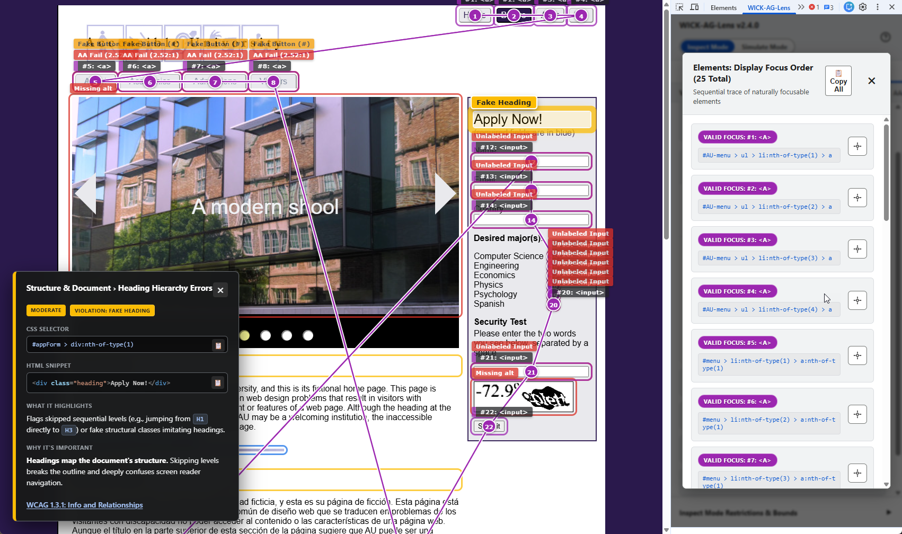
&nbsp;

---

## Table of Contents
1. [Visual Extension Installation](#visual-extension-installation)
2. [Core Features & DevTools UI Usage](#core-features--devtools-ui-usage)
3. [Disability Simulation Engine (Logic & Assumptions)](#disability-simulation-engine-logic--assumptions)
4. [PDF Accessibility Engine (Logic & Assumptions)](#pdf-accessibility-engine-logic--assumptions)
5. [Extension Limitations & Technical Bounds](#extension-limitations--technical-bounds)
6. [Browser Compatibility & Permissions](#browser-compatibility--permissions)

---

## Visual Extension Installation

Installing WICK-AG-Lens takes just a few clicks from the official Chrome Web Store:

1. Navigate to the [WICK-AG-Lens page on the Chrome Web Store](https://chromewebstore.google.com/detail/accessibility-inspector/fjbgedagallcokpkfdlmpafcffblmlhd).
2. Click the **Add to Chrome** button located in the top right corner of the page.
3. A confirmation browser dialog will appear. Click **Add extension** to grant the necessary permissions for the tool to inspect pages.
4. You will receive a message saying WICK-AG-Lens has been added to Chrome.
5. Once installed, open your Chrome Developer Tools (`F12` or `Ctrl+Shift+I` on Windows/Linux, `Cmd+Option+I` on Mac).
6. Locate the **WICK-AG-Lens** tab in the top navigation bar of the DevTools panel. *(Note: You may need to click the `>>` icon if your DevTools window is narrow).*

*(For contributors loading the extension locally from source in Developer Mode, run `node build.js` from the repository root first—see [Monorepo Architecture & Building](../README.md#monorepo-architecture--building)).*

---

## Core Features & DevTools UI Usage

### 1. WCAG Filtering & Audit Controls (Inspect Mode)
The inspector categorizes 55 heuristic rulesets across two primary tabs: **Violations & Warnings** (actionable failures) and **Informative & Structure** (valid page architecture and semantic patterns). *(See the full [Audit Library & Ruleset](../README.md#audit-library--ruleset)).*

* **Version & Level Filters:** Dynamically restrict the visible audits using the Version (`2.0`, `2.1`, `2.2`) and Level (`A`, `AA`, `AAA`) filters. Toggling these checkboxes instantly redraws the page highlights to strictly match the selected compliance criteria.
* **Master Toggles & Clean UI:** Use the Master Toggle at the top of each tab to activate all audits instantly, and use the category chevron buttons to collapse groups for a clutter-free DevTools workspace.
* **Inline Information:** Clicking the `[ i ]` icon next to any audit expands an inline panel detailing exactly *What it highlights*, *Why it's important*, and *How to fix it*, complete with links directly to the official W3C WCAG documentation.

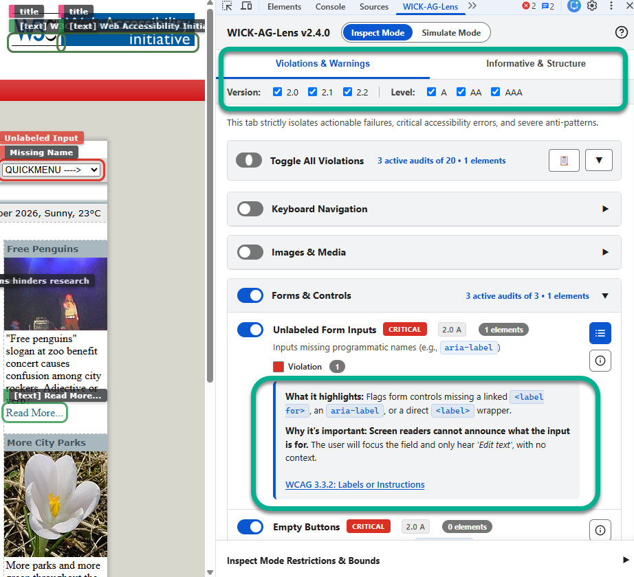

### 2. Disability Simulation Engine (Simulate Mode)
Switch from the standard "Inspect Mode" into "Simulate Mode" using the top header toggle to visually alter the host page, allowing developers to experience structural boundaries and contrast failures firsthand.
* **Color Blindness:** Applies strict SVG `feColorMatrix` transformations to emulate Achromatopsia, Protanopia, Deuteranopia, and Tritanopia.
* **Impaired Vision:** Utilizes interactive intensity sliders to dynamically emulate Double Vision (Diplopia), Loss of Contrast, Yellowing (Aging Lens), Cataracts, and Field of Vision Loss (Central Macular and Peripheral Tunnel parameters).
* **Accuracy Indicators:** The UI explicitly tags simulations as *Strict Simulation* (mapped to established physiological math) or *Approximate* (combinatorial CSS filters).

Color Blindness:

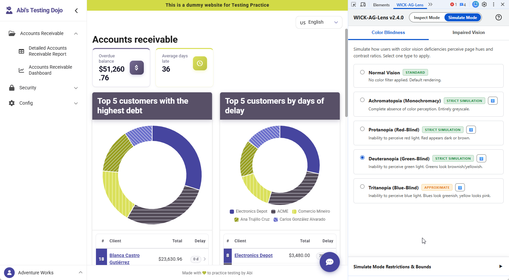

Impaired Vision:

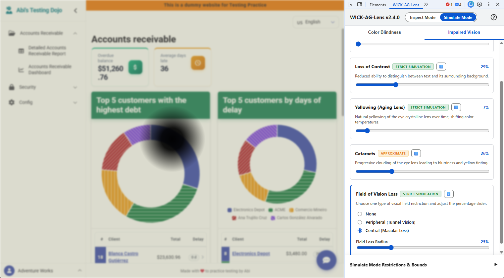

### 3. PDF Gatekeeper Auditing (PDF Mode)
Analyze raw PDF binary streams directly in the browser. Since Chrome's native PDF viewer is securely isolated and cannot be visually overlaid, this mode programmatically inspects the Document Catalog and Metadata dictionaries via an ArrayBuffer stream.
* **Auto-Scan Verification:** Navigate to any direct PDF URL and toggle "Scan Active PDF" to execute an instant structural audit covering Tags, Titles, Language, and Extraction Permissions.
* **View Technical Details Modal:** Click the details icon on any gatekeeper check to open a comprehensive modal. This displays the explicit Evaluation Finding (Pass/Fail), the precise Technical Stream Inspection output (e.g., `/MarkInfo << /Marked true >>`), Scope Guidance, and specific Remediation steps across Adobe Acrobat, Microsoft Word, and InDesign.
* **Global Clipboard Export:** A dedicated `Copy Tab Report` (📋) button allows you to instantly export all 4 PDF gatekeeper checks, their statuses, technical outputs, and software-specific remediation instructions directly to your clipboard.
* **Accuracy Identifiers:** Checks are clearly labeled with their confidence interval (e.g., *High Confidence* for strict catalog validation vs. *Moderate Confidence* for heuristic metadata scanning).

PDF Gatekeeper Auditing:

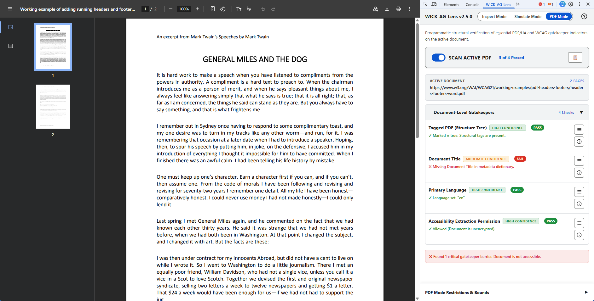

Technical Details & Remediation:

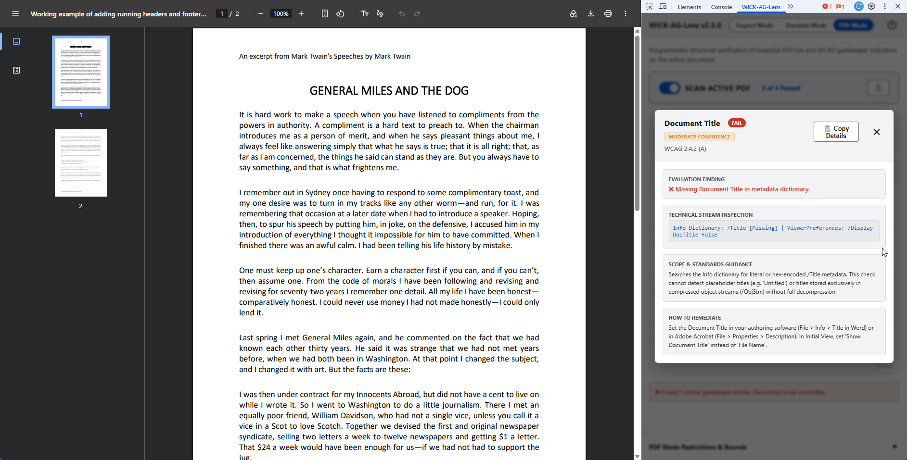

### 4. Interactive Info Panels & Code Previews
Clicking on any highlighted badge directly on the page summons a detailed DevTools-style toast notification. This panel provides immediate context for the audit, explaining *what* was flagged, *why* it creates a barrier for users, and **how to fix it** (utilizing clean, collapsible native HTML accordions to keep the UI compact and prevent screen clutter).

Crucially, the panel extracts a clean, extension-sanitized **HTML Snippet** of the target element, styled with VS Code dark-theme syntax highlighting, alongside the precise **CSS Selector**. Dedicated "Copy" buttons (📋) allow you to instantly grab the code or selector for bug reports without opening the native Elements panel.

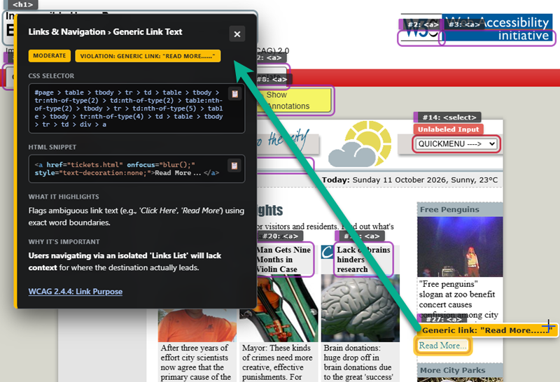

### 5. View Elements List & Precision Locator
For audits that return multiple findings, clicking the "View Elements" (list icon) button inside the DevTools panel opens a comprehensive details modal displaying a hierarchically sorted list of every flagged element.

* **Precision Locator:** Clicking the target crosshair button next to any item will smoothly scroll the browser directly to that specific element on the page, flashing a bright pulsating focus ring to help you locate it instantly—even if it is deeply nested inside a complex UI or an embedded iframe.
* **Export Modal List:** A dedicated `Copy All` button allows you to copy the exact list of isolated elements, their labels, and their CSS selectors directly to your clipboard.

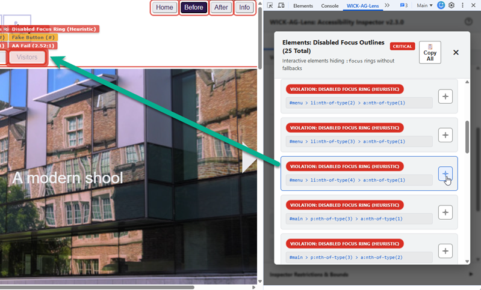

### 6. Comprehensive Tab Reporting
To streamline QA ticketing, WICK-AG-Lens features a global clipboard export function. Clicking the clipboard icon (📋) at the top of either the Violations or Informative tabs generates a fully formatted text report of your current analysis.
* The report only exports data for **actively toggled audits** that pass your current WCAG filters.
* It organizes the output by Category and Rule, explicitly logging `(No matching elements found)` for active audits that currently pass.
* Crucially, the exported report **automatically includes explicit, actionable Remediation steps** for every flagged rule, making it effortless to paste direct solutions into Jira or bug tracking tickets for your developers.

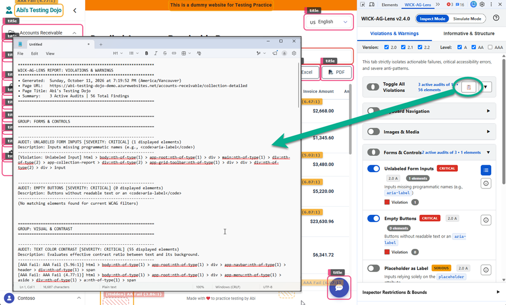

### 7. Real-Time SPA & Dynamic DOM Sync
WICK-AG-Lens features a Dual-Debounce `MutationObserver` to handle modern Single Page Applications (React, Vue, Angular) and dynamic content seamlessly. *(See [SPA Rendering & State Handling](../README.md#spa-rendering--state-handling) for technical details).*
* **SPA Navigation (Hard Wipe):** Instantly detects URL changes via the history API, clearing old highlights and triggering a fresh audit to prevent stale ghost boxes from floating over new views.
* **Dynamic DOM Mutations (Soft Update):** Listens for injected elements (e.g., lazy-loaded content) as well as state changes on pre-rendered components (e.g., toggling `display: none` or `aria-hidden` on modals and dropdowns). Once the DOM settles (`750ms` debounce), it silently runs a background rescan to attach new highlights and update holistic contexts without flashing the screen.

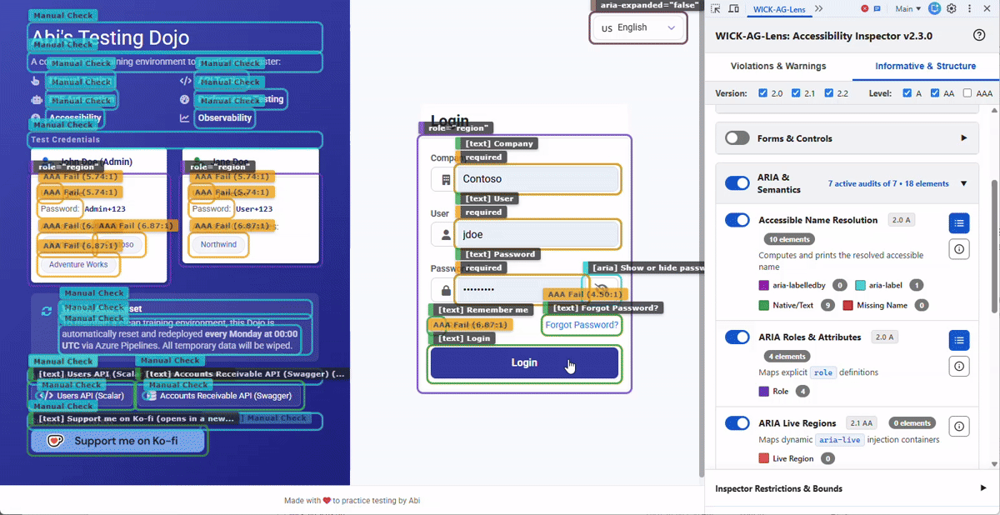

### 8. X-Ray Vision for Clipped Elements
When elements are pushed off-screen or hidden inside `overflow: hidden` containers (like carousel slides or scrollable panels), the extension detects their clipping bounds. Instead of ignoring them or drawing misleading boxes, WICK-AG-Lens renders these hidden elements using a specialized "X-Ray" ghosted hatched pattern. This allows auditors to visualize the exact footprint of hidden interactive elements and invisible focus traps without breaking the page layout.

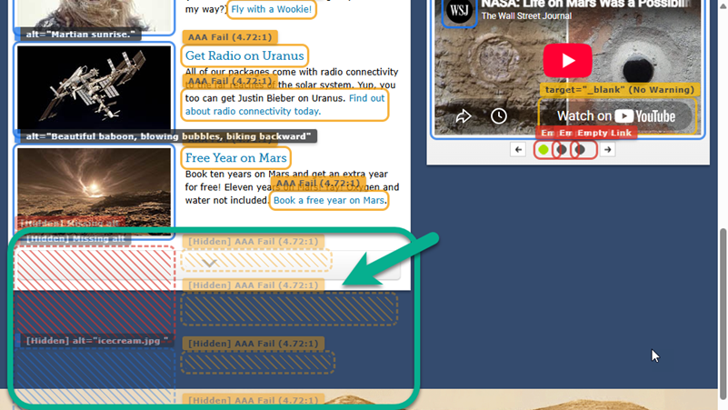

### 9. Embedded Offline Documentation
Accessibility auditing shouldn't require constantly hunting for internet resources. WICK-AG-Lens includes a fully embedded, offline-ready reference guide. Clicking the book icon in the extension header opens a comprehensive modal detailing every single rule, its WCAG mapping, technical limitations, and precise heuristic logic, ensuring your QA team always has context at their fingertips.

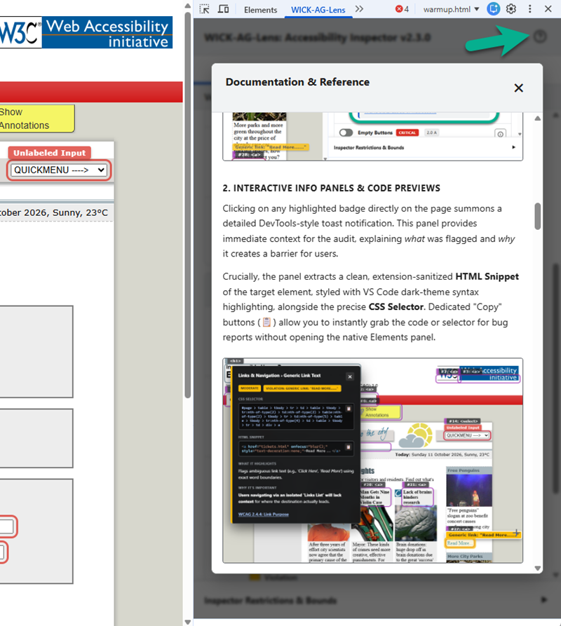

### 10. Native Dark Mode Support
The extension's DevTools panel fully respects your system and browser theme preferences, automatically switching between light and dark modes. It utilizes strictly WCAG 2.2 AAA compliant color contrast variables across both themes, ensuring that the auditing tool itself is accessible and easy on the eyes during long debugging sessions.

---

## Disability Simulation Engine (Logic & Assumptions)

The Simulate Mode provides an empathetic heuristic overlay to help developers identify critical contrast and layout barriers by simulating severe visual impairments directly in the DOM. These modules map to documented mathematical approximations rather than applying arbitrary color tints.

### Color Vision Deficiencies (CVD)
* **Achromatopsia (Monochromacy):** Simulates a complete absence of color perception. Rather than a basic grayscale filter, it utilizes a standard SVG `feColorMatrix` mapped strictly to the WCAG relative luminance formula `(0.2126 R + 0.7152 G + 0.0722 B)` to ensure colors are converted to grayscale in direct proportion to their perceived brightness.
* **Protanopia & Deuteranopia (Red/Green Blindness):** Simulates the physiological lack of L-cones and M-cones, respectively. It applies the precise mathematical linearRGB Viénot model matrices via an SVG `feColorMatrix`.
* **Tritanopia (Blue-Blindness):** Simulates the lack of S-cones. While a perfect simulation requires a 3D dual-plane mapping (Brettel 1997), WICK-AG-Lens utilizes an optimized SVG linear least-squares approximation matrix to maintain high-performance, real-time rendering within the browser compositor.

### Impaired Vision Physiology
* **Double Vision (Diplopia):** Simulates perceiving a secondary ghosted image offset from the original content. It renders a highly accurate secondary ghost image using an SVG `feOffset` function combined with an alpha reduction (`feFuncA`) and composites it using `feBlend` directly into the page layer.
* **Loss of Contrast:** Reduces the ability to distinguish between text and its surrounding background. It utilizes the native CSS `contrast()` function to reduce the luminance amplitude difference between elements while purposefully maintaining structural color (unlike other tools that biologically misrepresent contrast loss by aggressively converting the page to grayscale).
* **Yellowing (Aging Lens / Nuclear Sclerosis):** Simulates the natural yellowing of the eye crystalline lens over time. Rather than utilizing a generic CSS `sepia()` tone (which unrealistically paints everything brown), it uses a custom SVG `feColorMatrix` that fundamentally degrades the blue channel to replicate the actual biological absorption of short-wavelength light.
* **Cataracts:** Simulates the progressive clouding of the eye lens. It employs an approximate combinatorial filter simulating light scattering and opacity by mathematically intertwining a Gaussian blur function alongside a proportional drop in visual contrast and minor short-wavelength light absorption.
* **Field of Vision Loss:** Simulates both Central Loss (Macular Degeneration) and Peripheral Loss (Glaucoma/Tunnel Vision). It employs a non-interactive overlay bounded by a static CSS radial gradient. Central Loss creates a localized central scotoma constrained correctly to a 20% limit of the visual angle, while Peripheral Loss aggressively restricts outer inputs, shrinking the clear tunnel down to 5%.

---

## PDF Accessibility Engine (Logic & Assumptions)

The PDF Mode provides a programmatic structural verification of essential PDF/UA and WCAG gatekeeper indicators directly from the active binary stream. 

* **Tagged PDF (Structure Tree):** Scans the Document Catalog for the `/MarkInfo` dictionary. Ensures `/Marked true` is present and `/Marked false` is not. A missing tag tree prevents screen readers from understanding reading order and semantics (WCAG 1.3.1 & ISO 14289-1).
* **Document Title:** Uses a heuristic metadata scanner to search the Info dictionary for literal or hex-encoded `/Title` metadata, and verifies if `/DisplayDocTitle` is enforced (WCAG 2.4.2). 
* **Primary Language:** Strict Catalog property validation. Scans for the root `/Lang` ISO language code identifier to ensure speech synthesizers load the correct phonetic dictionary (WCAG 3.1.1).
* **Accessibility Extraction Permission:** Strict bitmask calculation. Evaluates User Security Access Permissions (`/P`). Evaluates Bit 10 (value 512, `0x200`) to ensure assistive technologies are mathematically permitted to extract text contents if the document is encrypted (Robust Principle).

---

## Extension Limitations & Technical Bounds

*(For core DOM engine bounds shared across both environments, see [Shared Limitations & Technical Bounds](../README.md#shared-limitations--technical-bounds)).*

### Inspect Mode (Visual Overlays)
* **Dynamic Content & SPAs:** The inspector listens to DOM mutations to provide real-time updates. However, rapidly mutating animations or heavily throttled browser threads may occasionally delay the soft-update rescan (debounced to `750ms`).
* **Clipping & X-Ray Vision:** Elements scrolled off-screen or hidden inside `overflow: hidden` containers (like carousels) are successfully detected and rendered with a ghosted X-Ray hatched pattern.
* **Cross-Origin Iframe Scrolling:** The tool successfully aggregates data across all active iframes (including nested cross-origin embeds) for reporting and element listings. However, it cannot bypass strict Same-Origin Policies to force browser scroll events inside cross-origin windows via the Precision Locator.

### Simulate Mode
* **Hardware & Monitor Limitations:** All visual simulations are inherently constrained by the physical hardware of the screen. Absolute accuracy is limited by your monitor's specific color calibration, backlight brightness, viewing angle, and ambient room lighting.
* **Color Blindness Models:** Protanopia and Deuteranopia use strict linearRGB Viénot physiological matrices, while Tritanopia utilizes an optimized linear least-squares approximation. Achromatopsia strictly follows the WCAG relative luminance formula rather than modeling biological rod-monochromacy.
* **Impaired Vision Approximations:** Conditions like Cataracts and Loss of Contrast are generated using mathematical CSS filter combinations. They mimic the optical experience to identify severe contrast issues but do not perfectly replicate the physiological deterioration of the human eye.
* **Field Loss Topography:** Central (Macular) and Peripheral (Glaucoma) visual field losses are simulated using CSS radial gradients bounded by static angles/percentages. These are 2D geometric approximations and do not account for physical biological blind-spot mapping, head movement, or dynamic pupil dilation.

### PDF Mode
* **Native PDF Viewer Sandbox:** Chrome strictly isolates PDF rendering inside an internal plugin layer. The DOM cannot be directly traversed or highlighted with visual overlays.
* **Binary Stream Analysis:** Checks are performed programmatically via static byte inspection of the raw PDF Document Catalog, which may skip deeply compressed object streams (`/ObjStm`).
* **Scope & Coverage:** Programmatic validation verifies critical structural prerequisites with zero false positives. However, deep layout semantics (e.g., table header associations, correct reading order, context-accurate alternative text on vector figures) still require manual screen reader testing or PDF/UA inspection (e.g., using PAC).

---

## Browser Compatibility & Permissions
* **Browser:** Compatible with Google Chrome version `100.0` or higher.
* **Permissions:** Operates on URLs permitted by the user using the `storage` permission and host access (`<all_urls>`).